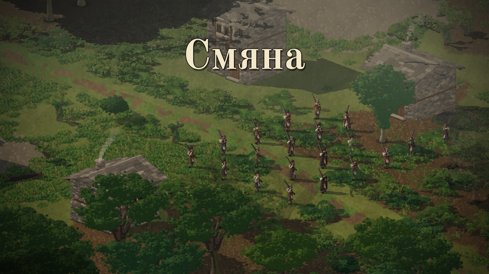
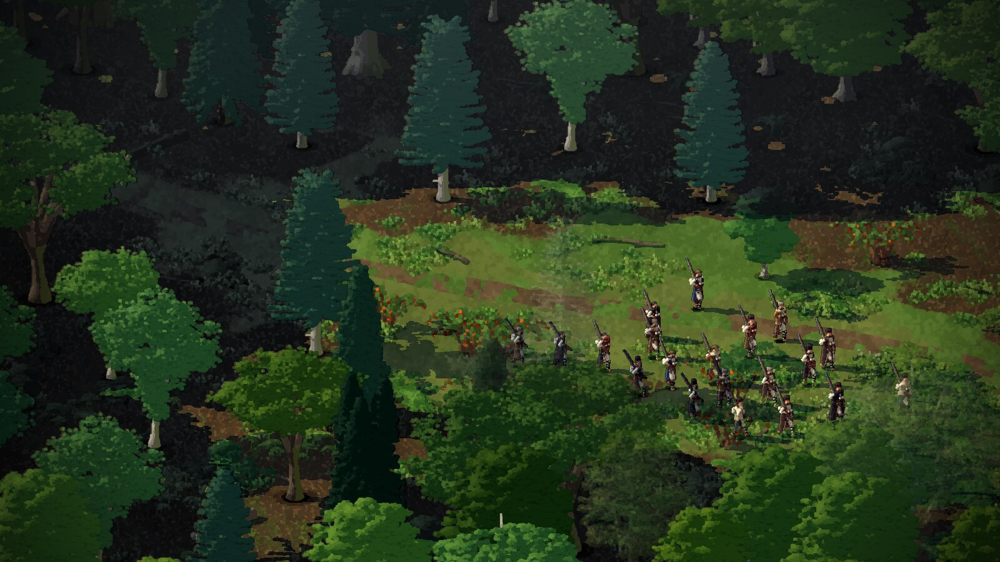
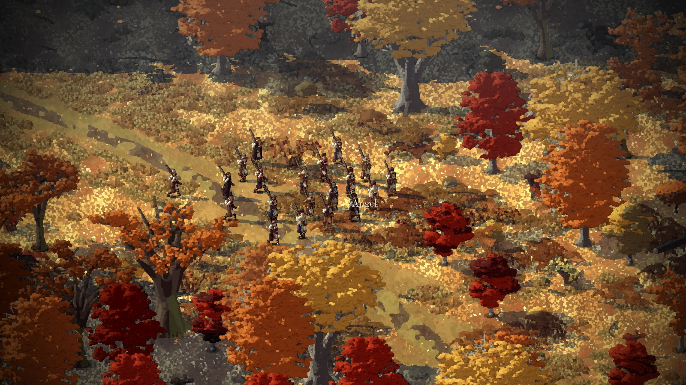
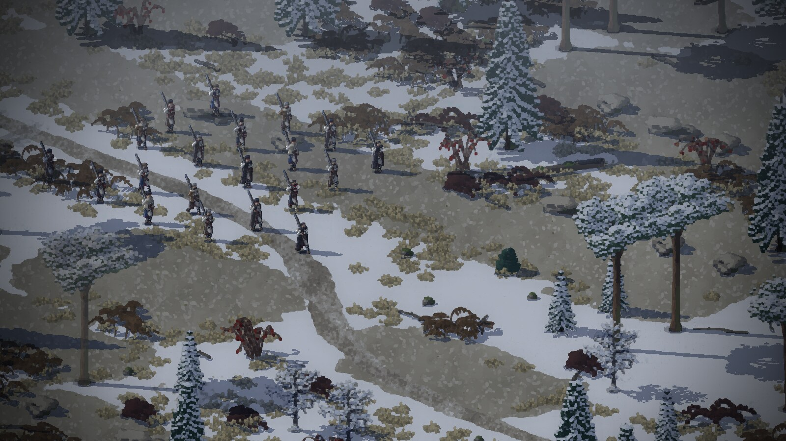

# Смяна (Smyana)

Smyana means shift, or change. And it fits perfectly two things in this game. When I saw `SHIFT`
was the theme for Game Off 2026 the first thing that came to my mind was the changing seasons of
the Bulgarian mountains. Smyana, Смяна, is used to describe the changing time, the change of
scenery, the changing of the guard, the end of a work shift - so it felt very appropriate that the
game would be 100% vibe coded; built on a vibe coded engine, with vibe coded art, music and
planning.

Dominic



An atmospheric survival game about twenty men who leave their village in the Rhodope mountains
of 1800s Bulgaria at the end of summer, with swallow-tailed rifles and four days' bread. They go
out over the ridge and come home by spring. On the way they gather, hunt, camp, hide from
patrols, and keep each other alive through the autumn and the winter. They come home with what
they found and what they learned.

It's a survival RPG built as an RTS, made for [Game Off 2026](docs/game-off-2026-rules.md), whose
theme is **Shift**. One run is the whole road, seven places out and back, summer to spring, in
about two hours.





## Play it

On a Mac or on Linux:

```sh
git clone https://github.com/Drache93/smyana
cd smyana
./play.sh
```

That is all of it. The first run fetches the engine and fetches and builds
[Lobster](https://github.com/Drache93/lobster), the language the game is written in, into
`.lobster/` (a few minutes, once). It needs git, cmake and a C++ compiler, and says how to get
them if one is missing (on a Mac: `xcode-select --install` and `brew install cmake`). After
that it starts in a second or two. `./play.sh windowed` plays in a window.

There is also an unsigned zip for macOS, built by
[`macos-build.yml`](.github/workflows/macos-build.yml) (the artifact "Smyana-macos" of its
latest run): unzip, right-click `Smyana.command` and choose Open.

## How to play

Drag across the men to choose them (double-click a man for all of them) and right click to send
them. The pointer shows what a right click will do: walk, gather, shoot, butcher, pick up, camp in
a hut. Signs under the chosen men make camp (C), open the packs (X) and halt; with the packs
open, a right click on an old tree hides them at its foot. Space pauses, Tab finds the men, arrows
or WASD move the view, the wheel or + and - zoom. Walk every man into the far edge of a place to
move on.

Who made what, and the AI disclosure, are in [`CREDITS.md`](CREDITS.md).

## What's here

| Path | What it is |
|---|---|
| [`docs/design.md`](docs/design.md) | The game design doc: what the game is and how it plays |
| [`docs/game-off-2026-rules.md`](docs/game-off-2026-rules.md) | The competition's rules and deadline (1 December 2026) |
| [`src/`](src/) | The game, in Lobster, on Creel (`smyana.lobster` is the program) |
| [`data/`](data/) | The game's data: terrain, the men, the places, [`route.json`](data/route.json) |
| [`creel/`](https://github.com/Casaide/creel) | The engine, as a git submodule |
| [`tools/`](tools/) | Scripts that write the grey-box places, the men's bodies and the reset code |
| [`art/`](art/) | The men's voxel art |
| [`archive/`](archive/) | How the game was made: pictures, notes, decisions, and why |
| [`archive/engine/`](archive/engine/) | Changes made to the Creel engine for this game |

## Development

`./play.sh` and `./check.sh` find Lobster by themselves ([`tools/lobster.sh`](tools/lobster.sh)):
`LOBSTER=/path/to/bin/lobster` if it is set, else `~/Dev/lobster/bin/lobster`, else the one built
into `.lobster/`. `./check.sh` also needs `lobsterfmt`, which is built beside it.

```sh
./check.sh                    # the checks, with no window: lint, then the whole route
src/lint.sh --fix             # lobsterfmt's layout for every file of ours (lint lists warnings too)
./play.sh windowed season:autumn leg:fir_woods_out   # a look at any leg in any season
./play.sh windowed season:autumn hour:18.5 camp:52,48 zoom:2.75   # the men round a fire at dusk
./play.sh windowed leg:camp_look camp:29,31 hour:19 debug   # the camp with its music (hour:22 for the men's song); music:off, music:homecoming
./play.sh windowed script:play fast:40 fresh   # a fast playthrough of the whole route, logged ("play:" lines); fresh keeps the men fed
tools/prebake.sh              # after changing the art, the light or the camera: bake every picture into baked/ and commit it
tools/package-macos.sh        # the macOS zip (the workflow runs it)
```

The pictures the game draws ship baked in `baked/`, so a start only reads them (a second or two). A sheet whose art
has changed is baked again on the next start and written there; commit it with the change. The
plan for the last days before the deadline is in [`docs/final-push.md`](docs/final-push.md).

## Engine

Smyana runs on **Creel**, the engine we built for [Age of Anything](https://age-of-anything.com/).
It keeps the same camera, and we're extending the engine alongside the game for what this game
needs: giant trees, seasons and lighting moods. The engine changes are recorded in
[`archive/engine/`](archive/engine/).

## The archive

Every piece of work goes into [`archive/`](archive/) with pictures, so anyone (us included) can
see how the game got to where it is and why. Start with [`archive/timeline.md`](archive/timeline.md).

Most of the code, art and writing is made with AI. The direction, feel and mood come from
Dominic, mostly by voice note, and those are kept in the archive in his own words: see
[why](archive/README.md#why-this-archive-matters), the
[first voice memos](archive/notes/2026-11-10-voice-memo-transcripts.md) and
[everything he said on day one](archive/notes/2026-11-10-dominic-in-his-own-words.md).
