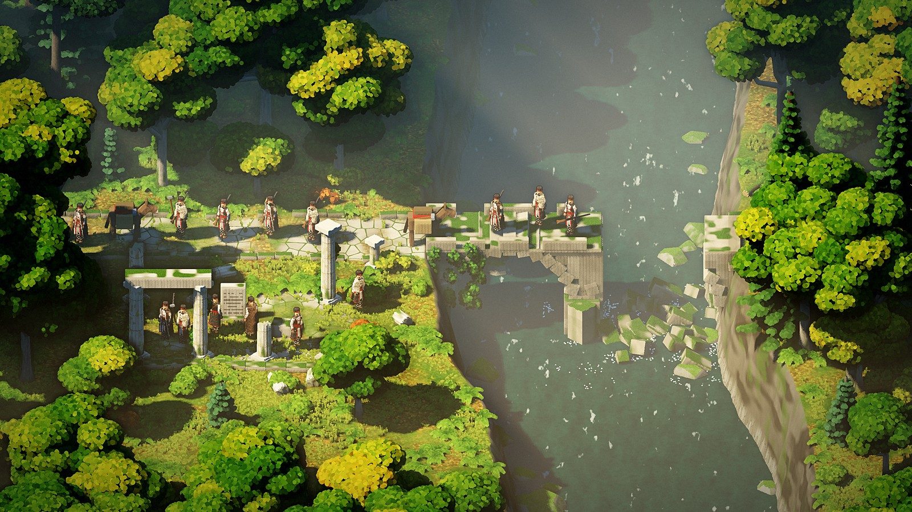

# Смяна (Smyana)

*Smyana* is Bulgarian for "shift": the change of the seasons, and a shift of work.

An atmospheric survival game about twenty men who leave their village in the Rhodope mountains
of 1800s Bulgaria to find seasonal work. They walk out in summer with stone hammers and
swallow-tailed rifles. They spend autumn and winter in the forest, gathering, felling, hunting,
fighting and surviving. They come home in spring with what they earned and what they learned.

It's a survival RPG built as an RTS, made for a game competition whose theme is **Shift**.

## Status

A first runnable version, November 2026: two grey-boxed places, twenty men, and the walk out and
home again in miniature. Most of the game is still to come.

```sh
git submodule update --init --remote   # the Creel engine, at its main
./play.sh                     # the game (windowed: ./play.sh windowed)
./check.sh                    # the checks, with no window: lint, then the whole route
src/lint.sh --fix             # lobsterfmt's layout for every file of ours (lint lists warnings too)
./play.sh windowed season:autumn leg:fir_woods_out   # a look at any leg in any season
./play.sh windowed season:autumn hour:18.5 camp:52,48 zoom:2.75   # the men round a fire at dusk
./play.sh windowed leg:camp_look camp:29,31 hour:19 debug   # the camp with its music (hour:22 for the men's song); music:off, music:homecoming
```

It needs [Lobster](https://github.com/Drache93/lobster) (`LOBSTER=/path/to/bin/lobster`, by
default `~/Dev/lobster/bin/lobster`), with `lobsterfmt` built beside it (`cmake --build build --target
lobster lobsterfmt` in its `dev/`). Left click or drag to select men, double-click for all of
them, right click to send them or to fell a young tree, C to make camp (C again puts the fire out).
Arrows or WASD move the camera. Walk
every man into the far edge of a place to move on.

## What's here

| Path | What it is |
|---|---|
| [`docs/design.md`](docs/design.md) | The game design doc: what the game is and how it plays |
| [`docs/game-off-2026-rules.md`](docs/game-off-2026-rules.md) | The competition's rules and deadline (1 December 2026) |
| [`src/`](src/) | The game, in Lobster, on Creel (`smyana.lobster` is the program) |
| [`data/`](data/) | The game's data: terrain, the men, the places, [`route.json`](data/route.json) |
| [`creel/`](https://github.com/Casaide/creel) | The engine, as a git submodule |
| [`tools/`](tools/) | Scripts that write the grey-box places, the men's bodies and the reset code |
| [`art/`](art/) | The men's voxel art |
| [`archive/`](archive/) | How the game was made: pictures, notes, decisions, and why |
| [`archive/engine/`](archive/engine/) | Changes made to the Creel engine for this game |

## Engine

Smyana runs on **Creel**, the engine we built for [Age of Anything](https://age-of-anything.com/).
It keeps the same camera, and we're extending the engine alongside the game for what this game
needs: giant trees, seasons and lighting moods. The engine changes are recorded in
[`archive/engine/`](archive/engine/).

## The archive

Every piece of work goes into [`archive/`](archive/) with pictures, so anyone (us included) can
see how the game got to where it is and why. Start with [`archive/timeline.md`](archive/timeline.md).

Most of the code, art and writing is made with AI. The direction, feel and mood come from
Dominic, mostly by voice note, and those are kept in the archive in his own words: see
[why](archive/README.md#why-this-archive-matters), the
[first voice memos](archive/notes/2026-11-10-voice-memo-transcripts.md) and
[everything he said on day one](archive/notes/2026-11-10-dominic-in-his-own-words.md).


