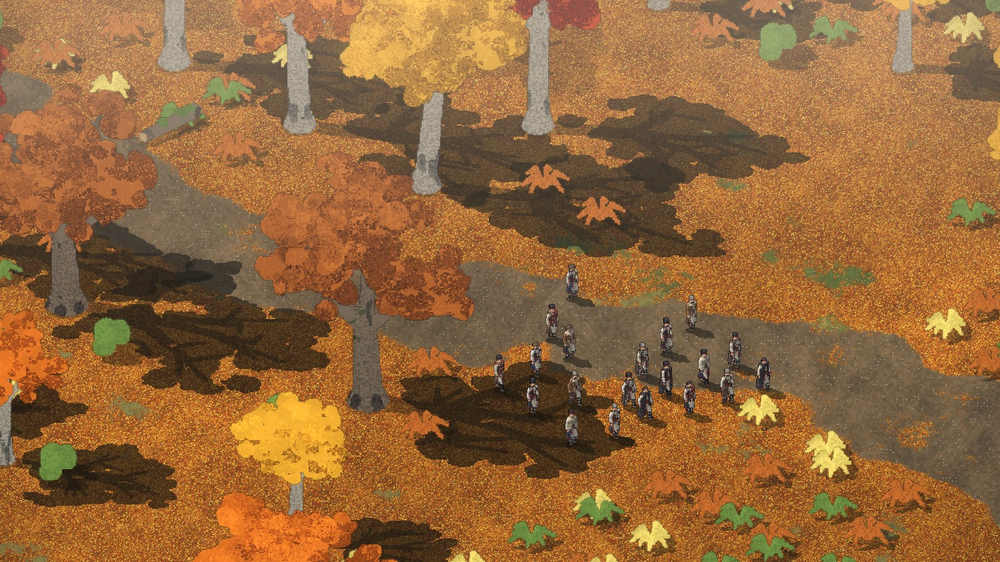
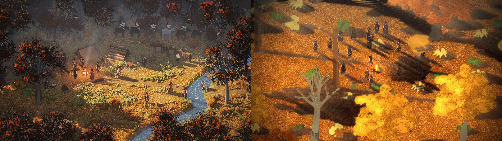

# 2026-11-10: A low sun and one shared shade

**Who:** Dominic + Claude
**Creel change:** [Casaide/creel#12](https://github.com/Casaide/creel/pull/12)

## What the game needed
The target picture's light (picture 23): long shadows from a low sun, a hard lit side and deep
shade, rays and mist in the air, dark woods round a lit clearing. Creel's atmosphere pass graded
the whole frame by brightness and laid haze by screen height. Its shadows were baked short, from
a high sun, and drawn onto the world one by one, so where two overlapped they went black.

## What changed in the engine
- The sun is a setting a game can lower before its art is baked (`VM_SUN` for props and trees,
  `vx_SUN` for the men). A long shadow is drawn as a smear from each voxel's shadow to the next,
  so it has no gaps.
- A shade buffer, at half the screen's size. The game draws its ground shadows into it, then
  wipes it under whatever stands up out of them (trees, rocks), and the atmosphere pass shades
  the frame by it. Overlapping shadows make one shade, and the men standing in it are shaded too.
- New, optional mood knobs: how deep the shade is and its colour, how much colour it loses, the
  sun's warmth on what's lit, rays toward the sun, mist in the shade, darker woods where there's a
  lot of shade round a spot, and a darker top of the frame. Left out, they're off, so Age of
  Anything's moods draw as they did.
- A fire's glow cancels the shade near it.

## Pictures
Before and after: 

## Decisions
- D-037: The light is a low afternoon sun, and its shadows join into one deep shade.

## Left to do
- The sun is fixed for the whole run. Moving it with the hour needs a re-bake or a few baked
  hours to fade between.
- Moods still switch at set hours with no blend.
