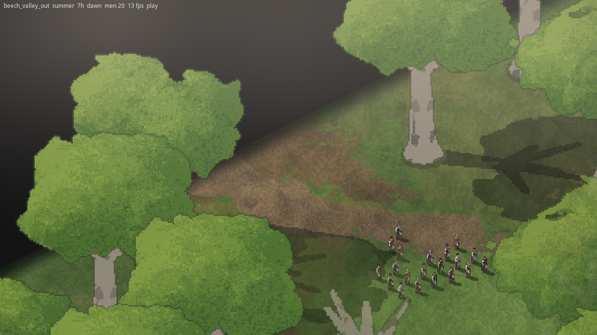

# 2026-11-10: What Creel lacked for a second game

**Who:** Claude
**Creel change:** none yet. These are notes for changes to come.

## What the game needed

Smyana is the second game on Creel, and the first to use it from outside as a submodule
(pinned at `f35d87a`). Getting a first runnable version up showed what the engine still takes
for granted from the game it came out of. Nothing in Creel was changed; Smyana works around
each of these in its own code for now.

## What we found

- **No main loop or window in Creel.** The match loop, camera and input are still in the first
  game's own program (Creel's roadmap already lists moving them). Smyana wrote its own
  (`src/smyana.lobster`).
- **No reset code generator.** Creel's sim keeps its state in globals, and the code that resets
  them between maps is generated by a tool that isn't in Creel. Smyana has its own
  (`tools/gen_reset.py`, 488 globals). Loading a second place in the same run depends on it.
- **The ground shader knows terrain by name.** Leaf litter is laid only under terrain called
  "tree" or "stump", and water, fords and rock are found by name too. A game with other names
  gets bare ground. Smyana kept the names and paints extra litter itself. Better: let the
  terrain data say what each terrain does to the ground.
- **Litter masks expect woods, not single giants.** One trunk on one cell is too weak to show
  after the mask is blurred.
- **No tree models.** Trees are the game's to supply, which is right, but there's no shared
  help for a tree with a small trunk and a wide crown that fades over units. Smyana's is in
  `src/smyana/trees.lobster` and could move to Creel once it's right (issues #6 and #7).
- **A voxel body needs a "hang" hold in its gear data** or the arm builder stops. Worth a clear
  error, or a default.
- **Moods don't blend**, and shadows don't follow the hour. That is Casaide/creel#5.

## Pictures

## Decisions

- D-023: Smyana is its own program on Creel, with Creel as a pinned submodule.

## Left to do

- Open Creel issues for the ones worth fixing there (the shader's terrain names, the reset
  generator, the "hang" hold), once Dominic agrees they belong in the engine.
