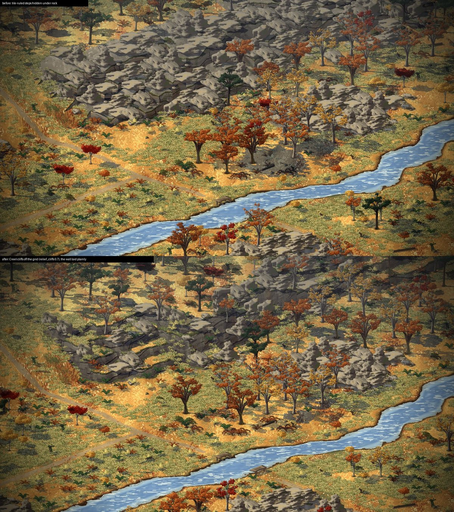
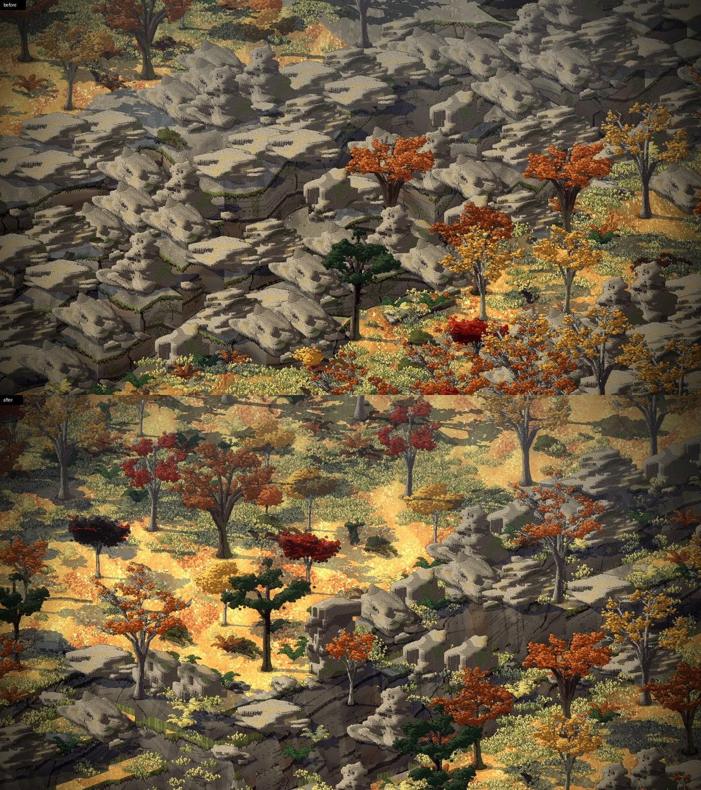
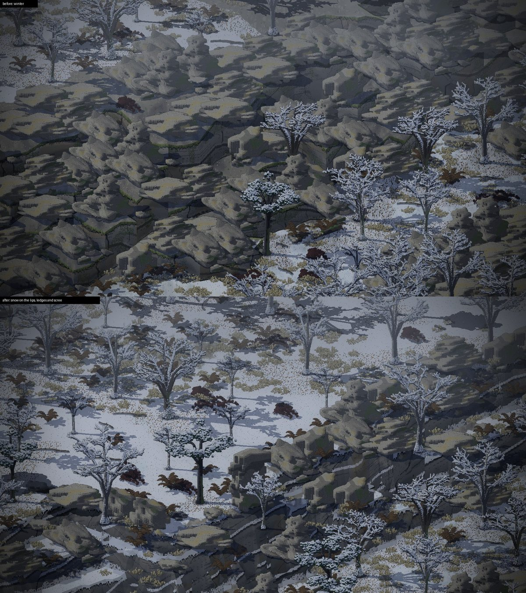

# Proper cliffs, 2026-11-11

Dominic, at 16:32 and 16:33 on 2026-11-11 (his words are in the notes for that day): "Open an issue on creel for proper
cliffs. Our work so far was worked around", then that the cliffs "are just sharp edges, and we've hidden those sharp
edges now behind rocks, but it's still not real cliffs. So doing proper cliffs, proper mount cliffs over rivers with
depth will require some clear work." At 21:55: "Music first, cliffs after". The music thread finished first, and this
thread did Creel issue 25 from 22:08. Claude did the work and made the calls (D-075, D-076). Dominic was away.

## What was wrong

Creel stored a height for each tile and drew one flat top a tile and one upright face along each tile edge. So every
cliff ran along tile edges, as a straight line or a staircase. The gorge's walls (picture 82) were stepped slopes with
a rock outcrop on 85 cells in 100, to hide the ruled faces.

## What Creel does now (`relief_cliffs`, Creel PR 27)

- **The sim is unchanged.** A tile beside higher ground is still cliff, and nothing walks on it. Only the drawing
  changes.
- **Each drop is a curve.** For each level, the drop from the tiles at or above it is drawn half a tile out, plus or
  minus a noise, inside that unwalkable tile below. A rim runs at any angle, and walkable ground keeps its level.
- **Ledges.** Each level's drop wanders on its own noise. Where two drift apart there is a ledge, and where they meet
  one taller face. Scree lies at each foot, drawn in the rock shader.
- **Ramps** are straight slopes. A wall beside one is cut into it.
- **Snow** (`relief_snow`) lies on the lip, the ledges and the scree. Smyana sets it from the ground's own snow.
- **How it's drawn:** a lattice of 8 points a tile near any change of height. Steep triangles facing the camera are
  rock (Smyana's gneiss shader). Steep triangles facing away are left out, and the rest is ground. Each lattice quad is
  cut along whichever diagonal follows the rim.

Tried and dropped: a rim that rolls over, a tenth of a level, which left a thin ruled seam wherever a wall met a ramp.
Ramps drawn as rock, which turned every ramp into a stair of faces until ramps were kept as ground.

## The gorge

`tools/make_places.py` now lays each wall plainly. Its foot bends slowly. How many tiles it takes to climb its four
levels changes along the wall, from one (a sheer face) to five (a stair of ledges). Rock lies on about a fifth of the
ledge cells and some at the foot, not over everything. The map says `"cliffs": 0.7`. The fir woods' bluff gets it too.
Look option `props:0` draws the bare ground. `./check.sh` passes: the bridge is mended, the ford is crossed, and all
twenty men go through both ways.

Picture 109, the gorge before (rock everywhere) and after:

Picture 110, the west wall closer:

Picture 111, in winter, with snow on the lips, ledges and scree:

## Still to do

- The camera looks toward the north-west, so a north-south gorge only ever shows its west wall, in the shade tone.
  The faces read dark. A cliff facing south (lit) would show the rock better. Place the pass's and ridge's cliffs with
  that in mind.
- The faces' lower edges still show small steps of the lattice up close. Moss is kept off faces seen nearly edge on.
- No overhangs (the ground is a height field), and no depth beyond nine levels.
- The far-below set piece (D-076) is a plan, not built.
