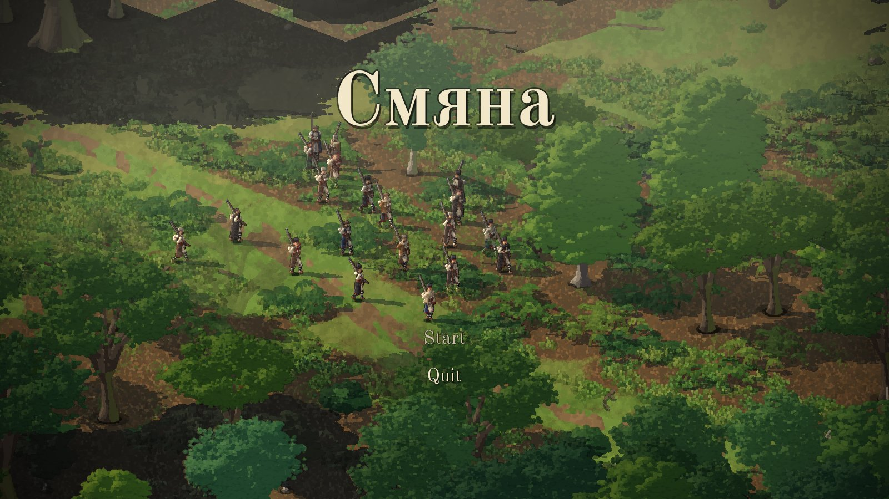
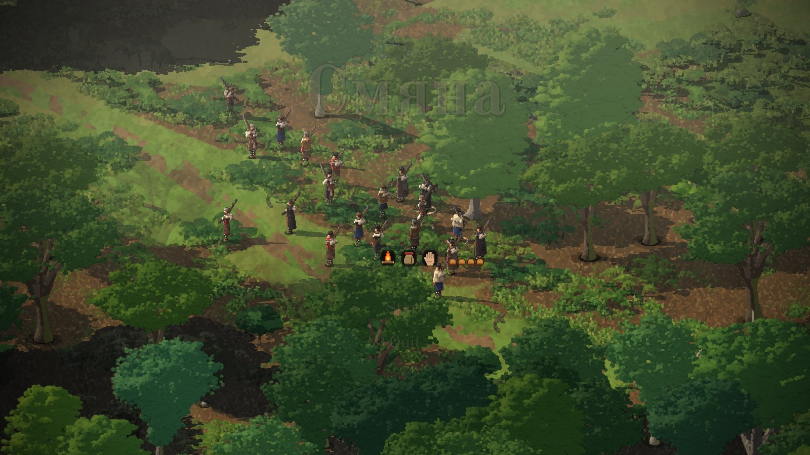

# 2026-11-24: A browser build spike

**Area:** engine (Lobster, the build)
**Who:** Dominic asked; Claude did the spike

## What happened

Dominic asked whether to spike browser play ([his words](../notes/2026-11-24-dominic-browser-play.md)). Lobster has a
WebAssembly target: the program is compiled to C++ (`lobster --cpp`) and built with Emscripten against SDL 3 and
WebGL 2. Nobody had tried it with Creel or Smyana.

It works. The whole game builds for the browser and runs there: the title screen, the men, the woods, the light and the
paint filter look as they do on the Mac, the music plays, and Start goes into the first place.

What stood in the way, in order:

1. **The 32-bit web broke the fork's code generator.** The fork now keeps an object's fields and a vector's elements as
   the types they are (a string as an `LString *`), while the runtime reads every slot as an 8-byte `Value`. On a
   64-bit machine a pointer is 8 bytes and the two agree; WebAssembly is 32-bit, so a vector of strings was read at
   the wrong places. `sha256_text("abc")` crashed, and the game with it, as it made the bake keys. Fixed in the
   generator: a reference or function in memory is an `LSlot<T>`, padded to 8 bytes on a 32-bit target and the plain
   pointer everywhere else, so the Mac build is the same code as before. (A 64-bit WebAssembly build, Memory64, also
   got past it, but Safari has no Memory64, and SDL's web code had two bugs under it, in cursors and in sound.)
2. **`scan_folder` listed nothing on the web**, so the men's bodies were never read. Lobster turned folder listing off
   on all GLES targets; Emscripten's in-memory files list fine, so it's on there now.
3. **The Ogg music would not decode**: the web Makefile left out the decoder that the desktop build turns on.
4. **`-sASYNCIFY_IGNORE_INDIRECT`** in the web Makefile breaks a program that calls `gl.frame()` from a function
   value, which Creel's bake loader does. Dropped.

All four are in [`tools/web/lobster-web.patch`](../../tools/web/lobster-web.patch), against the fork at
`creel/LOBSTER_VERSION`. [`tools/web/build.sh`](../../tools/web/build.sh) builds the game into `build/web/` and zips it
for itch.io.

## What it costs a player

- 13.5 MB of code (4 MB compressed) and 106 MB of data (82 MB compressed). itch.io allows 500 MB and 200 MB a file.
  Most of the data is the tree models (37 MB), which the game only reads to check the baked pictures are current; a
  web build could take that key from `baked/` instead and save a third of the download.
- The start, after the download, takes 2.4 s here, as on the Mac.
- Settings don't survive a reload (the browser's files are in memory). Quit leaves a black page.

## What isn't known yet

Speed. This machine has no graphics card, so the browser draws in software: about 1 frame a second, where the same
software renderer gives the native game about 10. That says nothing about a real GPU. Dominic is checking it on his Mac
in Chrome and Safari from a private test page.

## Decisions

None yet. Whether the jam entry gets a browser build is Dominic's call, once the speed is known.

## Later the same morning

The coordinator passed on Dominic's standing rule (never wait for him), so the three small things above were done:
the tree key now sits beside the baked trees in `baked/trees_key.txt`, written whenever it changes, and the browser
build takes it from there and leaves the models out (68 MB of data, was 106); the menu has no Quit in a browser; the
page keeps `settings.txt` in the browser's storage. `./check.sh` passes.
