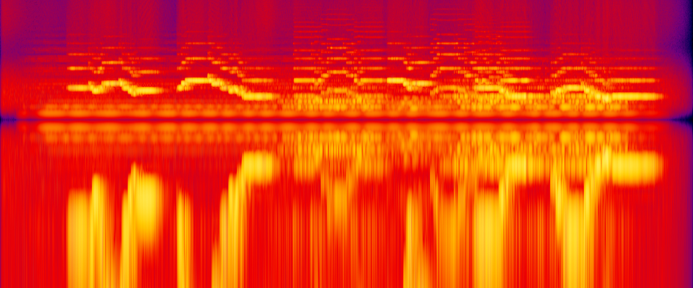

# 2026-11-10: A first try at the music

**Area:** audio
**Who:** Dominic + Claude

## What happened

Dominic asked for a first piece of music: not the final one and not the intro, "just a spike
into style and feel" and how we'll compose. Two minutes later he added "also research the style
of rhodope music"
([his words](../notes/2026-11-10-dominic-in-his-own-words.md#a-first-try-at-the-music)).

Claude built a small music bench in [`music/`](../../music/README.md). A piece is written as
text, one line per phrase, with times in seconds rather than beats. A numpy script turns it
into sound from sine waves and noise, with no samples, and also writes a MIDI file of the same
notes. The first piece, "Autumn dusk", is 1 minute 45:

- wind, then a kaba gaida drone swelling up from slightly flat, as a bag does when it fills;
- a kaval, far off, singing two slow phrases with no beat;
- the gaida's melody pipe answering with its own turn of the tune while low strings open
  underneath, the kaval replying, then the kaval alone bringing it home.

Listen: [`05-music-spike-autumn-dusk.ogg`](../audio/2026-11-10/05-music-spike-autumn-dusk.ogg)
(stereo, unlike the voice memos, because where the instruments sit is part of the test).

The first version was written before the research, in D, with the gaida playing the kaval's
tune an octave down. The research ([`docs/rhodope-music-style.md`](../../docs/rhodope-music-style.md))
changed it:

- **Key.** The kaba gaida's drone is most often E, so the piece moved up to E.
- **The gaida's tune.** Its melody pipe only reaches a fifth either side of its home note, so
  it couldn't play the kaval's tune as written. It got its own version that turns around E.
- **The "bip".** A piper can't stop the sound, so notes are separated by a quick flick of the
  fifth. The gaida line now has these all through it.
- **Five notes.** The tune already used a five-note scale (Claude's guess from general
  knowledge); the research confirmed that's the old Smolyan style.

## Decisions

None. Everything here is a proposal for Dominic to hear and react to.

## Direction changes

- The music plan had the Ottoman chase in a "driving uneven meter". The research says Rhodope
  dance music is mostly plain 2/4, and uneven meters belong to Thrace and Shopluk. Proposal: a
  hard 2/4 instead. Not decided.
- The plan leaned on women's choir harmony for the village. Village singing in the Rhodopes is
  mostly one line in unison; rich choir harmony is a 20th-century concert sound. Not decided.

## Pictures

## Funny moments and bugs worth remembering

- The first drone was two pipes of equal loudness a few cents apart. They cancelled each other
  every three seconds, so the "steady" drone throbbed like a slow siren. One pipe is now much
  quieter than the other.
- Claude can't hear. The piece was checked by measuring it: the pitches of single notes, the
  loudness, and the picture above. Whether it feels right is for Dominic's ears.

## Ideas parked

- Stems (drone / melody / strings as separate loops) so the game can thin and thicken the music.
- Playing the MIDI through a real sample library, or giving it to a kaval or gaida player.
- Sheep bells far off, as a sound that says people are near.

## Later the same evening: more mist, and music that follows danger

Dominic listened to "Autumn dusk": "Thats amazing. My wife says a little too Viking feeling.
'Needs more mist'". He then set a direction for all the music: it changes with the game, by
season and time, and when danger comes it gets tenser or faster, and "when its over the music
ends as fast as it began"
([his words](../notes/2026-11-10-dominic-in-his-own-words.md#a-first-try-at-the-music)).
That is D-036.

**"Autumn mist"** ([listen](../audio/2026-11-10/06-music-spike-autumn-mist.ogg)) is the second
take. Claude's guess at what sounded Norse in the first, and what changed:

| Too Viking | Mistier |
|---|---|
| A low buzzing drone, like a war horn | The drone an octave up, dull, barely there |
| Bare fifths in low strings | No strings. Single high notes drifting in and out as haze |
| The gaida's nasal melody pipe, close | Men humming the answer, far away |
| A tune built on E, B and D, which sounds heroic | A tune that starts on G or B and sinks, with longer gaps |
| A clear flute, near | Breathier, further off, a longer and duller echo |

The cost: with the gaida gone it is less plainly Rhodope. The gaida comes back in the fight.

**"Danger"** ([listen](../audio/2026-11-10/07-music-spike-danger.ogg)) is 80 seconds showing
the music following the game, the states laid end to end:

- 0s calm: the mist music.
- 18s hiding: one drum stroke cuts the kaval off mid-phrase. A heartbeat that slowly quickens,
  two low notes a half step apart, a thin high whine.
- 38s fight: tapan and gaida at 132 beats a minute in a plain 2/4, as the research suggested.
- 60s over: a last blow and everything stops dead. Echo and wind.
- 65s after: the kaval alone finishes the tune.

How this would work in the game (states, an intensity dial, separate loops) is written up as a
proposal in [`docs/music-and-sound.md`](../../docs/music-and-sound.md#music-that-follows-the-game).

### More bugs worth remembering

- The picture of the sound that Claude used as a check turned out to lie at the low end: it
  showed a great rumble under every flute note that wasn't there when measured. The numbers
  are trusted now, not the picture.
- Dominic found the branch in conflict with main: the tree work had merged meanwhile and both
  had added to the same notes and timeline, and both had a picture numbered 38. Merged, and
  the music picture is now 44.
