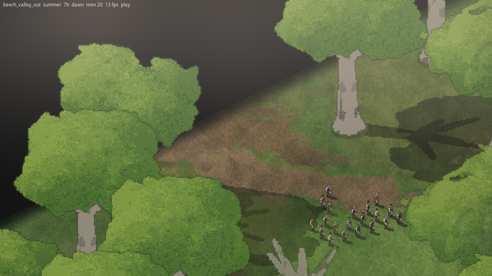
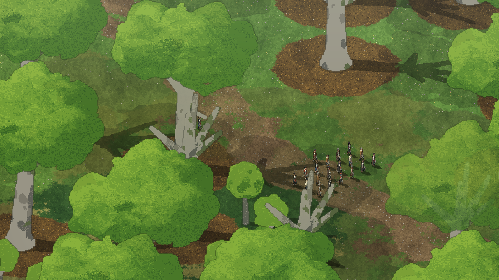
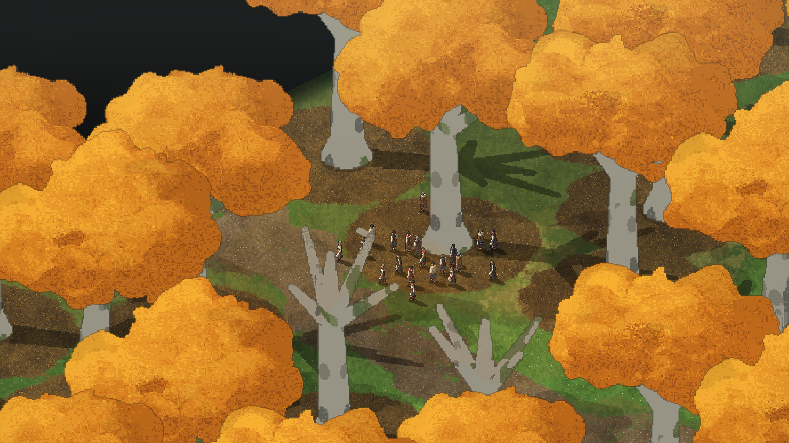
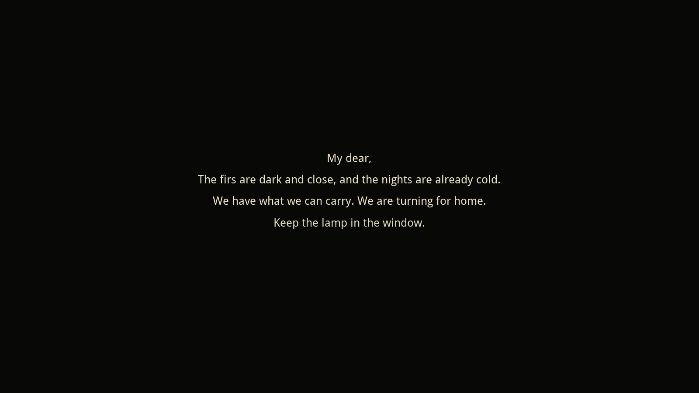
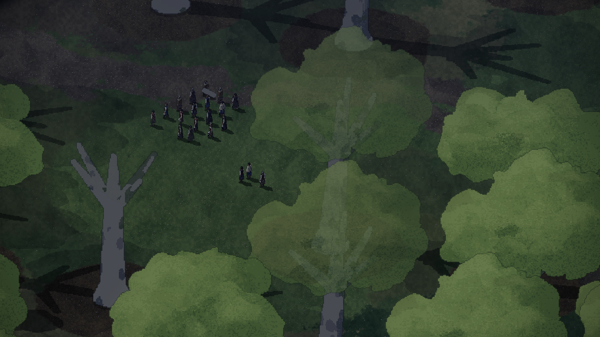
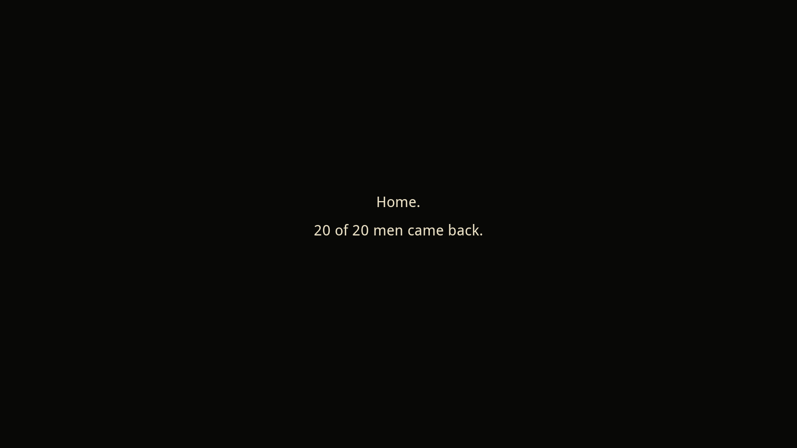

# 2026-11-10: The first runnable version

## What happened

Dominic asked for work to start on the environment issues and a first runnable version
([his words](../notes/2026-11-10-dominic-in-his-own-words.md#the-first-runnable-version)). The
place to start was issue #4: each place on the route is its own map, and the run is carried
from one to the next.

Claude brought Creel in as a git submodule (`creel/`, pinned to a commit) and wrote Smyana as
its own program on top of it. By the end of the day the game opens on a grey-boxed beech
valley: twenty men walk in from the west edge along a trail, under giant trees whose crowns
fade where a man stands beneath them. You can select the men (click, drag a box, double-click
for all), send them somewhere and have them fell a young tree and carry the wood. When every
living man stands in the gate at the far edge, the place closes, a letter home shows while the
next map loads, and they walk in from the matching edge of the next place.

The whole run can be walked, in miniature: the beech valley in summer, the fir woods in autumn,
then the beech valley again in spring on the way home, and a last line counting the men who
came back. The tree felled on the way out is still a stump on the way home.

What is in the repository now:

- `data/`: Smyana's own data pack for Creel (terrain, rules, the men, the two places, the
  route, the moods by hour).
- `data/route.json`: the route file. Places, their order, which edge leads where, the season
  of each leg, the letters, the length of a day and the size budget for a place.
- `src/smyana.lobster`: the game (window, camera, drawing, orders, the letter).
- `src/smyana/route.lobster`: the route and the place swap, with no drawing in it.
- `src/run_check.lobster` and `check.sh`: a check with no window that walks the men over the
  whole route and looks at what was carried and remembered (18 expectations).
- `tools/`: the scripts that write the two grey-box places, the ground atlas, the men's bodies
  from the art in `art/men/`, and the sim's reset code.
- `play.sh`: runs the game.

### What carries across, and what a place remembers

Carried with the run now: which men are alive, each man's health, what he carries, the hour of
the day, the day count and the season. A place remembers its ground: felled trees as stumps,
how much wood is left in a part-cut tree, and wear on the ground.

Not carried yet, because the game doesn't have them yet: needs (hunger, warmth, rest), skills,
carts, caches and dead animals. The run's state has one place to add them (`Man` and
`PlaceMemory` in `src/smyana/route.lobster`).

### A real load, timed

Issue #4 asked for a real load to be timed early. On this session's cloud machine (no graphics
card, so drawing is slow and these are upper bounds):

| Step | Time |
|---|---|
| Loading a place into the sim | 2 to 3 ms |
| Baking the twelve men, first run only | 2.1 s |
| Baking the trunks, first run only | about 3 s |
| Baking a season's crowns, first time that season is seen | 2.7 to 3.4 s |
| The same, once cached on disk | well under a second |

So the worst load between places is about 3 seconds, and the letter (20 seconds in the route
file) covers it many times over. The letter could be much shorter if we want it to be. Not yet
measured: frame rate on a real graphics card. Under software drawing here it's about 10 frames a
second, which says nothing about Dominic's Mac.

## Decisions

- D-024: Smyana is its own program on Creel, with Creel as a pinned submodule.
- D-025: The route is a file of legs, and the men leave a place by standing together in a gate.
- D-026: What the run carries and what a place remembers, for now.
- D-027: A size budget for a place.
- D-028: Old trees can't be felled, young ones can, and crowns fade over the men.

## Direction changes

None. This follows D-020 (one map per place) and D-021 (as little UI as possible: the only
things drawn over the world are a ring under a selected man, the drag box, the letter and the
last line).

## Pictures

## Funny moments and bugs

- The first giants stood on bare grass. Creel's ground shader lays leaf litter by terrain
  *name*, and only under "tree" and "stump", so a terrain called "old_tree" got none. Even once
  renamed, one lone trunk per cell was too thin to show up in the blurred mask, so the game
  paints its own litter around each giant.
- The first crowns were cut off flat on top and at the sides, like hedges: the box they were
  built in was too small. Their shadows also piled up into solid black where crowns overlapped.
- The session doing this work was cut off twice part way through. Dominic's whole reply: "Try
  again".

## Placeholders and known limits

These are Claude's stand-ins, not agreed content:

- The three letters home and the men's names in `data/` are placeholder text.
- The fir woods use the beech models; the real trees are issue #6.
- The two places are grey boxes made by a script, not designed places (issue #5).
- The moods switch by the hour with no blend, and trees still cast sun shadows at night. The
  real lighting is Creel's work (Casaide/creel#5, tracked in #12).
- There is no chopping animation, and the men carry no tools or rifles in the game yet.
- No wolves, bears, patrols, needs, fire or camp.
