# 2026-11-10: From voice memos to Smyana

**Area:** game, art, story
**Who:** Dominic + Claude (claude.ai project, several threads)

## What happened

It started with four voice memos Dominic recorded about a game called "Shift", for a
competition whose theme is Shift. Claude transcribed them
([transcripts](../notes/2026-11-10-voice-memo-transcripts.md),
[audio](../audio/2026-11-10/)). The idea: about twenty villagers from 1800s Bulgaria go out
through the forest into the mountains, gather resources and knowledge, and race the seasons,
bandits and bears to get it home. The trees are giant, they change with the seasons, and they're
the resource, the cover and the hiding place for caches. As the leaves fall, the caches show.

Claude wrote a first design doc and a flat vector mock-up. Dominic rejected the mock-up straight
away: the game runs on Creel, the Age of Anything engine, so it has to look like that game. The
mock-ups were redone as paintovers of real Age of Anything frames from its old-forest map, with
trees scaled up about 2.5x and the game's own voxel humans recoloured as the builders: late
summer setting out, autumn dusk round the fire with wolves' eyes in the dark, and first snow
with a patrol in the mist.

Then the story found its centre. Dominic brought in Kovachevitsa, a Rhodope village whose
builders, about 200 men with hammers and swallow-tailed rifles, went away for seasonal work and
came home with new skills, like building Roman drains. The game became a demo of one run, summer
to spring, about the men's hardship for the families at home rather than about building up a
village. The village is only seen when they leave and when they come home.

Through the day the design narrowed: no work sites or jobs, just travel, gathering, cutting,
sleeping, fighting and surviving, with Roman ruins and other places to learn from. Fire feeds
the men and gives them away. Wolves, bears and Ottoman patrols are the dangers. What the men
learned shows up in a closing cutscene of the village, upgraded.

The camera moved under the canopy so you can see the men through the foliage. The first try had
trunks far too wide to fell, so it was redone with a mix of old giants, young trees and
saplings, more undergrowth and bigger men. Dominic then worried that a whole game in deep woods
would get samey. Claude suggested deep woods as one mood among several, with the seasons changing
the same woods, and Dominic asked for a better-quality mock-up of that. The result was "The
route": five frames rendered as small 3D scenes on the game's camera, with real sun, firelight
and mist, using builder sprites made in another thread. Dominic: "that's amazing".

Last, the name. Claude offered Гурбет (Gurbet, the word for exactly what those men did) and some
Bulgarian words for "shift". Dominic chose **Смяна (Smyana)**, the plain word for a shift, and
asked for this public repo with an archive, the same as Age of Anything.

Everything Dominic said today is kept word for word in
[`../notes/2026-11-10-dominic-in-his-own-words.md`](../notes/2026-11-10-dominic-in-his-own-words.md).

## Decisions

All of D-001 to D-018 in [`../decisions.md`](../decisions.md) were made today. The main ones:

- D-002: built on Creel with the same camera; D-003: the engine is extended in parallel.
- D-004: a demo, one real-time run from summer to spring; D-016: about an hour long.
- D-005: the hardship of the men, not village building; D-006: inspired by Kovachevitsa.
- D-008: a survival RPG built as an RTS, no jobs.
- D-012: Rhodope trees, camera under the canopy.
- D-014: the title is Смяна (Smyana).

## Direction changes

- Flat vector mock-up -> paintovers of real engine frames -> rendered 3D scenes on the engine's
  camera. Why: it has to look like the engine it runs on.
- Men working at job sites -> travel and survival only. Why: jobs felt dull.
- Bandits -> wolves, bears and Ottomans.
- Kovachevitsa by name -> a fictional village inspired by it.
- Trees above the camera -> camera under the canopy, with a mix of tree sizes.
- One deep forest -> a route through several kinds of woods.
- "Shift" -> Smyana. Gurbet was considered and turned down.

## Pictures

### The Bulgarian man

One of the first stages, made to test how the new game's art would look: a Bulgarian man in
haidut dress, designed in 2D first and then built as a voxel model, before any of the mock-ups.
He was made for Smyana, though the art may be reused in Age of Anything too (Dominic). The work
was done alongside the engine, so its pictures are also in Age of Anything's archive.

He wears a black kalpak with a red band, a white shirt under a long black coat trimmed in red, a
sash, a bandolier and two pistols, leg wraps and opanci. Dominic liked the clothes from the first
pass and asked for the bandolier, pistols, a smaller kalpak and a cloak, and kept all three
cloaks: plain, a sheepskin fleece and a yamurluk. The face took five rounds at about 9 pixels
across. Two eye voxels under a brow looked stern, a deep moustache became a black block from the
front, and upturned tips became "a giant black smile". One dark voxel per eye and a drooping
handlebar moustache one layer thick did it: "perfect".

The concept sheet, front, side and back, 7.5 heads tall:
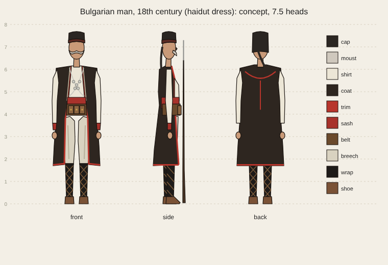

The first voxel model, then his facings walking:
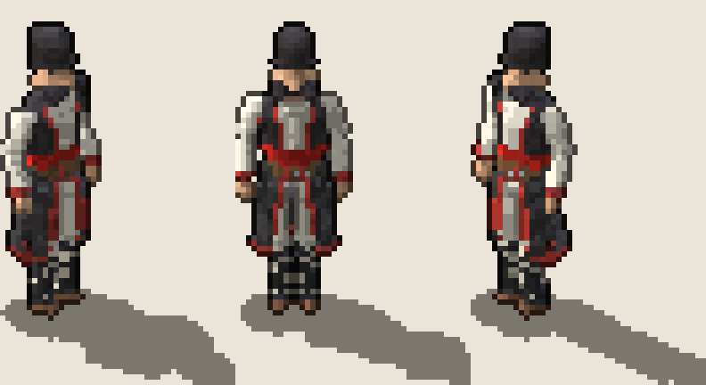
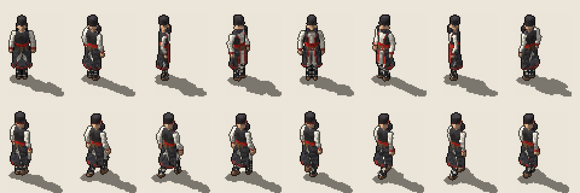

Second and third passes, with the cloaks:
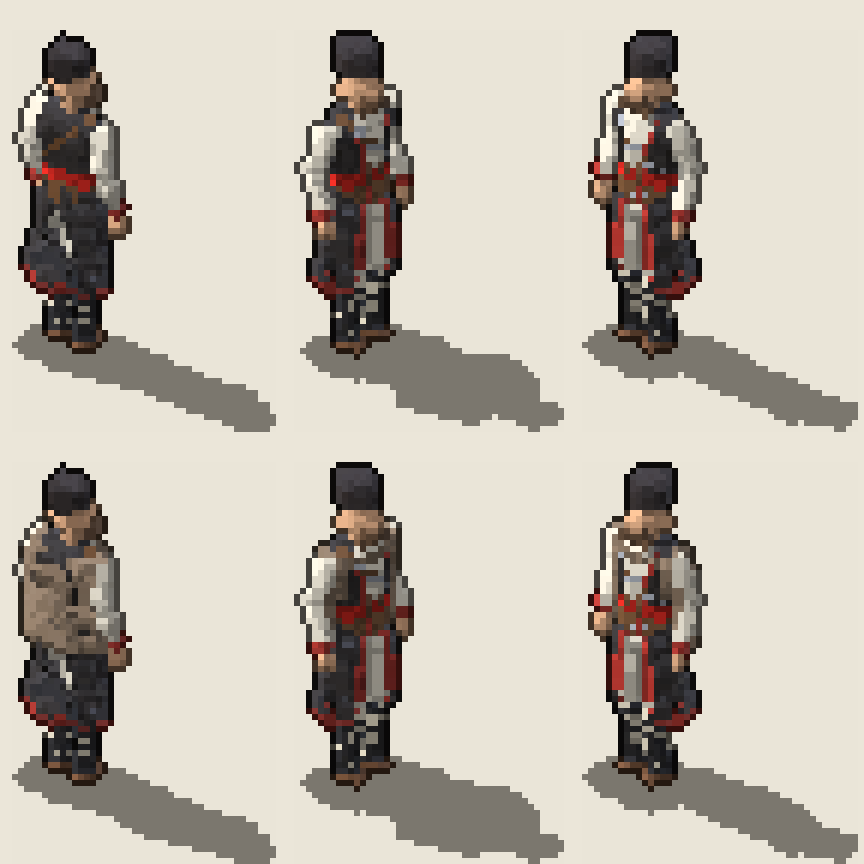
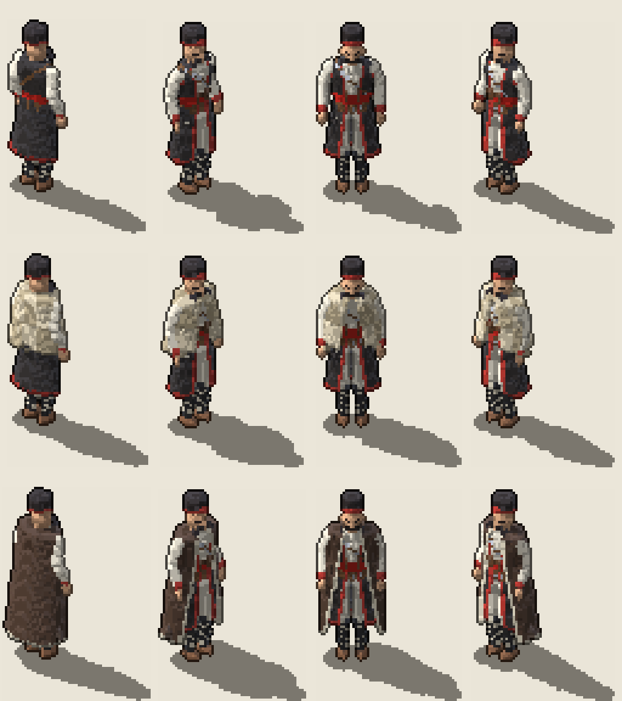

The face, round by round: the stern first try, eyes as single dots, the three cloaks, the
handlebar, and the droop that was "perfect":

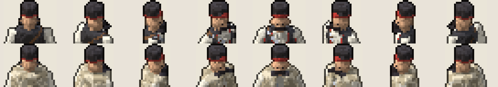
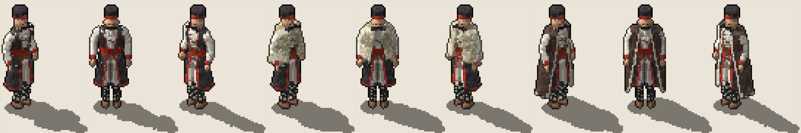
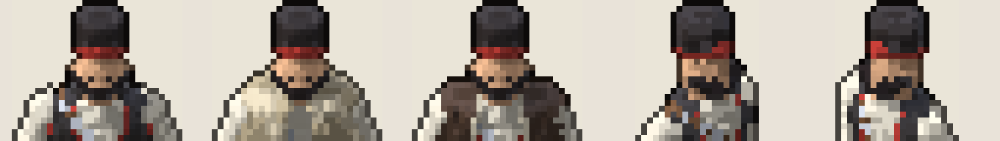
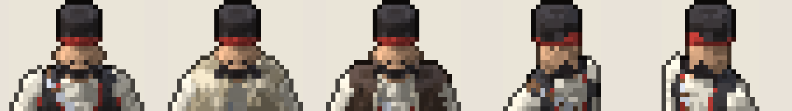

On a pony (the first try crashed the game, below), and the three cloaks as finished:
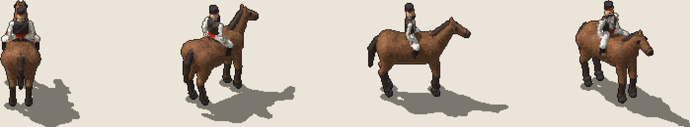
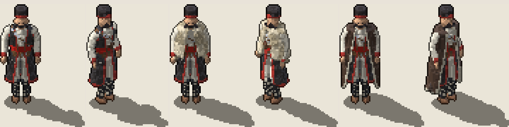

As builder sprites for the mock-ups: three outfits, four facings, standing only for now:

### The mock-ups

The mood boards, painted over real Age of Anything frames. Late summer, setting out:

Autumn dusk: keep the fire, put it out, or walk on? Dominic confirmed this one was right:
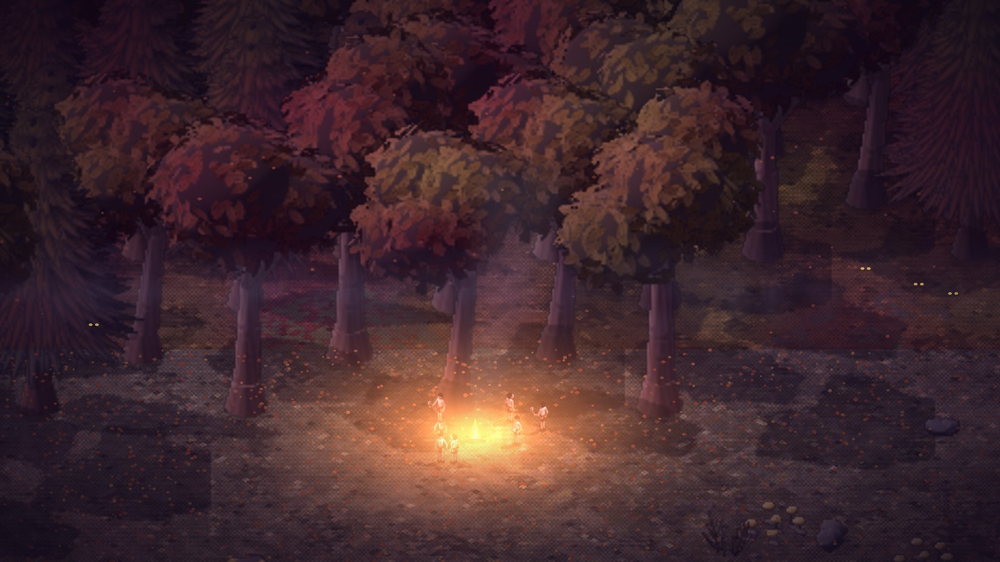

First snow, two days from home, a patrol in the trees and nowhere to hide the cart. Also
confirmed right:

Camera under the canopy, second try, with a mix of tree sizes and more undergrowth:
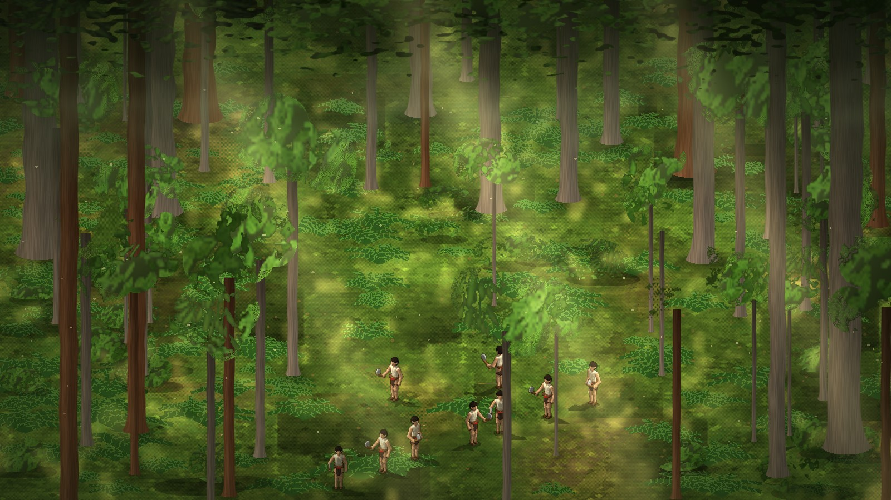

**The route**, rendered as small 3D scenes on the game's camera:

Beech clearing, camp. Safe and open, but the smoke gives the camp away:
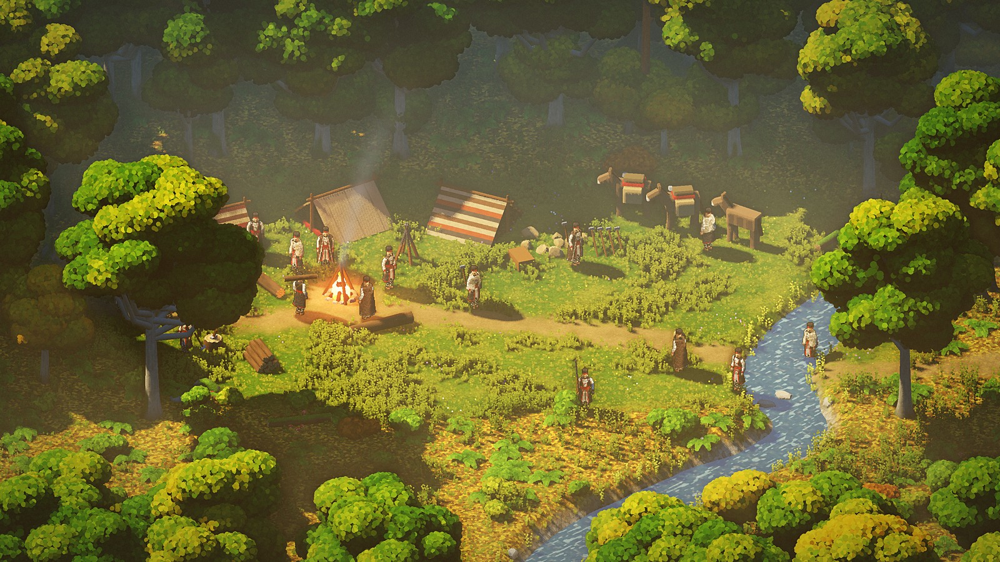

Deep fir, the shortcut. Fast and hidden, with wolves in the gloom:
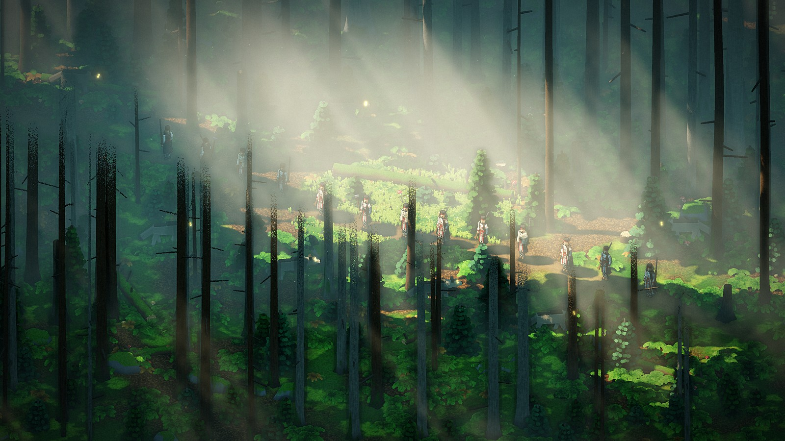

High ridge, the long way. Exposed above the treeline, with a patrol on the road below:
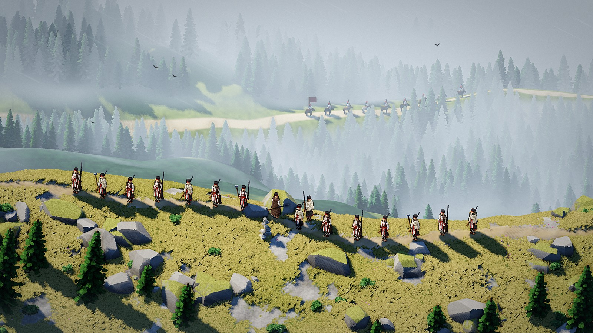

Roman ruins and a broken bridge in a gorge, where knowledge is found:

The same beech clearing after leaf-fall. No cover left, and riders pass close:
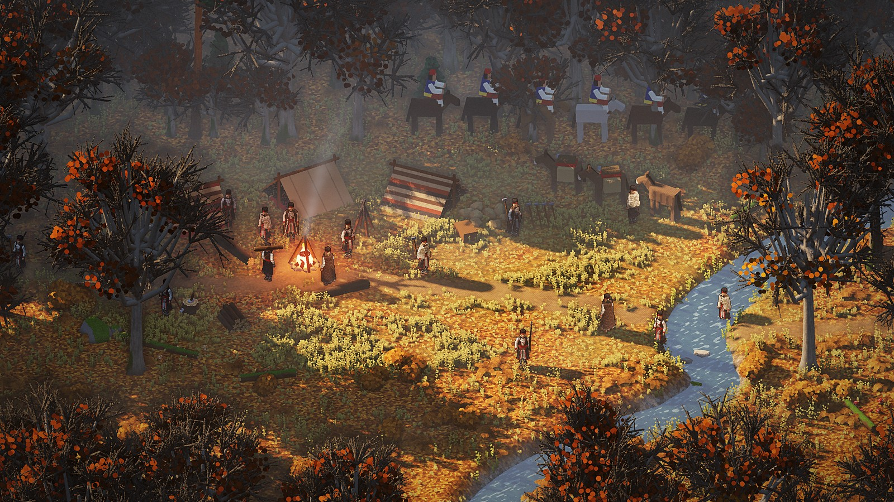

## Funny moments and bugs worth remembering

- The Bulgarian man's first ride crashed the game a minute into a match: the body had no seat, so
  the rider had no legs to sit with.
- His first moustache, with upturned tips, read as "a giant black smile".

- The transcription heard the engine's name as "Creole".
- The swallow-tailed rifles were first transcribed as "swan-tailed".
- The first under-canopy mock-up had trees so wide that, as Dominic put it, they'd be pretty
  impossible to cut down.
- The route frames' trees came out as round "fluffy" broccoli crowns, which is the wrong kind of
  tree for the Rhodopes. Real beech has tall smooth grey trunks and flat layered crowns; firs and
  pines should be narrow spires. To fix next time.

## Ideas parked

- Music and sound: Rhodope slow songs and drones rather than fast dance music. Plan in
  [`../../docs/music-and-sound.md`](../../docs/music-and-sound.md) (proposal).
- A wide opening cinematic that introduces the forest, the wilderness and the village, with big
  music.
- Redesign the village for the departure and the homecoming.
- Voice acting.
- Pause that still lets you give orders.
- Several years in one game, for a later version.
