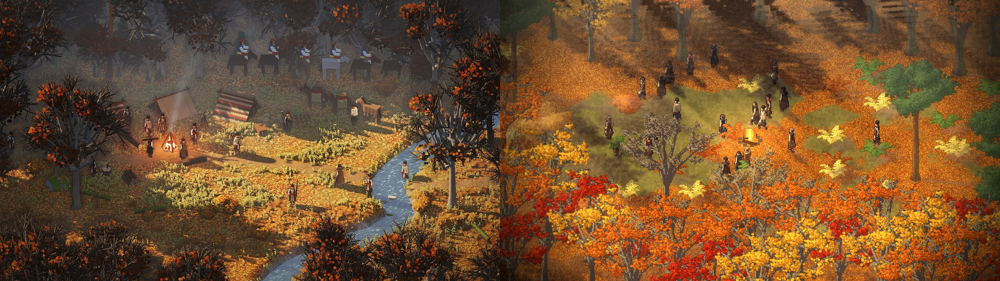
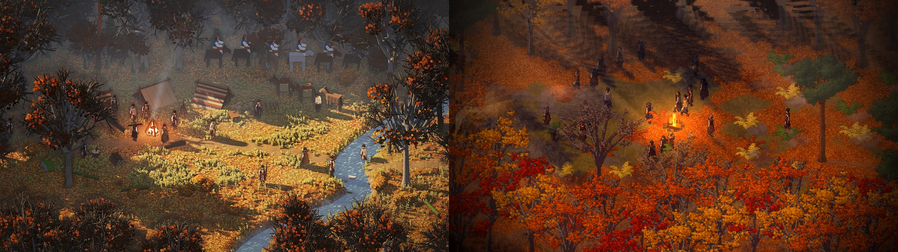
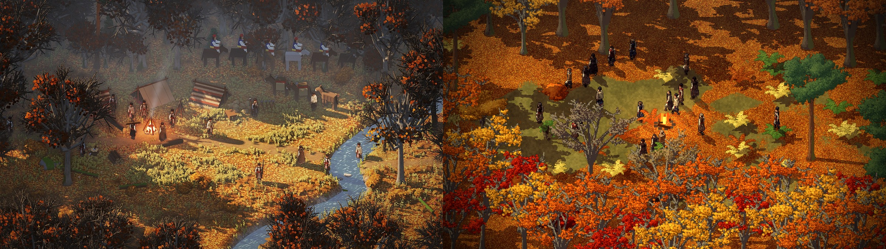
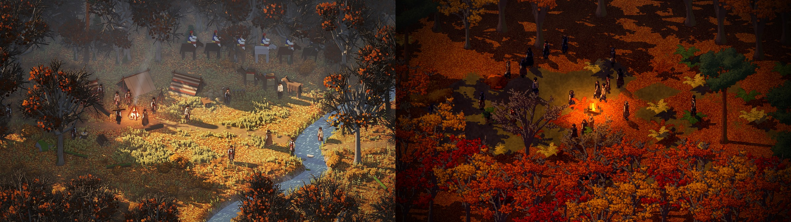
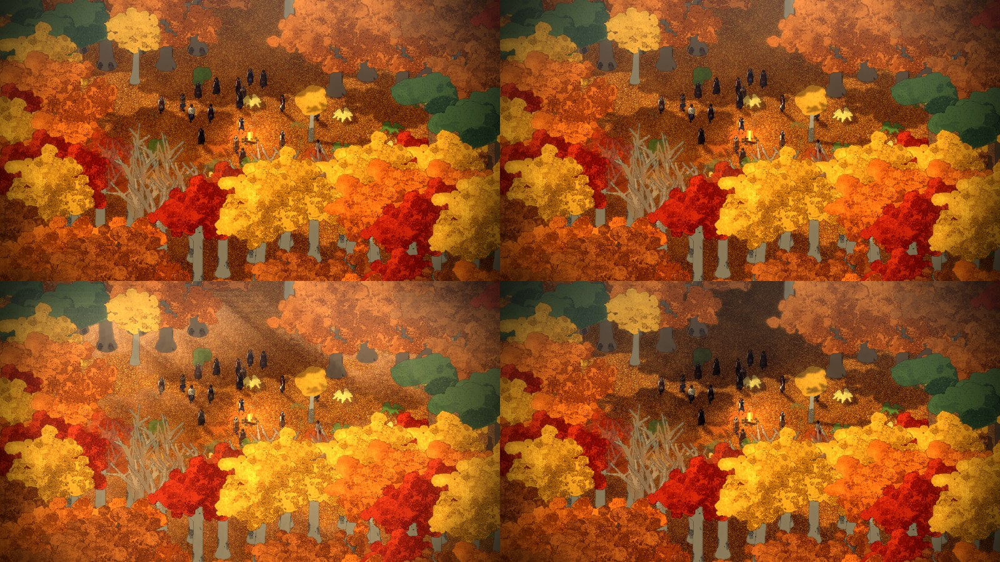

# 2026-11-10: A low sun, one deep shade, and a fire

**Area:** game + engine
**Who:** Dominic + Claude

## What happened
Dominic pointed at picture 23 (the beech clearing after leaf-fall) as the target and asked for a
thread on lighting and mood ([his words](../notes/2026-11-10-lighting-and-mood.md)). Beside it,
the game's frames were flat: a high sun, short shadows that piled up black where they overlapped,
the same bright orange everywhere, and nothing in the air (picture 60).

Claude changed the light in five steps, checking each frame beside the target at the same zoom:

1. **A low sun.** The art is now baked under a sun 26 degrees up (`atmosphere.json`'s `sun`),
   so trees, rocks and men cast shadows two to three times their height, all the same way.
2. **One shade, not piled shadows.** Shadows are drawn into a shade buffer of their own and join
   into one shade where they overlap. Whatever stands in it is shaded too: the men, the
   undergrowth, the logs. The trees and rocks wipe the shade off themselves, since their own bake
   lights them. The lit ground takes the sun's colour, and the shade a deep colour of its own
   that also loses some of its saturation.
3. **Light in the air.** Rays run back toward the sun through the gaps in the shade, and a low
   mist lies in the shade only, so the dark woods go soft and the lit ground stays clear.
4. **Dark woods round a lit clearing.** Where there is a lot of shade a good way round a spot (a
   wide ring of taps on the shade buffer), it goes darker and greyer, so a clearing stands out.
   The far woods at the top of the frame darken too.
5. **A fire.** For a look only, `camp:<x>,<y>` puts the men round a fire: stones, crossed logs and
   flickering flames, with its glow on the ground. The glow cancels the shade near it, so the men
   by the fire are lit by it. An autumn dusk mood goes with it.

Every mood now has the new knobs (summer gets the long shadows and a deep green shade too).
New options for a look: `hour:<h>`, `zoom:<z>` and `camp[:x,y]`.

## Decisions
- D-037: The light is a low afternoon sun, and its shadows join into one deep shade (Proposal).
- D-038: The campfire is only for a look until fire is part of the game.
- D-040: Shadows are a normal, soft shade (Dominic), superseding the deep shade of D-037.
- D-041: Everything crisp and sharp: hard-edged shade, no smudging layers, little dither (Dominic).

## Pictures

## Funny moments and bugs worth remembering
- The first pass was a blood-orange sunset at three in the afternoon, and the little plants
  glowed bright yellow in the deepest shade, because they wiped the shade off themselves like the
  trees did (picture 66).
- A long shadow is a smear of a voxel's shadow down to the one below it; drawn as dots it came out
  striped like a barcode (picture 67).
- The fire's first glow lit a patch of ground the size of a house and bleached the men white
  (picture 68). Then it vanished, because it sat in a man's shadow and was shaded like the ground.

## What's still between us and the target
The light is close. What isn't is mostly what's lit: the target's woods are dense dark trunks
with clusters of leaves, ringing a small clearing with a stream, herbs and a path; the beech
valley is still open ground with spaced trees and an all-orange floor, and its crowns are lit
flat. That's the trees and places work (the trees thread, PR #25).

## Ideas parked
- The sun moving through the day (re-baking the shadows, or baking a few hours and fading).
- Moods blending as the hour changes instead of switching (#14).
- Fire as a game system: it feeds the men and draws danger (the design doc).

## Second pass: a normal shade (later the same evening)
Dominic found the first pass's shadows messy, stretched and far too dark
([his words](../notes/2026-11-10-lighting-and-mood.md#on-the-first-lighting-pass-2148-and-2149)).
The sun went up from 26 to 40 degrees, so shadows are about as long as things are tall. The
shade is now a light multiply (about 0.6 of the light, not 0.25). It barely loses colour, and the
mist and darker-woods effects are half as strong. The shadows still join into one shade rather
than overlapping, which was the "overlapping" mess. Long shadows from trees just off the left of
the screen were being cut off. Trees are now drawn from further out, so their shadows come in
whole.

For a fairer comparison, `camp:<x>,<y>` now also clears three tiles round the fire and thickens
the wood beyond, like the mock-up's clearing. Pictures 56 and 57 were rendered with the trees
thread's new trees (PR #25) merged in locally, since those are the trees that will ship.

## Third pass: crisp and sharp
Dominic: the overlaps looked like "bug smudges", and the biggest difference from the design is that
"evryhting crisp and sharp" ([his words](../notes/2026-11-10-lighting-and-mood.md#on-the-second-pass-2154-and-2155)).
Claude rendered the frame with each layer switched on alone (picture 73). The rays, the mist in
the shade and the darker-woods ring made the smudges, so all three are off in every mood. The
shade buffer is now full size, sampled pixel for pixel with no blur, so shadow edges are hard.
The haze is about half as strong, and the bloom is half too.

It was partly the engine as well. Creel's voxel baker jitters every voxel's light before banding
it, which speckles every edge between tones: Age of Anything's painterly look. That jitter is now a
setting (`dither` in `atmosphere.json`'s `sun`, 0.15 for Smyana), and leaves get four hard bands of
light instead of five. The trees thread also now bakes one voxel to one art pixel (PR #25).

Pictures 58 and 59 were rendered with PR #25 merged in locally.

