# 2026-11-10: Rhodope trees, ground and rock

## What happened

Dominic looked at the first runnable version and said the trees were a crazy size and had to
keep to the designs. He then asked for the right trees, ground and rocks for the region (the
rock matters because it's what the houses are built from), pointed out that the mock-ups have
some places with normal RTS-sized trees and others where the trees fade off to the sky, gave a
list of the Rhodopes' trees, and said autumn's reds, oranges and yellows are a huge part of the
mood and should probably be the game's poster
([his words](../notes/2026-11-10-dominic-in-his-own-words.md#the-trees-the-ground-and-the-rock)).

He was right about the size. Claude had built every old tree about thirteen men tall with a
trunk three men wide, which is the first under-the-canopy mock-up Dominic had already turned
down, not the route frames he liked. Measured against the route frames (pictures 19 to 23), an
old tree is five or six men tall with a trunk about a man wide.

What changed, all still stand-ins built in code until the real art (#6):

- **Size.** Old broadleaves are now five to six men tall, young trees two to three. The camera
  starts closer, so the men are about the size they are in the route frames.
- **Size is set per place** (D-029). A map says what kind of wood it is. The beech valley is
  "beech": whole trees at RTS size. The fir woods are "deep": dark bare spruce and fir trunks
  that run up and fade out before their tops, with only their shade on the ground, and whole
  broadleaves and young firs beneath them as understorey.
- **Kinds** (D-030), from Dominic's list: beech (smooth silver trunk), oak (short thick dark
  trunk, wide crown), hornbeam (smaller, dense), Scots pine (tall bare trunk, flat top), spruce
  and fir (dark spires). Ash, plane, alder, willow, maple, lime, wild pear, elm, black pine and
  dwarf pine are not made yet.
- **Autumn** (D-031). Each broadleaf turns its own colour, and each tree of a kind a little
  differently: beech orange, gold or red, oak russet, hornbeam gold. The young trees turn too.
  In autumn the fallen leaves spread much further over the ground and the ground textures
  switch to a brighter litter. Conifers stay dark, which sets the colours off.
- **Rock** (D-032). Rock cells now carry an outcrop: thick flat beds stacked in steps, warm
  grey, with Creel's lichen and moss on them. Loose slabs lie beside outcrops. These don't do
  anything in the game yet.
- **Ground.** Four ground atlases instead of one: beech wood and conifer wood, each with an
  autumn version. The conifer floor is dark needles, moss and bilberry. Leaf litter is laid in
  ragged patches under each tree, not rings.

## Decisions

- D-029: A place says how big its trees are: whole trees, or trunks fading to the sky.
- D-030: The tree kinds come from Dominic's list of the Rhodopes' trees.
- D-031: Autumn is the game's poster season.
- D-032: The rock is gneiss in flat slabs, as outcrops and loose building stone.
- D-033: Dominic confirms gneiss, used with wood for roofs and walls.
- D-034: The look comes first, and the archive's pictures are the target.
- D-035: Trees are designed in 2D from real photos first, then made as vox.

## Direction changes

- The first version's giant trees everywhere are gone (D-028 said old trees are giants whose
  crowns fade over the men; the fading stays, the giant size doesn't. See D-029).

## Pictures

For the size it replaced, see [picture 33](../images/2026-11-10/33-beech-valley-summer.png).

## Funny moments and bugs

- The first Scots pine had bark so orange it looked like a carrot with a hat.
- The first rock outcrops were grey lumps with dark green cones on them: the ledges were too
  fine to see and Creel's moss covered the rest. Rebuilt as a few thick plates.
- With the trees at the right size the edge of the map shows as a grey void. The giants had
  been hiding it.

## Known limits

- Gneiss is Claude's reading of the region's building stone. Dominic to confirm the rock and
  its colour.
- The crowns are still rounded lumps. A beech's flat layers don't read yet (#6).
- The deep woods are too bright and too thin next to the mock-up: they need the lighting work
  (Casaide/creel#5, #12), ferns and undergrowth (#8) and mist (#15).
- The edge of a map needs a wall of forest or a camera limit (#5).
- The autumn leg is the fir woods, where most trees are evergreen. Whether the route should put
  a broadleaf place in autumn is for #5.

## Later the same evening: the look comes first

Dominic asked whether the open issues were being checked and updated (they hadn't been: Claude
then posted where #4, #6, #7 and #11 stand) and said he wants the look first, so the archive's
pictures can be made in the engine with our men. Claude first took the pictures as a guide to
size and layout only, which was wrong: Dominic said the style being built doesn't match the
design, and the pictures are the target (D-034). He confirmed gneiss (D-033).

A second pass the same evening got closer in layout but not in style: broadleaves rebuilt as
branches with clusters of leaves, bracken, bushes and fallen logs (#8), an autumn leaf carpet
over the whole floor of a broadleaf wood, deeper shade under the crowns, a warm autumn mood,
and a rim of thick forest round each place with the camera kept inside it, so the map's edge
never shows. It still reads as flat poster shapes next to the picture. Dominic's answer: design
the trees in 2D from real photos first, then make the vox (D-035).

The first design sheet, for beech, drawn by `tools/tree_design.py`. It was drawn from what
Claude knows of the tree, not from photos: the session's network couldn't reach any, so it
still needs checking against real pictures before the vox is made.

Dominic's answer to the sheet: "Looks good!" So the beech was made as vox from it
(`tools/tree_vox.py` writes `art/trees/vox/beech_*.vox`: a sapling, two young, two mature, two
old). The palette index says what each voxel is (bark, or a leaf lit from above, mid, or
beneath), and the game bakes the wood and the leaves as separate pictures, so the leaves take
the season's colour and still fade over a man. The first try filled the crown solid, and from
the game's camera the layers vanished into one lump; thinner sprays with air between them
brought them back.

Still to do on beech: the crown hides most of the branches, the light on it is flatter than the
target pictures, and the oak, hornbeam, pine and spruce are still the old stand-ins.

## The spruce's design sheet (Claude, for Dominic's check)

The second sheet, made the same way as the beech's (`python3 tools/tree_design.py spruce`). It
sets the spruce at about eight men tall, taller and much narrower than the beech, and shows the
two forms it takes: green to the ground in the open, and a bare bole with dead stubs in a stand,
which is the deep-wood tree. It doesn't change through the year except for bright tips in spring
and snow in winter. Drawn from what is known of the tree, not yet checked against photos. No vox
is made from it until Dominic has looked.

## The beech rebuilt against the target (Dominic's correction)

Dominic, of the first vox beech and the spruce sheet: "Those are still much bigger than mockup and you've gone for
very soft style. Again, what are you testing there?" and "Your 2D design was much closer to our original mockup, but
you implemented it soft and cloudy. Why?" He was right. Claude had tested that sheet to vox to game worked, not the look
beside the mock-up. Three causes of the softness: leaves scattered as single voxels, each voxel only a pixel or two of
dithered shade, and the baker's light reaching 64 voxels where it should reach a few (the grid's unit was a whole
tile), which flattened every tree to one tone. And the size was wrong by half again (D-036).

Rebuilt: sizes in men, a slim silver bole, boughs, branches and twigs, leaves as dabs in clusters, baked nearly twice
as fine on sheets of their own, with the grid's unit small so the baker's light and shade work within the tree. The
camera is closer, so a man is the size he is in the mock-ups. Until the other kinds have models, the beech valley is
all beech.

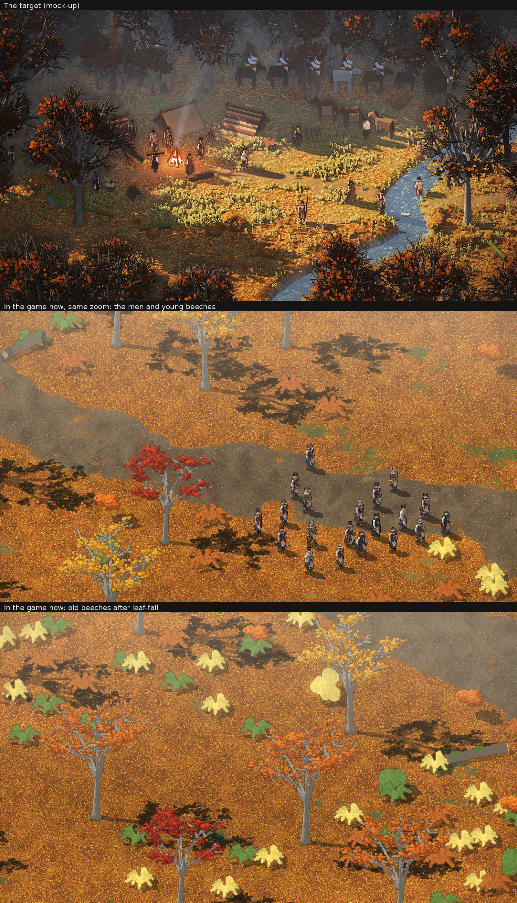

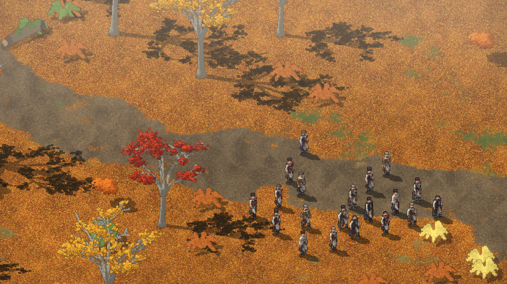

Still short of the target: the woods are too thin now the trees are the right size, the bark and twigs are too pale,
the undergrowth is still the coarse grey-box, and the light, shade and haze (their own thread).

Later the same evening: the beech wood made closer (old trees under two tiles apart, young clumps placed first so
there are still trees to fell), the bark darkened, bare twiglets added, and the undergrowth (#8) rebuilt as fine as the
trees: ferns as ribs with leaflets, bushes as stems with leaf dabs, and pale patches of low herbs like those in the
target's clearing.

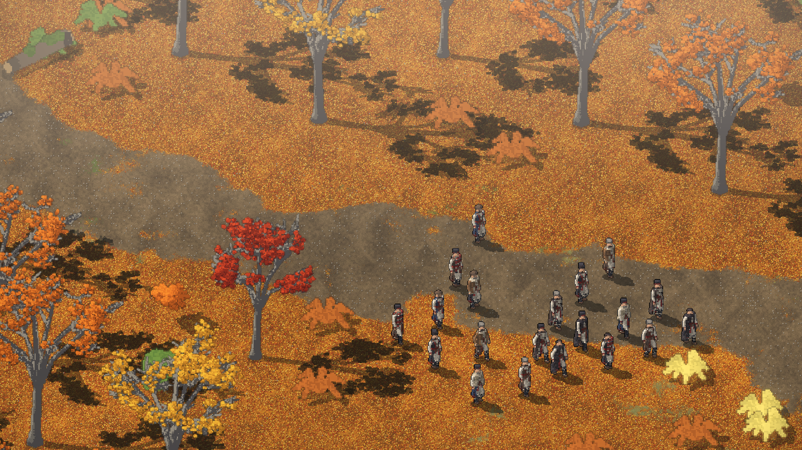

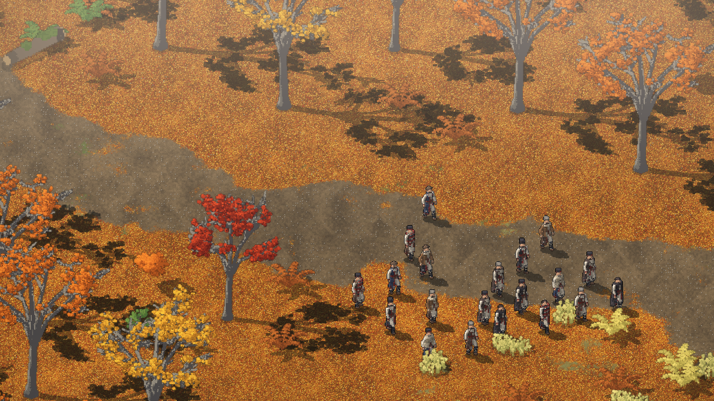

The flat light turned out to be every model's fault, not only the vox trees': each grid is built in tiles, and the
baker's light reaches a few of the grid's units, so it reached across the whole tree. Now every grid's unit is made a
sixteenth of a tile just before it is drawn (`LIGHT_UNITS`), and logs, the stump, the rocks, the deep-wood trunks and
the young spruces are built as fine as the vox trees. The deep fir woods have slim dark trunks with dead snags, a
quarter to a third of a man wide as in their mock-up, and stand closer.

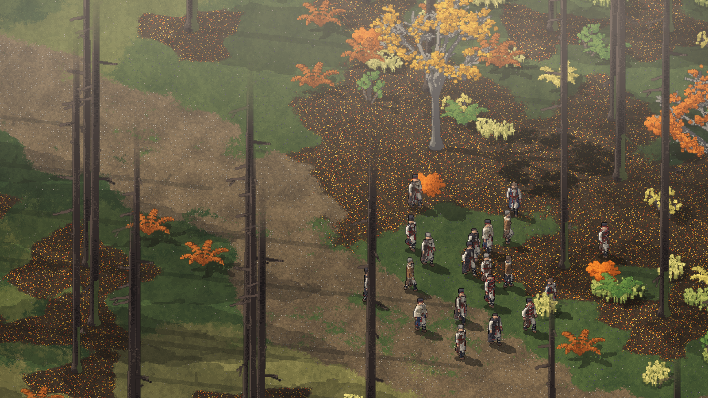

Summer in the same style: the crowns fuller (more leaves round each twig's end, which fall in autumn), and the crown's
fade over the men (#7) set to the new, smaller beech.

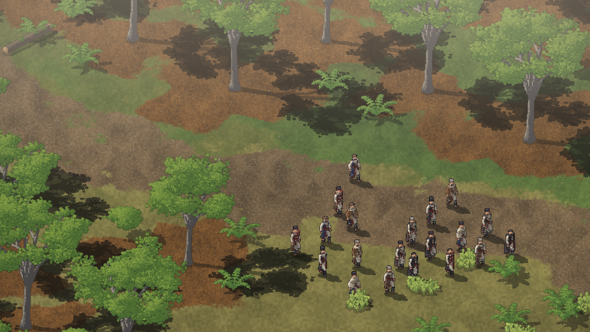

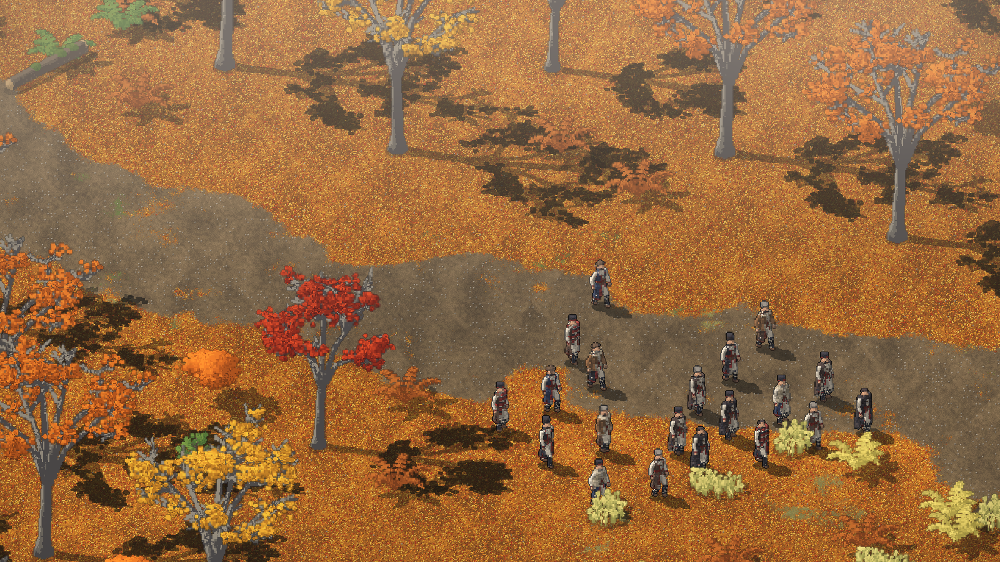

Dominic: "Skip 2D" (D-039). Oak, hornbeam, pine and spruce made straight as models with the same tool: the oak
stout and wide, keeping most of its russet leaves; the hornbeam small and narrow; the pine a bare bole with a high
crown; the spruce a spire of drooping whorls. The old stand-in trees built in code are gone.

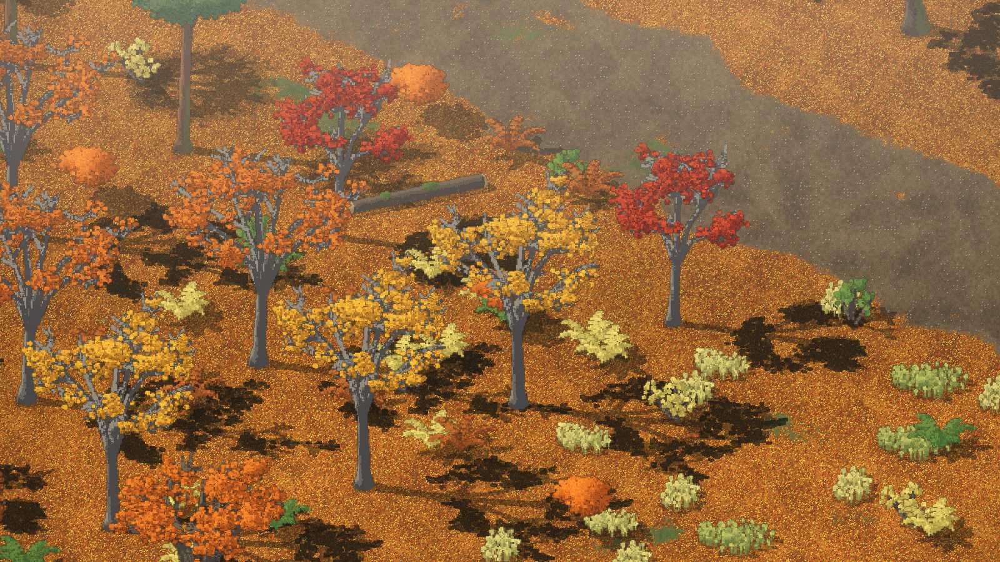

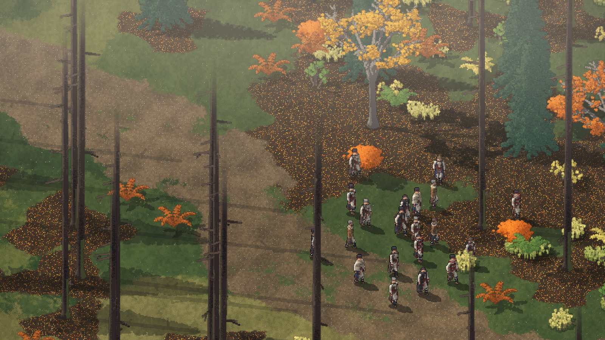

The autumn ground is no longer all orange: the leaf carpet lies in drifts, with grass, herbs and bare earth showing
between them in the open (the lighting work found that the target's ground is mixed, and that is what its light needs).

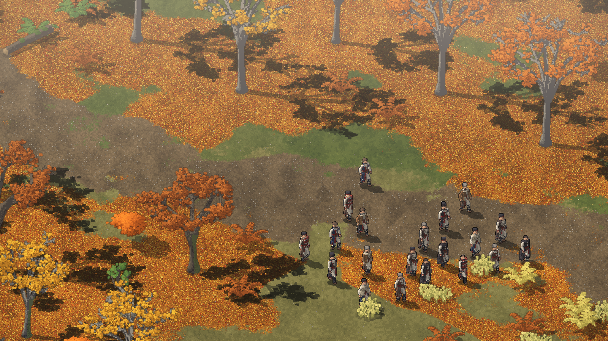

Winter (#11): a first-snow ground (`tools/ground_atlas.py`, `atlas_winter.png`): thin blue-white snow in the open with
grass tips through it, the fallen leaves showing under the trees, slush on the trail, and the bare trees' long shadows
across it. No snow lies on the boughs or the men yet.

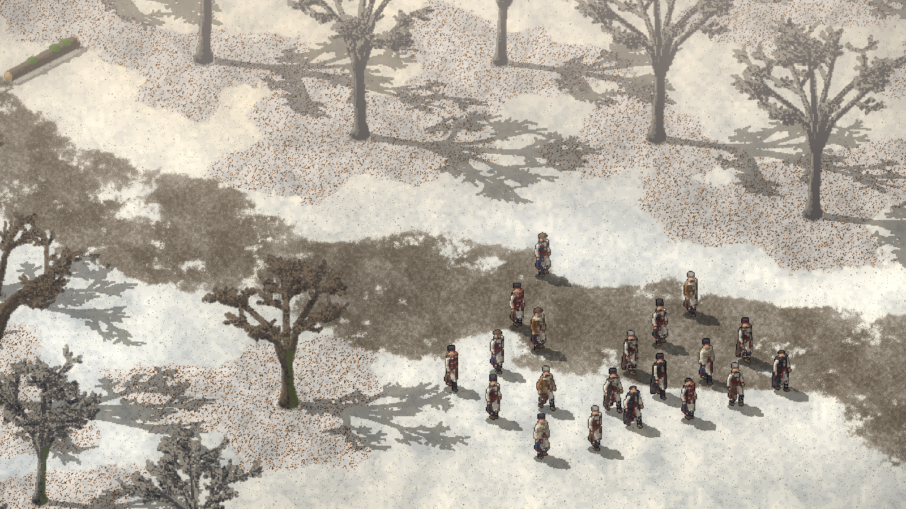

The stream and the trail narrowed from two tiles to one, and trees set close round each clearing. A tile is still
about three men across, so the stream is about twice as wide as the target's: the ground is drawn tile by tile, and
going narrower needs either a smaller tile or a ground that can draw a strip inside one. Not decided.

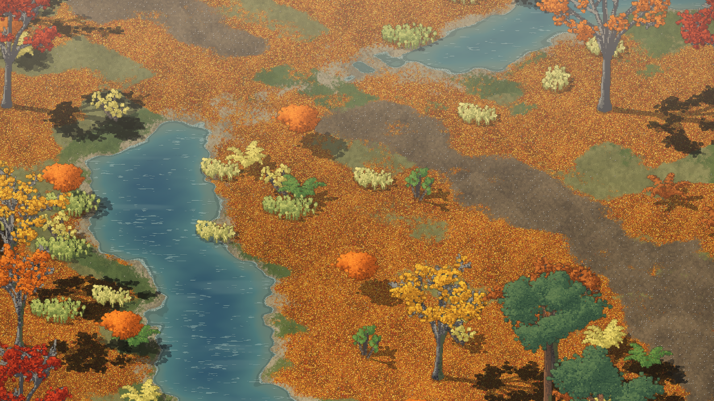

A first landslide (#20): in the deep fir woods the trail is buried under fallen gneiss with broken trunks and loose
slabs in it (`slide` in `tools/make_places.py`), found after it has happened. The men have to walk round it. It is
only a look and a blocked way so far: nothing to clear or climb, and it is the same on the way home.

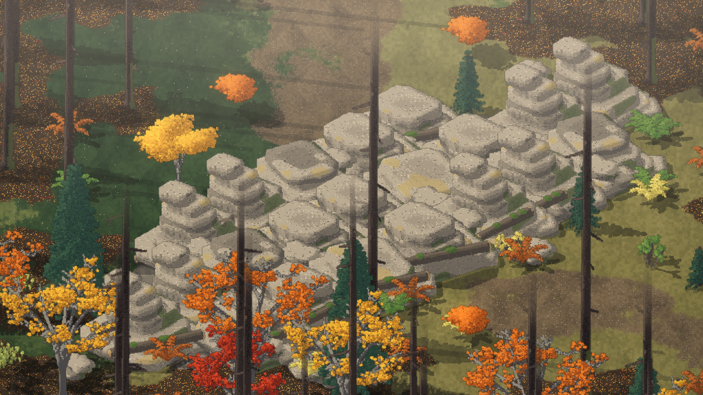

Dominic, in the lighting thread: "Should be harder edged too. Biggest difference with the design is evryhting crisp
and sharp. Our new stuff is looking soft so far, engine issue?" One cause was in the trees: they were baked at 112
voxels a tile and stretched to the screen, while the men are one voxel to one pixel of Creel's art (135.76 a tile). Now
every tree, rock and plant is baked at the men's fineness. A .vox model can't be more than 256 voxels a side, so the
big trees are saved in pieces (`<name>.cXYZ.vox`). The baker's per-voxel dither and the screen's haze are being looked
at in the lighting thread.

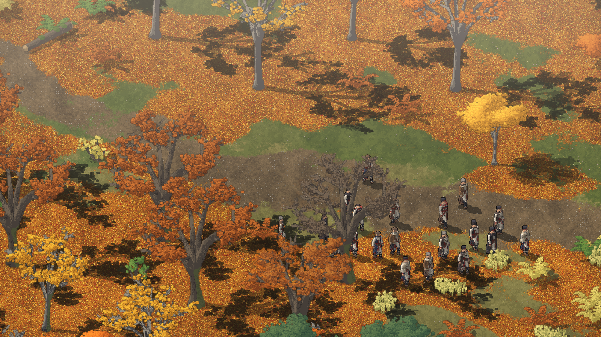

## The landslide, rebuilt (22:05)

Dominic of the first one: "Landslide looks pretty bad. Unclear its source, and scale of rocks looks really wrong. Just
piles of square rocks?" It was the outcrop model dropped on the trail. Now there is a crag above the trail that let go,
and from it a tongue of earth, broken rock of many sizes and snapped logs that widens down the slope and covers the
trail, with scree on the ground under it (a new terrain, "rubble", which men can't walk). The outcrops are thin beds
that dip, not blocks. Picture 76. Still wrong: the earth heaps read as flat plates with ridged edges, not as slumped soil.

Main (the lighting thread's shade and crisp settings) was merged into this branch at 22:04; young beeches and the
undergrowth now stand in the shade like the men.

## Ground you can read, and a landslide on a ledge (22:10 to 22:40)

Dominic (22:01): "Unsure if lighting work needed still until the ground texture and bushes are done". The forest floor
was a speckle of single texels. Now `tools/ground_atlas.py` strews real leaves on it (pointed ovals four to six texels
long, each at its own angle and lying over the last, a darker lower edge), puts tufts and a few fallen leaves on the
grass and stones on the trail. Herbs grow in low fine drifts exactly where the litter lies thin (`open_ground`), with no
stems showing, and a bush is stems and twigs with leaves at their tips. Picture 80.

Dominic (22:07) of the rebuilt landslide: "I think better if landslides are smaller and more focuses. Like on a pass
above a cliff face, so we o ly have a very tight space to go, and its blocked". Creel already had high ground (levels 0
to 3, cliff faces, rims) that Smyana had never used. The fir woods now stand at level 3 and a ravine beside the trail
lies at level 0, so the trail runs a ledge: a crag wall above, a real cliff below, and where the wall let go a small
heap across the trail. Everything drawn goes through `gp()` (Creel's `on_ground`), and the mouse through `pick_milli`.
The cliff's face is Smyana's own shader (`src/smyana/cliff.lobster`, loaded over Creel's "cliff"): thin dipping gneiss
beds. The debris' earth is mounds now, not plates. Picture 78.

Not done: the slide leaves one tile of the ledge's lip to squeeze by, because there is no way yet for the men to clear
it; truly blocked needs that. The ravine's bed is plain rock with a thread of water, and nothing casts a shadow into it.

## Too spotty: the ground made soft (22:16 to 22:25)

Dominic of picture 80: "verry spotty, ground was soft and pretty in the mockup", and he sent the two camp mock-ups
again. The strewn leaves had ten colours from yellow to dark brown on a dark bed, each with a dark lower edge: every
leaf stood out from its neighbours. In the mock-up the litter is one warm field that drifts between gold and orange,
with no dark gaps. Now the leaves take seven close tones, picked by a slow noise so the carpet lies in soft drifts, on a
bed of the same warmth, their lower edge only a little darker; the autumn grass is an olive gold near the litter in
value, with more leaves on it, so the two run into each other. Picture 82 (ours above the target). Lesson (Claude):
"leaves you can see" was the wrong aim; the aim is tone and softness first, detail only where it costs neither.

## A scene to compare like with like (22:20 to 22:35)

Dominic: "please recreate the scene with river on the right, full trees at the back, clearing, so we can compare
better", then "add the tents, fireplace, and our horses while there - get another thread to make them. So we can cleanly
compare it all in one go". `tools/make_scene.py` lays the mock-up's clearing out tile for tile as its own place
(`camp_clearing`, the look-only leg `camp_look`): the fire left of the middle, the trail from it to the stream, the
stream in at the right and out at the bottom, the wood thick at the back. Shot with
`leg:camp_look camp:28,31 look:30,30 hour:16 zoom:2.75`. Picture 84 is the first cut above the target. What differs
still (Claude's list): the back of the wood is lit ground between trunks where the mock-up's is dark and misty; the
stream is about twice as wide (a tile); the trail is a wide grey patch, not a thin tan path; the trees' branches carry
no shade of their own (Dominic: "The trees in the example had shadows in the branches too. Our pic still looks like big
bright omni light on everything"); no tents, fireplace or animals yet (their own thread).

## Branch shade, a stream's bank, a thin trail (22:25 to 22:50)

Three things the comparison scene showed, each fixed against it (the engine side is in
`archive/engine/2026-11-10-own-shadow-and-nine-levels.md`):

- The trees shade their own boughs and trunks now (picture 86). The baker had been stepping over anything as thin as
  a bough.
- The stream runs below a low earth bank and is narrower than its tile (picture 88). Dominic: "Stream also has a bank,
  slight depth in mock up".
- The trail is a path about a man wide, in a soft tan, drawn through the middle of its tiles and eased where they step
  (`build_trail`), not a tile-wide grey patch (picture 90). The men still walk the same tiles.

Still open against the mock-up: the stream is wider and darker than its pale blue one; the back of the wood (the
lighting thread); the camp's things (their own thread).

## The pass again: a cliff above it (22:50 to 23:10)

Dominic of picture 78: "rock slide starting to make sense. But the rest of that image is really bad. The cliff are
bricks? there's no cliff above? just piles of big rocks, there's the trees being cut off (mixing biomes here badly,
including trees and pushes on a mountain edge path?) and really low quality greyish ground on the left."

Each one, and what was done:

- *Bricks:* the face was thin regular beds with joints. Now massive rock in a few close tones, wandering fractures,
  broken grain lines, a ledge here and there (`src/smyana/cliff.lobster`).
- *No cliff above:* the "wall" was outcrop models standing on flat ground. With nine ground levels in Creel the place
  stands at 4, a bluff above the ledge at 8 and the gorge's bed at 0: four levels of real cliff each way.
- *Trees cut off, biomes mixed:* no old trees stand within the pass or for a way below the gorge (the deep wood's tall
  trunks ran out of the top of the picture in front of the cliff); below the gorge the wood starts again with young
  trees.
- *Greyish ground:* the bed was Creel's flat rock. The ledge and bluff are mountain turf now, stony only by the slide;
  scree has stones you can see, in close tones.

Picture 94 is the first try at this, kept as a bug: everything bare, a brown waste. Picture 92 is where it stands.
Still wrong (Claude): the faces' fractures run too straight and upright, the river in the gorge is a pool with a ring of
bank, the trail fades out under the scree by the slide.

## The camp stands in the comparison scene (23:35 to 23:50)

Dominic at 22:20: "add the tents, fireplace, and our horses while there - get another thread to make them. So we can
cleanly compare it all in one go". The camp thread made the models (PR #33, `src/smyana/camp.lobster`); this places
them.

- A place can lay out a camp: the map's `"camp"` is a list of `[frame, x, y]` in milli-tiles. `tools/make_scene.py`
  writes it for the clearing as the mock-up has it: the canvas tent behind the fire, a rug lean-to each side of it, the
  woodpile by the fire, three pack mules right of the tents and five horses along the wood's edge. No tree is planted
  on them and no undergrowth grows under them.
- Every fire now stands in the fireplace model (ring of stones, logs, tripod and cauldron); the flat stones and logs the
  placeholder drew are gone, its flames and smoke stay (D-038 still holds: the fire is for a look).

Picture 96 is the scene above the mock-up. What it shows still open (Claude): the flames are flat bars against voxel
models; the woodpile is lost in shade; the men stand about the trail and not round the fire; the back of the wood is
bright where the mock-up's is dark and misty (the lighting thread).

The faces' fractures no longer split the rock into upright panels: each leans and wanders its own way down, and some
are missing (picture 98). Still wrong (Claude): the cliffs' edges run ruler-straight along the tiles, and the river in
the gorge is still a pool.
