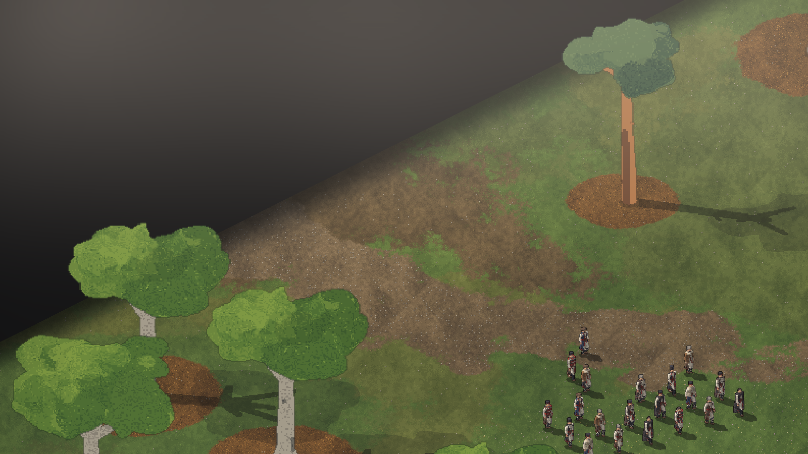
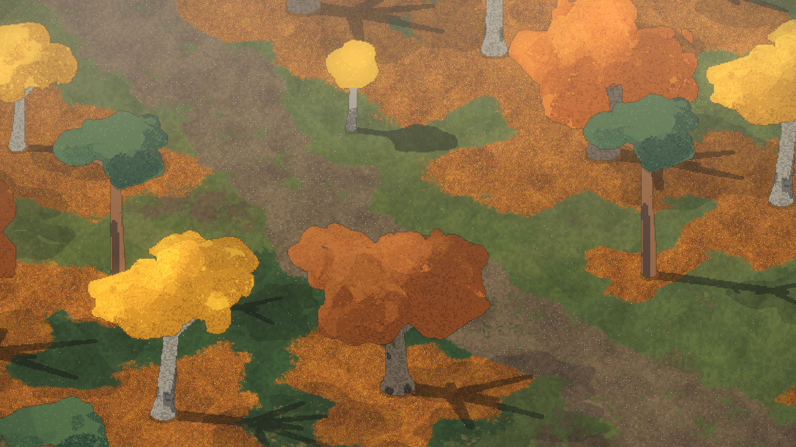
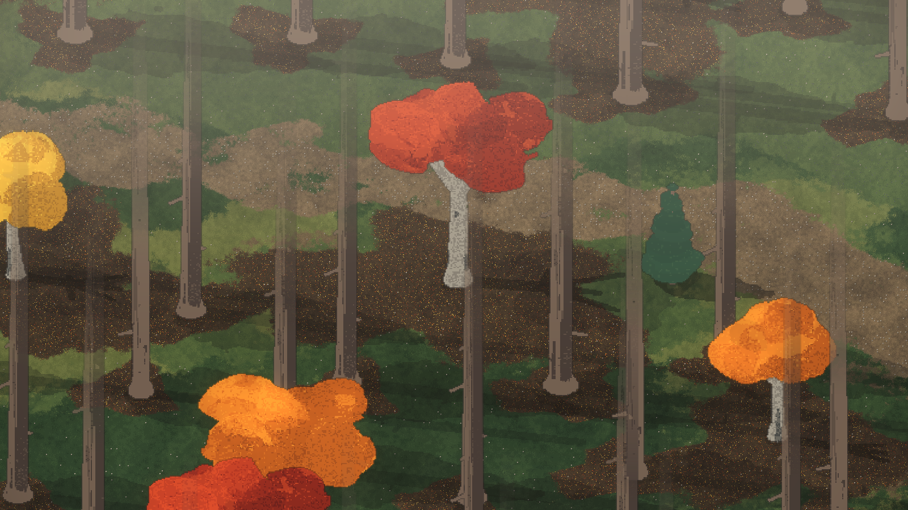
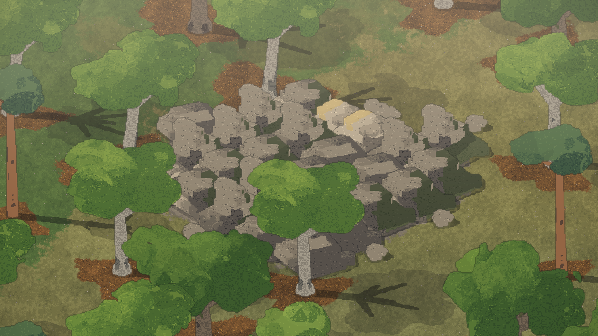
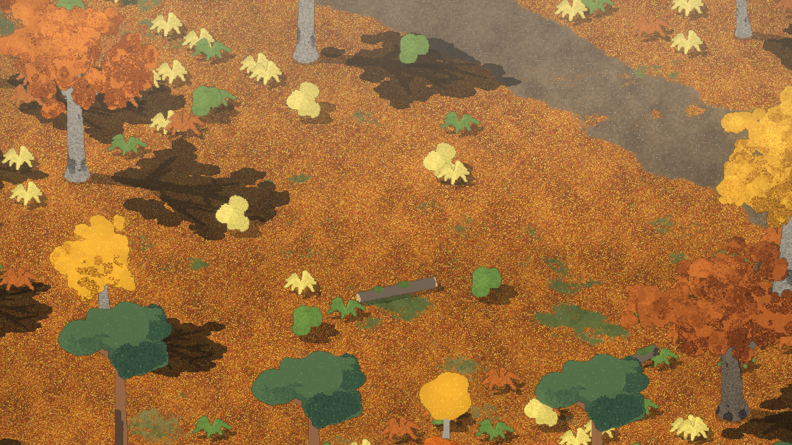
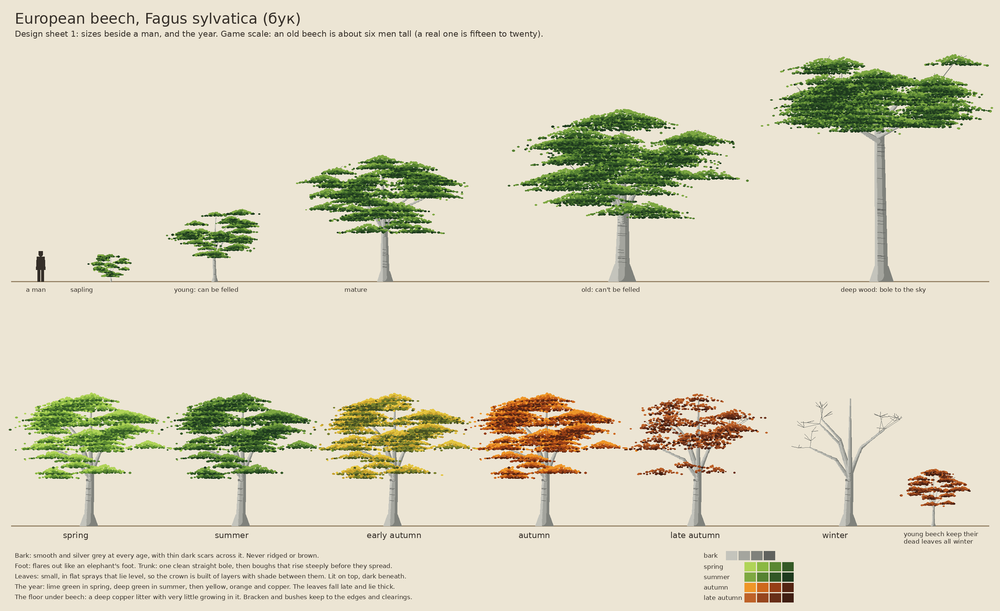
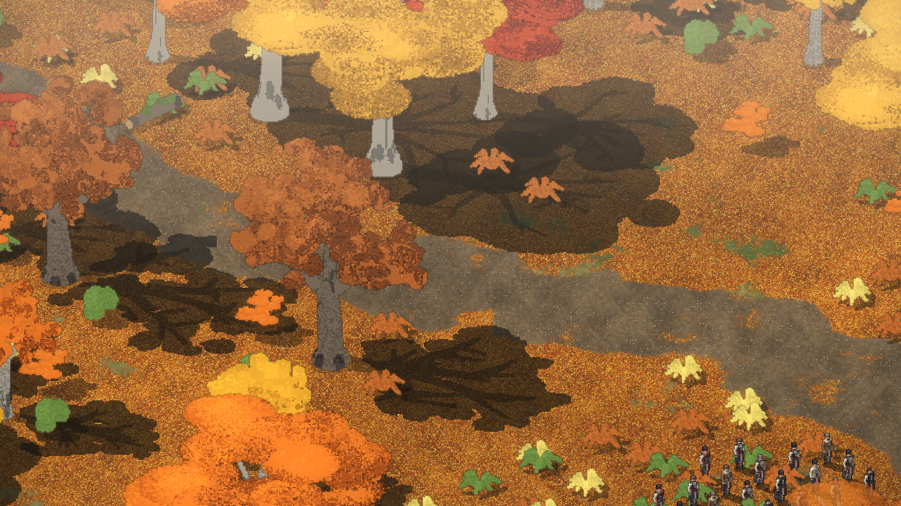
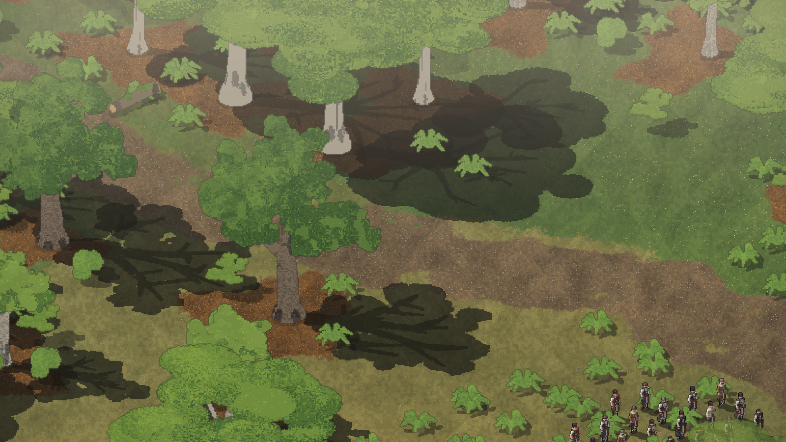
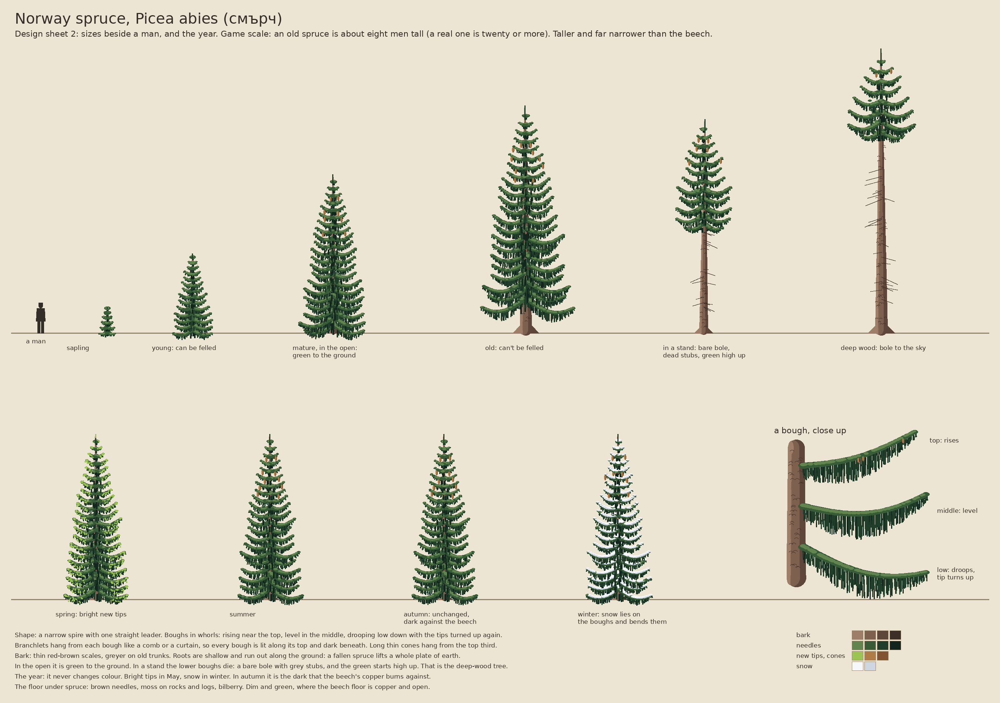

# 2026-11-10: Rhodope trees, ground and rock

## What happened

Dominic looked at the first runnable version and said the trees were a crazy size and had to
keep to the designs. He then asked for the right trees, ground and rocks for the region (the
rock matters because it's what the houses are built from), pointed out that the mock-ups have
some places with normal RTS-sized trees and others where the trees fade off to the sky, gave a
list of the Rhodopes' trees, and said autumn's reds, oranges and yellows are a huge part of the
mood and should probably be the game's poster
([his words](../notes/2026-11-10-dominic-in-his-own-words.md#the-trees-the-ground-and-the-rock)).

He was right about the size. Claude had built every old tree about thirteen men tall with a
trunk three men wide, which is the first under-the-canopy mock-up Dominic had already turned
down, not the route frames he liked. Measured against the route frames (pictures 19 to 23), an
old tree is five or six men tall with a trunk about a man wide.

What changed, all still stand-ins built in code until the real art (#6):

- **Size.** Old broadleaves are now five to six men tall, young trees two to three. The camera
  starts closer, so the men are about the size they are in the route frames.
- **Size is set per place** (D-029). A map says what kind of wood it is. The beech valley is
  "beech": whole trees at RTS size. The fir woods are "deep": dark bare spruce and fir trunks
  that run up and fade out before their tops, with only their shade on the ground, and whole
  broadleaves and young firs beneath them as understorey.
- **Kinds** (D-030), from Dominic's list: beech (smooth silver trunk), oak (short thick dark
  trunk, wide crown), hornbeam (smaller, dense), Scots pine (tall bare trunk, flat top), spruce
  and fir (dark spires). Ash, plane, alder, willow, maple, lime, wild pear, elm, black pine and
  dwarf pine are not made yet.
- **Autumn** (D-031). Each broadleaf turns its own colour, and each tree of a kind a little
  differently: beech orange, gold or red, oak russet, hornbeam gold. The young trees turn too.
  In autumn the fallen leaves spread much further over the ground and the ground textures
  switch to a brighter litter. Conifers stay dark, which sets the colours off.
- **Rock** (D-032). Rock cells now carry an outcrop: thick flat beds stacked in steps, warm
  grey, with Creel's lichen and moss on them. Loose slabs lie beside outcrops. These don't do
  anything in the game yet.
- **Ground.** Four ground atlases instead of one: beech wood and conifer wood, each with an
  autumn version. The conifer floor is dark needles, moss and bilberry. Leaf litter is laid in
  ragged patches under each tree, not rings.

## Decisions

- D-029: A place says how big its trees are: whole trees, or trunks fading to the sky.
- D-030: The tree kinds come from Dominic's list of the Rhodopes' trees.
- D-031: Autumn is the game's poster season.
- D-032: The rock is gneiss in flat slabs, as outcrops and loose building stone.
- D-033: Dominic confirms gneiss, used with wood for roofs and walls.
- D-034: The look comes first, and the archive's pictures are the target.
- D-035: Trees are designed in 2D from real photos first, then made as vox.

## Direction changes

- The first version's giant trees everywhere are gone (D-028 said old trees are giants whose
  crowns fade over the men; the fading stays, the giant size doesn't. See D-029).

## Pictures

For the size it replaced, see [picture 33](../images/2026-11-10/33-beech-valley-summer.png).

## Funny moments and bugs

- The first Scots pine had bark so orange it looked like a carrot with a hat.
- The first rock outcrops were grey lumps with dark green cones on them: the ledges were too
  fine to see and Creel's moss covered the rest. Rebuilt as a few thick plates.
- With the trees at the right size the edge of the map shows as a grey void. The giants had
  been hiding it.

## Known limits

- Gneiss is Claude's reading of the region's building stone. Dominic to confirm the rock and
  its colour.
- The crowns are still rounded lumps. A beech's flat layers don't read yet (#6).
- The deep woods are too bright and too thin next to the mock-up: they need the lighting work
  (Casaide/creel#5, #12), ferns and undergrowth (#8) and mist (#15).
- The edge of a map needs a wall of forest or a camera limit (#5).
- The autumn leg is the fir woods, where most trees are evergreen. Whether the route should put
  a broadleaf place in autumn is for #5.

## Later the same evening: the look comes first

Dominic asked whether the open issues were being checked and updated (they hadn't been: Claude
then posted where #4, #6, #7 and #11 stand) and said he wants the look first, so the archive's
pictures can be made in the engine with our men. Claude first took the pictures as a guide to
size and layout only, which was wrong: Dominic said the style being built doesn't match the
design, and the pictures are the target (D-034). He confirmed gneiss (D-033).

A second pass the same evening got closer in layout but not in style: broadleaves rebuilt as
branches with clusters of leaves, bracken, bushes and fallen logs (#8), an autumn leaf carpet
over the whole floor of a broadleaf wood, deeper shade under the crowns, a warm autumn mood,
and a rim of thick forest round each place with the camera kept inside it, so the map's edge
never shows. It still reads as flat poster shapes next to the picture. Dominic's answer: design
the trees in 2D from real photos first, then make the vox (D-035).

The first design sheet, for beech, drawn by `tools/tree_design.py`. It was drawn from what
Claude knows of the tree, not from photos: the session's network couldn't reach any, so it
still needs checking against real pictures before the vox is made.

Dominic's answer to the sheet: "Looks good!" So the beech was made as vox from it
(`tools/tree_vox.py` writes `art/trees/vox/beech_*.vox`: a sapling, two young, two mature, two
old). The palette index says what each voxel is (bark, or a leaf lit from above, mid, or
beneath), and the game bakes the wood and the leaves as separate pictures, so the leaves take
the season's colour and still fade over a man. The first try filled the crown solid, and from
the game's camera the layers vanished into one lump; thinner sprays with air between them
brought them back.

Still to do on beech: the crown hides most of the branches, the light on it is flatter than the
target pictures, and the oak, hornbeam, pine and spruce are still the old stand-ins.

## The spruce's design sheet (Claude, for Dominic's check)

The second sheet, made the same way as the beech's (`python3 tools/tree_design.py spruce`). It
sets the spruce at about eight men tall, taller and much narrower than the beech, and shows the
two forms it takes: green to the ground in the open, and a bare bole with dead stubs in a stand,
which is the deep-wood tree. It doesn't change through the year except for bright tips in spring
and snow in winter. Drawn from what is known of the tree, not yet checked against photos. No vox
is made from it until Dominic has looked.

