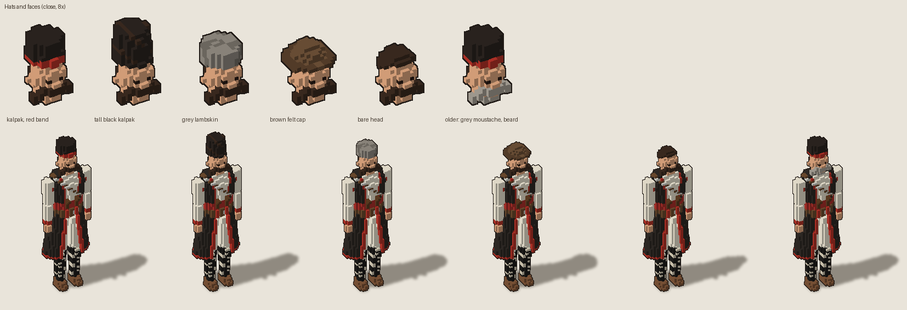
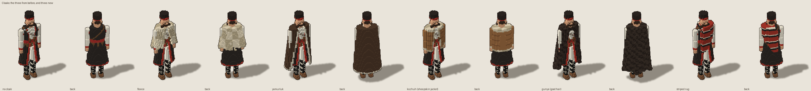
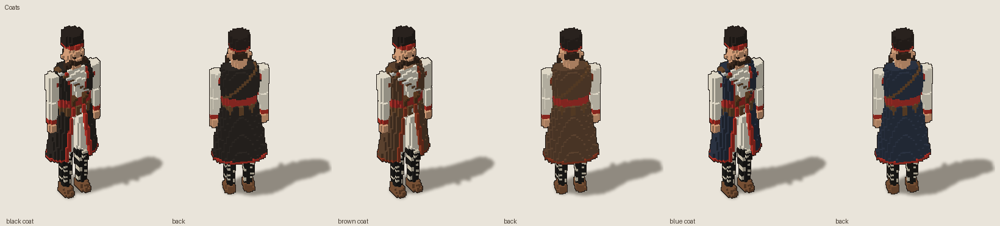
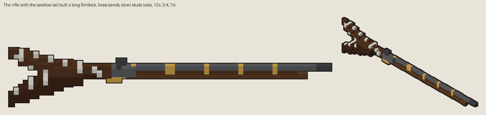
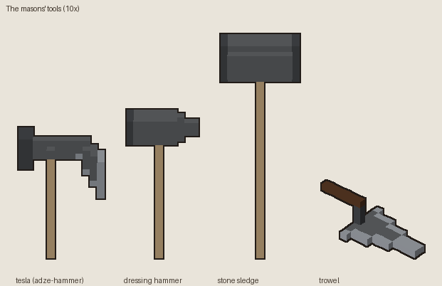
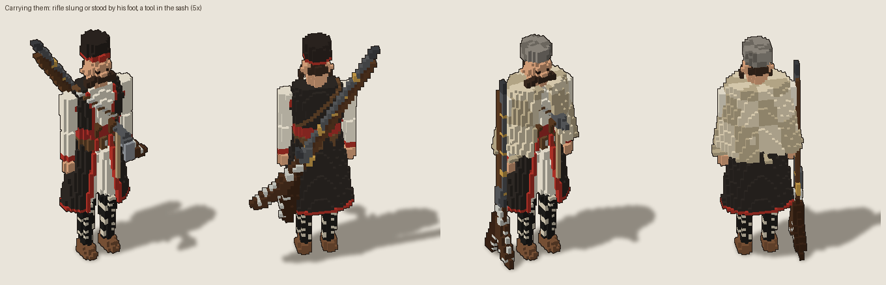
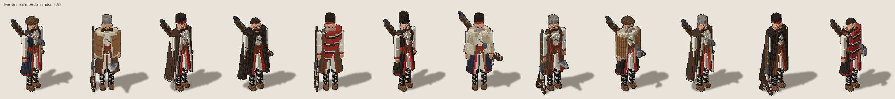
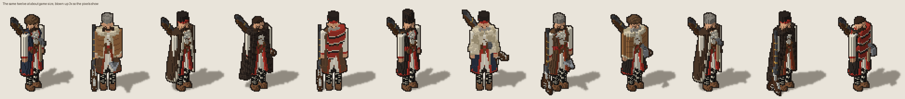

# 2026-11-10: The men: looks to mix and their kit

## What happened

Dominic liked the Bulgarian man so much he asked to finish designing the men while we were at
it: a few other looks so we can mix hats and cloaks at random, the rifles with their
traditional swallow-tail butts, and the stone hammers ([his words](../notes/2026-11-10-dominic-in-his-own-words.md#the-men)).

Claude found the man's source in Age of Anything (`mods/vox_example/tools/haidut.lobster`, a
script that writes the `.vox` voxel by voxel) and its rules in the voxel-art skill. Lobster
couldn't be built in the cloud container (no OpenGL headers), so the script was redone in Python
voxel for voxel, with the looks added as options, plus a small renderer to see them
([`art/men/`](../../art/men/README.md)).

- **Hats:** the kalpak with the red band (the original), a taller black kalpak, a short grey
  lambskin, a brown felt cap with a rolled brim, and bare-headed. Under every hat he now has hair
  at the back of his head; before, it was skin.
- **Coats:** black (the original), undyed brown wool with rust trim, dark blue.
- **Cloaks:** the fleece and the yamurluk as before, and three new ones: a kozhuh (a sheepskin
  jacket, hide out, the fleece showing at its edges, with sleeves), a gunya (the shaggy goat-hair
  shepherd's cloak of the Rhodopes) and a striped red and black wool rug over the left shoulder.
- **An older face:** a grey moustache and a short grey beard.
- **The rifle:** a long flintlock with a full stock, brass bands, the lock on the right, and the
  swallow-tail butt: two long horns with a deep V between them, studded in silver. It reads as a
  swallow tail at game size, slung across the back.
- **The masons' tools:** "stone hammers" was read as the builders' own tools: the tesla
  (adze-hammer), a stone-dressing hammer, a two-handed sledge and a trowel.

## Decisions

- D-019 (Dominic): the men get looks that are mixed at random, and carry the swallow-tail rifle
  and masons' hammers.

## Pictures

Hats and faces, close and whole:

The cloaks, front and back:

The coats:

The rifle with the swallow-tail butt:

The masons' tools:

Carrying them:

Twelve men mixed at random, then the same twelve at about game size:

## Funny moments and bugs worth remembering

- The first drop shadows turned with the man, so each facing cast its shadow a different way.
- The first felt cap was the same shape as the kalpak, just brown.

## Ideas parked

- Holds for the rifle and tools (on the shoulder, swinging a tesla, aiming).
- Parts that stack in the engine, so a look is chosen per man rather than baked as a whole file.
