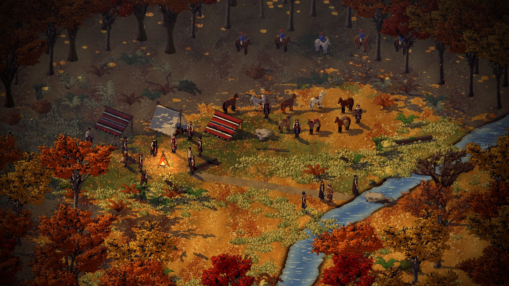
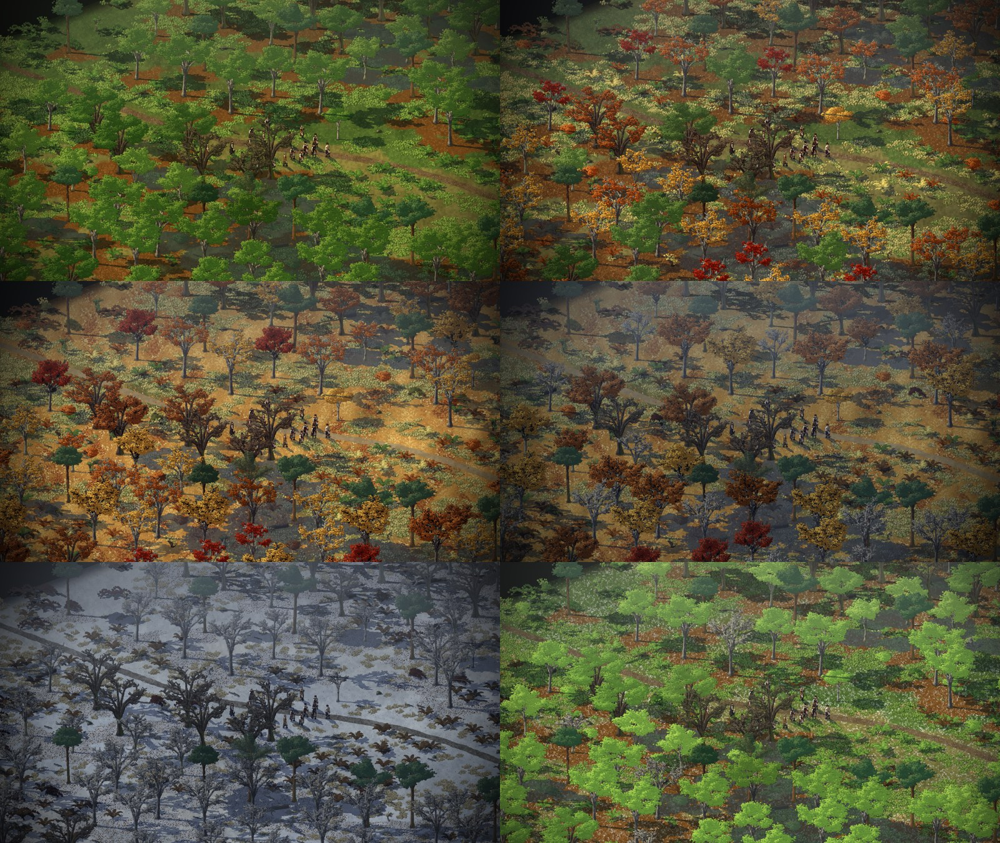
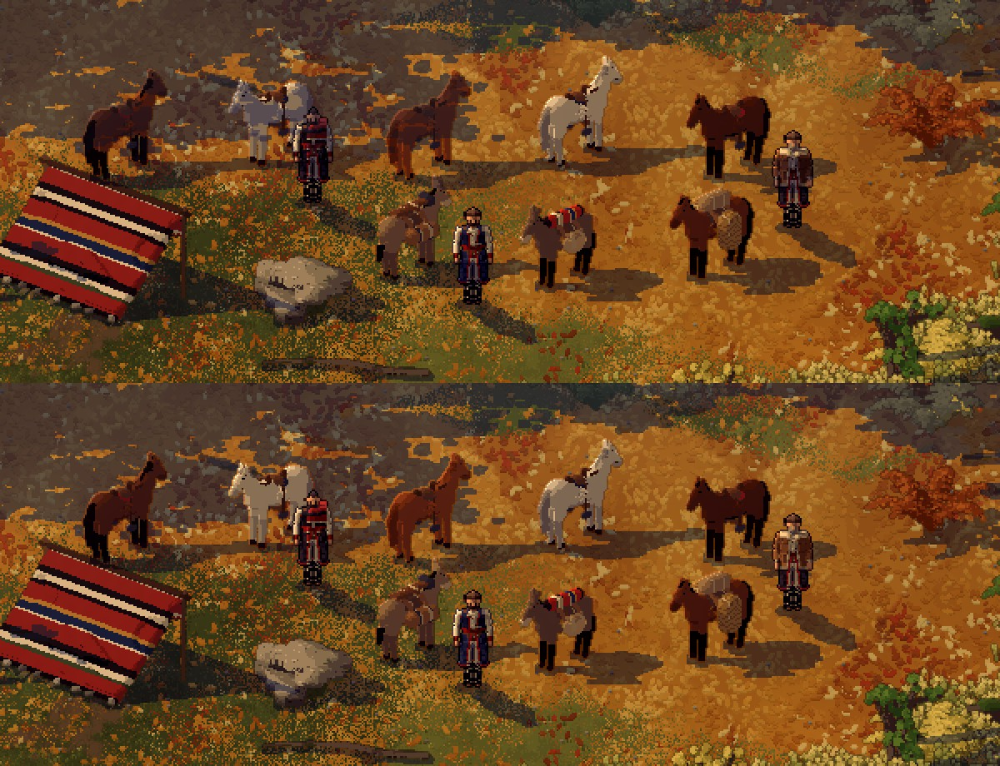
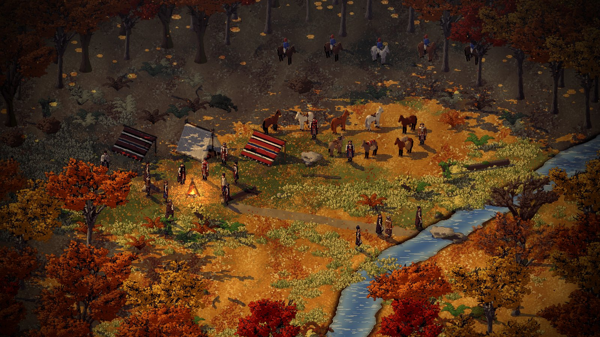
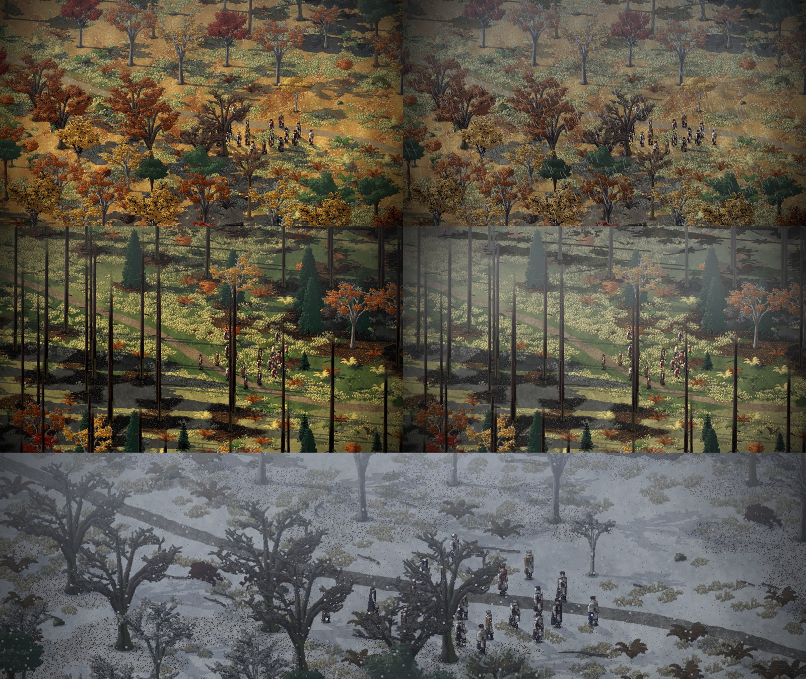
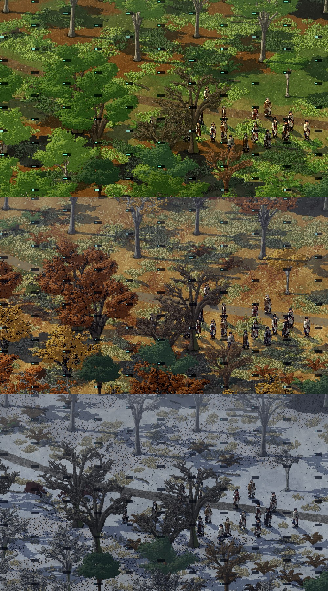
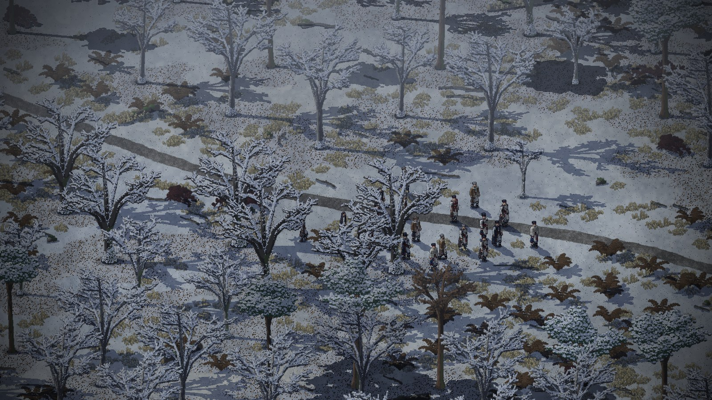

# Closing the environment issues (2026-11-11)

A fresh thread, started when Dominic drew a line under the two long ones (his words, 08:02, in
[his notes](../notes/2026-11-11-dominic-in-his-own-words.md)). It works from the
[environment handoff](../notes/2026-11-11-environment-handoff.md) and the lighting thread's
[last section](2026-11-11-moods-seasons-and-the-men.md#where-this-thread-stopped-handoff-2026-11-11). His complaint
about the old pictures was that they were made from stale versions, so every picture here says which commits it was
rendered from. Times are UTC.

## The two threads' last work brought together (08:05 to 08:15)

The lighting thread's rim on units in shade (pull request 45) and the environment handoff (46) both added a line to
the end of the timeline, so 45 conflicted with main. Claude merged both onto main in this thread's branch, kept both
lines, and pointed the engine at Creel's main, where the rim had been merged (Creel `8234c4b`).

## The riders face along the path, under the trees (10:00 to 10:10)

Dominic, 08:37: "riders at the edge shouldnt be looking away, should be facing to the right - like they're following
your path - and be much closer to the trees".

- A rider could only face the two ways the camp's horses do, side on to the camera, and at the back of the clearing
  that showed their backs. Riders are now baked facing four ways (`CAMP_RIDER_TURNS` in `src/smyana/camp.lobster`):
  `rider8` to `rider11` face down the screen to the right, the way the trail runs to the ford.
- They stand nearly two tiles further back, in under the first trunks of the back wood (`tools/make_scene.py`).

Picture 44, rendered from this branch on Smyana main `13a2956` with Creel `8234c4b`:

## The season clock (10:10 to 10:50)

Issues 10, 11, 13 and 14 all waited on one thing: the season was a word on each leg of the route, and it changed only
between places. Claude gave the run a clock for the year (D-062).

- **The clock** (`src/smyana/route.lobster`). The year is counted in thousandths of a season: 0 high summer, 1000 full
  autumn, 2000 midwinter, 3000 spring. A leg of the route gives two ends (`"year": [450, 800]`): the walk in brings the
  year at least to the first, and it moves on while the men are there, one thousandth every 28 ticks, up to the
  second. So the season turns while you watch, and a slow player still can't reach winter in the first valley. It is
  plain whole numbers in the sim, carried from place to place with the men.
- **Higher ground runs ahead** (`"altitude"` on a leg): the fir woods are 150 thousandths further into autumn than
  the valley below, and the same amount behind it in spring. The turn from ahead to behind happens through the
  winter, where nobody can see it.
- **Each tree turns on its own day.** A tree is up to 200 thousandths ahead of the year or behind it, by the cell it
  stands on, and so is each clump of undergrowth. A wood goes gold a tree at a time, thins a tree at a time, and comes
  into leaf a tree at a time. The stages are the ones already baked: summer, autumn, late (after leaf-fall), bare,
  spring.
- **Leaves come down** from every crown that is shedding, a pixel or two of the tree's own colour each, and the
  carpet on a beech wood's floor thickens with the clock, an eighth at a time.
- **The ground turns a texel at a time.** Creel gained a second set of ground textures that turns in over the first
  with no blending, so it stays crisp ([engine note](../engine/2026-11-11-a-ground-that-turns.md)). Autumn's leaves
  turn in over summer's ground, the first snow over the leaves, and spring's ground under the snow as it goes.
- **The light stands between two seasons** (#14). Each season's moods were already there; now the light is mixed from
  the season before and the season coming, on top of the turn from one hour's mood to the next.
- **The days shorten** (#13): `atmosphere.json` has the hours of dawn, day, dusk and night at midsummer and at
  midwinter (`hours_winter`), and they move with the clock. At midwinter dusk begins at half past three.
- **The night runs faster** (#13): the clock of the day is now its own count, and from nine at night to five in the
  morning it runs two and a half times as fast (`"night"` in `route.json`), so a night by the fire is about a minute.
- A leg that names a `"season"` stands still in it, off the clock. The comparison scene does, so it looks as it did.
  `year:<n>` on the command line shows any place at any point of the year.

Picture 46: the beech valley at six points of the year (450, 800, 1300, 1700, 2100, 2800), rendered from this branch
on Smyana main `a5ed604` with Creel's `ground_atlas_next` branch (Casaide/creel#23):

What it shows, and what is still weak: the turn at 800 is the best of it, green and gold and red in one wood. Spring's
green is loud beside the others. The floor under the trees is already orange in summer, which is the litter under
each old tree and was so before.

## The trees' shadows on the horses (10:15 to 10:40)

Dominic, 10:12, with a close-up of the camp's horses: "the way the shaddows fall on the horses isnt very realistic,
feels like it flat from camera perspective? but shadows dont fall like that right?" and "(trees shadow on the horse)".

He was right. The shade is a picture the size of the screen, and a horse kept the shade of whatever ground lay behind
it on the screen. A tree's shadow lying on the ground two tiles back was painted across the horse's flank as if the
horse were flat on the ground.

- Creel now keeps a copy of the ground's shade (`atmo_shade_standing`), and a unit drawn with `atmo_shade_stand`
  takes the shade of the ground at its own feet, all of it alike, read at five places across the feet so it goes into
  a shadow by degrees (Casaide/creel#23, documented in Creel's `docs/atmosphere.md`).
- Smyana draws its men, horses, mules and riders that way.
- The first try read the ground straight below each pixel of the body, which drew a shadow's edge as upright stripes,
  and it did the same to the rug lean-to and the bushes. One reading for the whole body, and only for men and animals,
  is what stayed.

Picture 48, before above and after below, from this branch on Smyana main `a5ed604` with Creel `3a903bf`:

Between the two, at 10:18, Dominic asked the threads to write their state down and stop, to pace usage, and a minute
later said the environment is the focus and this thread goes on. The
[state written then](../notes/2026-11-11-environment-state-at-the-pause.md) stands as the list of what is left; the
season clock and this fix, which it lists as unfinished, are in the pull request with this entry.

## The mist no longer lightens the deep wood (10:45)

The start-up thread (issue 86) found that shade under overlapping trees came out greyer and lighter than a lone
tree's shadow (Dominic there: "Lone trees its dark, overlapping its grey"). Its fix to Creel's mist could not be
pushed from that thread, so it is carried in this thread's Creel pull request (Casaide/creel#23): the mist keeps the
haze's colour and never lightens what it lies on. Picture 50 is the comparison scene with all of the above, from this
branch on Smyana main `a5ed604` with Creel `7100d3d`:

(The season clock's decision is D-062. It was written as D-059 until the start-up thread's D-059 to D-061 reached main
first, and the state note of 10:25 still calls it D-059.)

## Weather: mist, rain and snow (10:45 to 11:25)

Dominic merged pull request 47 at 10:44 ("Done"). Issues 10, 11, 13 and 14 were closed with a comment each saying what
was built and where the rest went. Then weather (issue 15), from a fresh branch on main `a26605e` with Creel `91f157f`.

What was built (Claude; decision D-063, a Proposal):

- **Spells in the sim.** The weather comes in spells of three hours on the clock (`"weather"` in `data/route.json`).
  A spell is clear, mist, rain or snow by the season's chances, worked out from the spell's number, so two runs see
  the same sky. The first spell of a run is always clear: the men leave on a clear morning. Rain falls as snow where snow lies. A spell comes on and goes off over its first and last quarter. A
  leg can name its own weather, and a leg that stands still in its season (the comparison scene) stays clear.
- **Snow slows the men.** Lying snow takes up to a quarter off their pace, and snow coming down hard a tenth more.
- **The light under it.** `"weather"` in `data/atmosphere.json` says how far each of a mood's numbers moves under mist,
  rain and snow. Overcast takes the sun and most of the cast shade away and greys the colours; it is added to whatever
  the hour and the season have set, so rain at dusk is still dusk.
- **Rain and snow coming down.** Drawn into the world a pixel of the art at a time, so they take the hour's light and
  stay crisp. Rain is short strokes leaning with the wind, with a fleck where each lands. Snow is single pixels
  swinging as they sink.
- **Wind.** A little always, more in rain and snow, in gusts. It leans the rain, carries the snow and blows the
  falling leaves sideways.
- `weather:rain` (or `mist`, `snow`) on the command line shows a place in that weather.

Picture 74: the beech valley in autumn, clear and in rain; the fir woods at eight in the morning, clear and in mist;
the beech valley in midwinter with snow falling.

Not done, said plainly: the crowns do not sway in the wind (they are baked pictures; only what falls shows the wind),
no snow lies on the boughs, and weather has no sound (sound is issue 59). Falling snow is hard to see against lying
snow and reads mostly against trunks and men. I looked at still pictures only, not at the weather coming and going
over a walk.

## Cover in the leaves (11:25 to 11:50)

Issue 9, on the same branch as the weather (Claude; decision D-064, a Proposal).

- **A cover value per tile**, 0 to 100, worked out in the sim (`cover_at` in `src/smyana/route.lobster`, numbers in
  `"cover"` in `data/route.json`). Each old tree within two tiles gives some: a broadleaf by the leaves it still wears,
  a fir or a pine all year. A young tree beside the man gives a little. Bracken on his own tile gives more, and stands
  dead through the winter at half.
- **It drops as the leaves fall**, tree by tree, because it reads the same clock as the pictures.
- **Felling takes it for good.** A felled tree is a stump on the map and the place remembers the map, so the cover is
  still gone on the way home.
- **A spotting check** (`spots`) for the wolves, the bear and the patrol to use (issues 60 to 62): a watcher's range is
  cut by the man's cover, and by night, mist, rain and falling snow (`sight_pct`). Nothing calls it yet, because no
  threat is built yet.
- **No meter.** For us only, `cover` on the command line draws a bar on each tile. Picture 76 is the beech valley in
  late summer, late autumn and midwinter with those bars:

To do this, which tree and which bracken stand on a tile is now worked out in the sim, and the view draws from the
same rule (it was in the view only). The pictures are unchanged by it.

Rendered from this branch on main `a26605e` with Creel `91f157f`.

## Snow on the boughs, wind in the crowns (15:20 to 15:50)

Dominic merged pull requests 88 and 89 ("ok", 12:22); issue 9 was closed. The last two things on issue 15, from a
fresh branch on main `d60ec5f` with Creel `91f157f` (Claude):

- **Snow on the boughs.** The bare broadleaves, old and young, and the evergreens' crowns have a second picture each,
  baked from the same model with snow two voxels deep on whatever is open to the sky. A tree changes to it once
  enough snow lies, each from its own day, and loses it on its own day in the thaw. Picture 78 is the beech valley in
  midwinter:

- **Wind in the crowns.** A crown leans with the gusts: its foot stays, its top is carried over by up to four and a
  half pixels of the art in a storm and about one on a calm day, each tree in its own time, in steps of half a pixel
  so it stays crisp. No Creel change: Creel already draws a picture through a slant (`sprite_xf`).

Not checked: I compared two still frames of the lean, not the motion. Whether the rows stepping sideways read as
wind or as a shimmer needs Dominic's eye on the running game. A crown that is faded because men stand behind it does
not lean.
