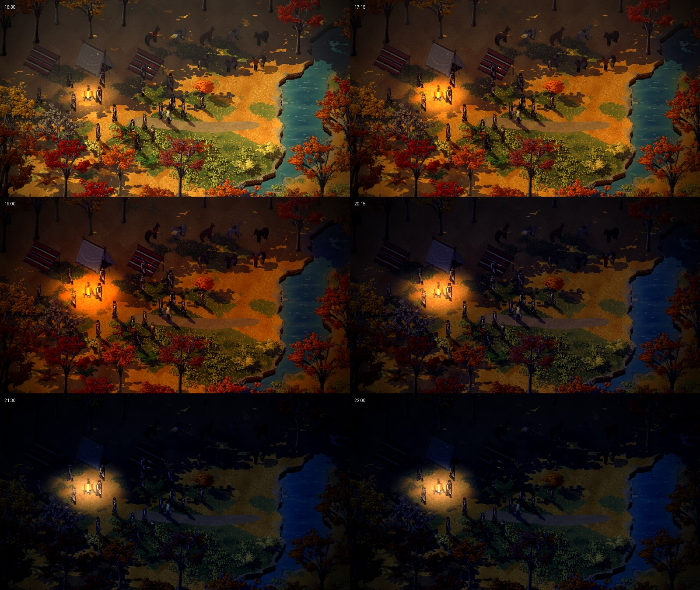
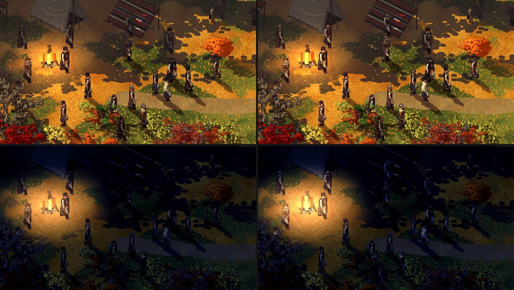
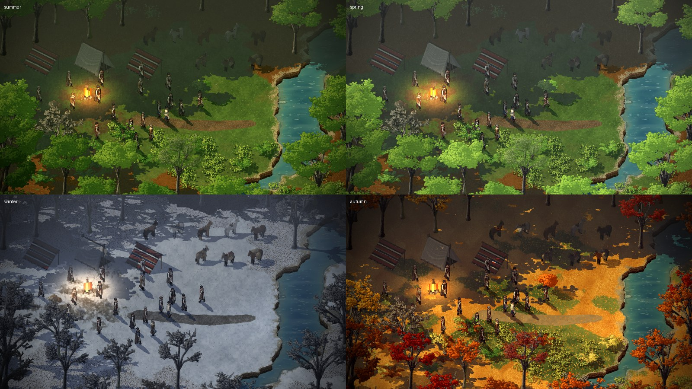
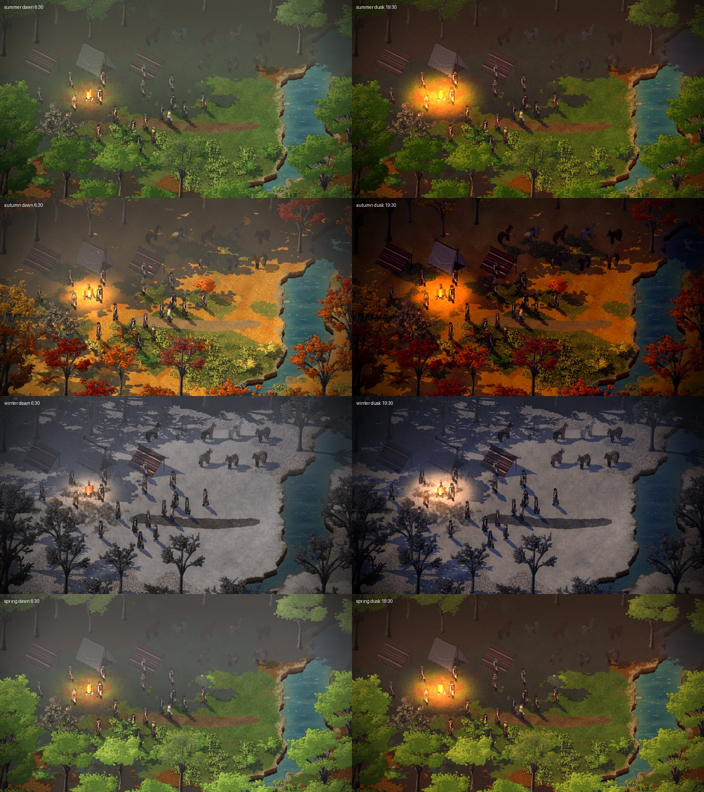
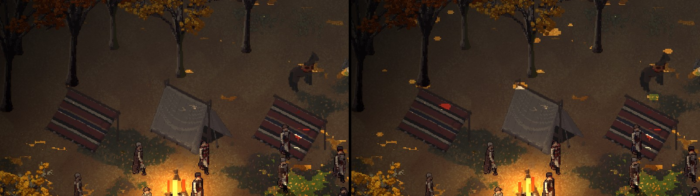
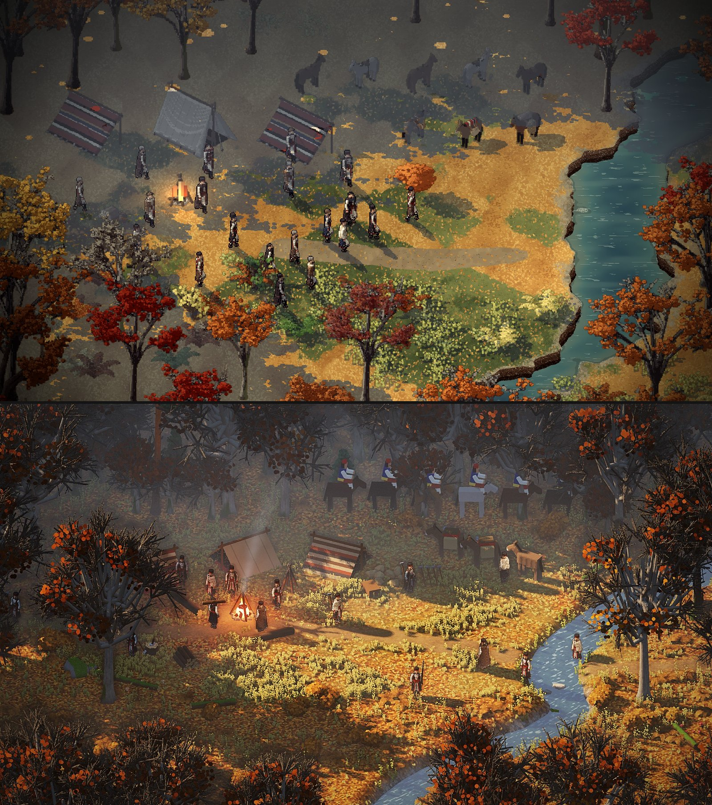

# Moods that turn, a light for each season, and men you don't lose (2026-11-11)

Dominic, when the dark-wood PR merged: "but you're not done there, why did you stop?"
([his words](../notes/2026-11-10-lighting-and-mood.md#when-the-dark-wood-pr-merged-2026-11-11-0544)).
So this pass went on to the three lighting issues: moods (#14), seasons (#11) and seeing the men (#7).
Every frame is the trees thread's comparison scene (`leg:camp_look camp:28,31 look:30,30 zoom:2.75`).

## The day turns instead of switching (#14)
Moods used to switch on the hour, so dusk came on at 18:00 in one frame. Creel now has
`atmo_set_between`, which mixes every number and colour of two moods. Smyana's `hours._blend`
(1.5 hours) is how long before a mood starts the one before it turns into it. So the afternoon goes
gold, then dusk falls, then the night comes in. The light is set again only when the turn has moved
a step (48 steps).

The night was flat: grey and washed out, with the dark wood lighter than at dusk. Now it is
moonlit blue, darker and with more contrast, with the fire as the light and the deep wood dark and
misty under its canopy.

## The men stay readable (#7)
With the canopy shade, the dusk and the night, the men sank into the dark. Dominic wants as little
UI as possible, so the light should show them, not markers. Where a man stands is now marked in
the shade buffer, in its blue channel, drawn back to front so a tree in front of him still hides
him. The atmosphere pass then gives the men a little less shade, wood and mist, and a little light
(`unit_lift`: 0.35 to 0.4 by day, 0.55 at dusk, 0.7 at night). The effect is subtle by day: white
shirts show. At night they read as men, not shadows. In each pair the frame on the left is before.
The day pair is at 16:30 against 16:00, so the fire differs a little.

## A light for each season (#11)
Only autumn had its own day light. Summer and spring used the plain day, which read as bright omni
light, and winter's snow was glaring white. There are now `day.summer`, `day.spring` and
`day.winter` moods, matched to the summer and first-snow mock-ups (archive pictures 15 and 17):
- Summer: warm yellow-green, with mist in the deep wood.
- Spring: fresher and softer.
- Winter: cold blue-grey, the snow greyed down and hazy.

The canopy shade gives each season the same dark wood round a lit clearing. Winter's bare trees cast
no canopy.

## Dawn and dusk in each season
Each season now has its own dawn, and summer, spring and winter have their own dusk. Dawns are soft
and misty, with the fire's glow smaller in the morning. Autumn's dawn is warm haze. Winter's dawn is
pale pink-grey and its dusk is cold blue with a faint warm edge. The snow stays greyed down at both
ends of the day.

## Sunflecks under the canopy (#7)
Deep in a closed wood, a few small spots of sun now get through the canopy onto the floor. They swell
and go as if the boughs were swaying, slowly, over about forty seconds. They only appear by day
(`sun.flecks`: five a tree, under trees whose wood is more than half closed). They are cut out of the
shade buffer as small pixel ovals, so they stay crisp and light whatever they fall on, tents and men
included.

## After the critique of the comparison scene (07:00)
At Dominic's request, another Claude critiqued the comparison scene against the target
(`/mnt/project-files/smyana-trees/comparison-critique-2026-11-11.md`). Its measurements: ours averaged
RGB 107, 72, 34 at saturation 154 (out of 255), the target 89, 69, 51 at 98. Our top third was a flat
brown (53, 40, 30), and the target's is grey (66, 58, 55). These were the light's parts:

- **Shade is cool and lighter.** The autumn shade is now blue-grey (`#a6b0c0`) and loses a third of
  its colour. Before, it was the same orange turned down to brown.
- **Mist rises up the screen.** The haze is stronger and blue-grey from a third of the way up, so
  the back wood goes paler row by row. That stands in for the perspective we can't have. The
  deep-wood mist is now paler than the floor under it, where before it was darker.
- **Lit ground is less orange.** Autumn's saturation is down from -0.16 to -0.36, with a softer,
  straw-coloured highlight.
- **The men keep their own colour in shade,** only darkened, instead of going grey.
- **Water keeps its light in shade.** A stream in shade read as a road. The shader tells water by
  its colour (blue over red) and shades it less.
- **The fire's glow is about a man wide** instead of a large yellow disc.
- **Shade edges are at the art's pixel size.** The canopy shade used to be scaled up, which
  magnified its pixels into stair steps. It is now the crown's own shade drawn again at a ring of
  offsets.

Measured after: ours 90, 77, 58 at saturation 86, top third 67, 64, 61. That is within a few points
of the target. Where the light falls (the camp should stand in the sunlit pool) depends on the
scene's layout, which is the trees thread's.

## Left to do
- Moods don't yet blend between seasons, because the season changes by place.
