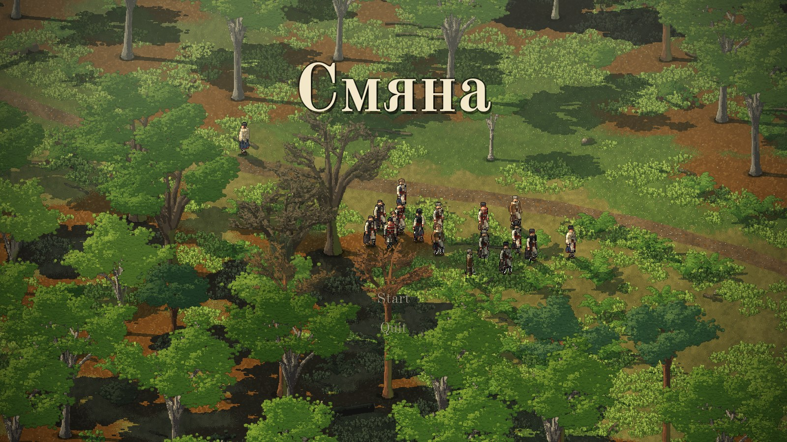
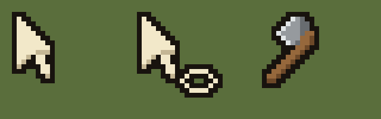
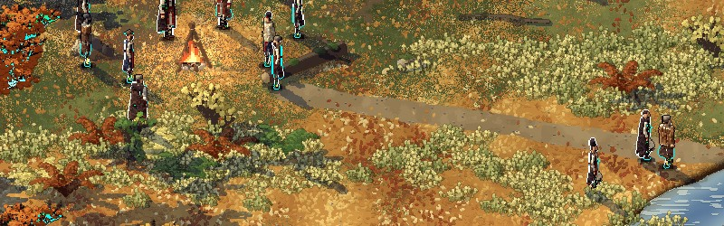
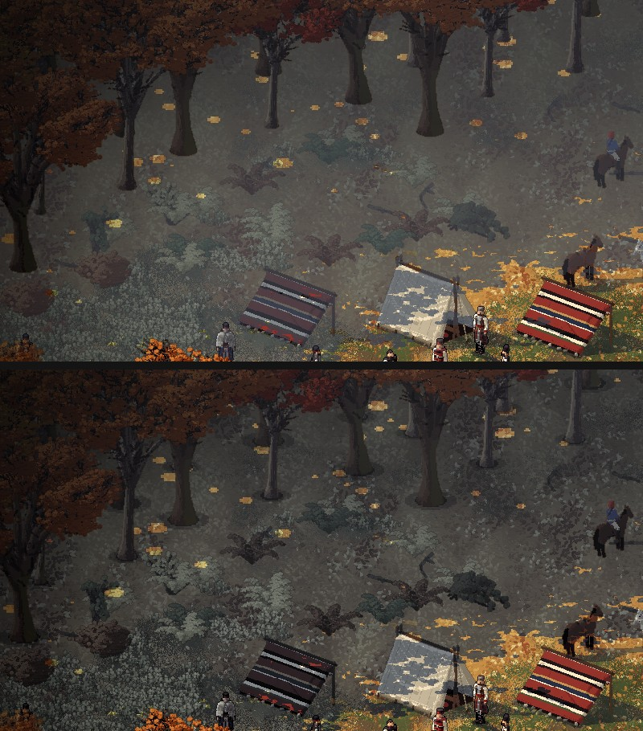
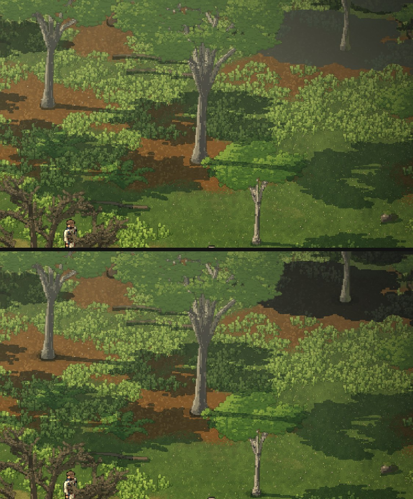

# The menu, the cursors and the feet of the trees (issue #86)

2026-11-11, about 09:57 to 10:40 UTC. Claude, working on Dominic's issue #86, "Start up and QL". His words are in
[the notes](../notes/2026-11-11-dominic-in-his-own-words.md#0835-issue-86-start-up-and-ql-github).

## Why the start was slow

The start took 21 s on a second run, with every picture already in `bake_cache/`. The trees were "baked in 18 s"
every time. The rocks' sheet was only read back if the sheet for the load of wood was read too, and that one was never
saved, so the rocks were baked again on every start. Both are saved and read on their own now. The start is about 4 s
in a cloud session with software GL; most of that is reading the men's twelve sheets.

## The loader and the menu (D-059)

The loader is now only the name, Смяна, on the dark. The menu shows the same name in the same place, over the wood,
where the men walk about the camp (one of them takes a few steps every second or so) and the camera drifts. Under it
are Start and Quit. On Start the men stop where they are, the words fade over about a second, and the game is already
running under them. The run's clock and its gates don't move until Start. A picture (`shot:`) or the tour still starts
playing at once; `menu` shows the menu for a picture.

None of Lobster's fonts had Cyrillic, so the name is set in Old Standard TT (OFL), a book face of the 19th century,
in `data/fonts/OldStandard/` with its licence.

## Cursors, zoom and the camera (D-061)

- Three cursors drawn by the OS: a parchment pointer, the pointer with an order's ring when chosen men would walk where
  it points, and an axe over a young tree they would fell. `tools/make_cursors.py` draws them, with 2x copies for
  Retina. They haven't been tried on a Mac yet.
- The zoom was in quarter steps between 0.75 and 4, but the start's zoom came from the window's height in pixels. On
  a tall or Retina window the start was above 4, so the wheel could never come back to it. Now the zoom is in ten
  steps of the window's height, rounded to quarters. The start is one step further out than before, and the wheel
  zooms about the point under the mouse.
- The camera moved 900 screen pixels a second, which is slow on a big window. It now moves 1.6 window heights a second.

## Shade (D-060)

Where tree shadows overlap deep in a wood, Creel draws "canopy" shade, and its `mist` mixed that toward a pale haze, so
it came out grey and lighter than one lone tree's shadow. The mist now keeps the haze's hue but never lightens what it
lies on. The first try left cyan edges on very dark, saturated pixels: after the grade's contrast their brightness
could go below zero, and the ratio flipped their colour. The fix clamps the ratio. This is a Creel change, handed to
the environment thread to put in its Creel pull request.

Every trunk, young tree, stump and man has a small dark oval at its foot, two tones and pixel-cut, drawn on the ground
under it (`draw_feet`). The shade darkens it further, so the darkest point is where the thing touches the ground. The
trunk widths come from measuring the baked trunks.

## Left

- Creel's mist change has to land before the canopy shade matches picture 66.
- Try the cursors and the feet on Dominic's Mac.
- The letters home still use Droid Sans. Old Standard would suit them too, if Dominic wants it.
