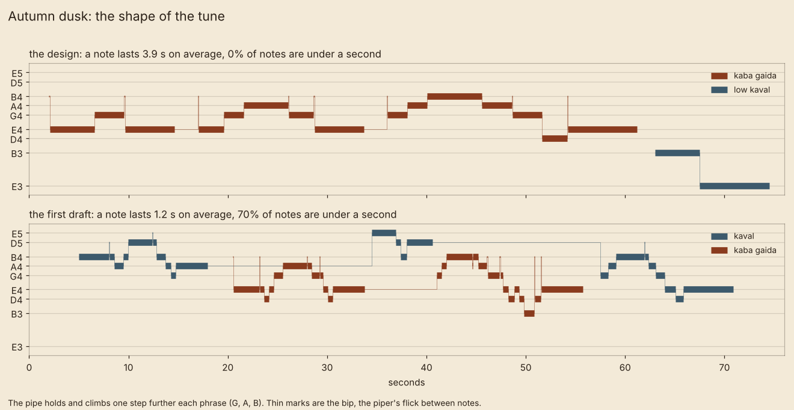
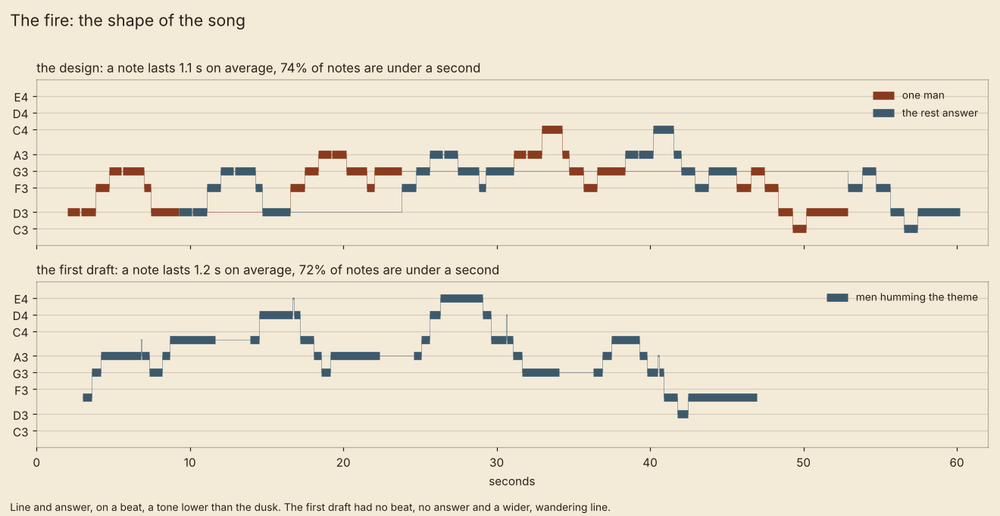

# 2026-11-11: The whole score in first draft, and the game plays it

**Area:** audio
**Who:** Dominic + Claude

## What happened

Dominic, at 07:57 UTC: "it's time to also start an agent ... on putting together all the music that we planned. So we
can get first draft of that. We should then be in a situation where we can get a very minimal demo, just men standing
around a camp with music playing."
([his words](../notes/2026-11-11-dominic-in-his-own-words.md#0757-on-finishing-the-environment-and-starting-the-music-voice-as-transcribed-in-chat))

Claude drafted every track of [the track list](../../docs/music-tracks.md) but one, and put them in the game. Done by
08:40 UTC.

**The tracks.** 23 of the 24, 33 minutes, in 26 files (the end strokes are four). All are written as text and made by
the music bench, as the sketches were: [`music/pieces/set_03_score.py`](../../music/pieces/set_03_score.py). The files
the game plays are in [`assets/audio/music/`](../../assets/audio/music/). They are not copied into `archive/audio/` as
the sketches were: that would put every track in the repo twice.

- *The ruins (17) were left out.* Dominic parked them on 2026-11-10 until there is more research into what "ancient"
  should sound like, so no third take was made.
- *The main theme is written.* Seven tracks were waiting on it. Four slow lines on five notes (E G A B D): a call that
  climbs to the fifth and stays there, an answer that comes to rest short of home, a turn that goes highest, and a
  last line that walks down home. Winter night is one man singing it alone; the fire is the men humming it; the intro
  opens out from one voice and is left hanging on the call; the homecoming walks it three times with more each time.
- *Sung tracks have a voice without words.* The bench can hold a vowel and slide between notes, no more. So winter
  night, the lament, the fire, the intro, the leaving and the homecoming show where a voice sits and what it sings.
  They need a singer, as the track list already said.
- *The Ottomans have their own sound*, as planned: a zurna (a new voice in the bench, a hard bright reed) over a second
  one holding the home note, a slower heavier drum, and a scale with a wide step in it that the men's music never uses.
- *Earlier reactions were followed.* Autumn day is spike 02 with the kaval nearer and a quiet low gaida drone under it,
  after "mist too soft now". Autumn dusk is the bagpipe sketch he liked, longer. Hiding has nothing evenly spaced in
  it, after the steady heartbeat was "repetitive". Spring morning is the quick tune he heard as "spring or morning".
  No calm track has low strings (they made the first piece "too Viking"); the ending has a soft pad of them, as the
  list allowed.

**Loops and levels**, two things the bench could not do before:

- A danger track starts on its first sound and goes round with no seam. What rings on past the end is laid over the
  start; drones and wind are faded across the join.
- Each track is brought to a loudness for its kind, so the game plays them all at one volume: calm at -27 dB by the
  bench's own measure, danger at -20, the homecoming at -19, the menu at -31.

**In the game.** The game swaps whole tracks, as decided (D-042). Which track goes with what is data
([`data/music.json`](../../data/music.json)); the code is [`src/smyana/music.lobster`](../../src/smyana/music.lobster).

- A calm track for the season and the hour plays through once, then the forest is left alone for 90 seconds.
- At night with a fire lit, the men's song takes turns with the season's night track.
- Danger cuts straight to its loop. When it ends a single drum stroke rings over the cut, then six seconds of
  silence, then the calm music from its beginning.
- When the men walk out of a place the calm music fades, since the next place may be another season.
- The homecoming plays at the end of the run.

Creel did not need changing: it can already play and stop a music file, and the turn-taking is the game's own. Creel's
music system (stems faded by a player's age) belongs to Age of Anything and is not used.

Nothing in the game raises danger yet, so with `debug` the keys 1 to 6 start each danger and 0 ends it.

**The minimal demo** he asked for:

```sh
./play.sh windowed leg:camp_look camp:29,31 hour:19 debug   # autumn dusk at the camp: gaida and kaval
./play.sh windowed leg:camp_look camp:29,31 hour:22 debug   # night: the men's song at the fire
```

## How it was checked

Claude can't hear. Every render was measured ([`music/measure.py`](../../music/measure.py)):

- *Notes.* Each calm track's energy sits on E, G, A, B and D and nowhere else. The danger tracks add F, and the
  Ottomans' track G sharp and C, as written.
- *The phone alarm.* Dominic heard long, hard, steady notes around 600 to 1300 Hz as "emergency alarm on phone". No
  calm track holds that band at full for more than a seventh of its length. The one to listen for is "leaving the
  village": 41% of its energy is in that band, because it is nothing but women's open voices.
- *Seams.* The jump across each loop's join is no bigger than the track's ordinary movement from one sample to the
  next, except where the loop starts on a drum blow, which is a jump by nature.
- *The swaps.* Run with no window and a pretend sound device, the game's music took its turns as described above: a
  summer day track, 90 seconds of nothing, the dusk track, a cut to bandits, a cut to the chase, a stroke, silence,
  calm again, the fire's song and then the autumn night track.
- *The camp.* The camp scene at 19h started "04_autumn_dusk" three seconds in.

What measuring can't say is whether any of it feels right. Nobody has heard these yet.

## Decisions

D-072 (Claude, open to Dominic): which calm track plays in which season and hour, and the 90 second gap.

## What is known to be thin

- Spring morning is 43 seconds and spring day 81: both shorter than planned.
- Nine calm tracks cover sixteen slots of season and hour, so dawn shares the day's track everywhere but spring, and
  summer night shares the dusk's.
- Only the homecoming is wired of the moments. The intro, the leaving, the lament, the ending and the menu have
  tracks and names in the data but nothing calls for them yet.
- No sounds of the world yet (wind, birds, the fire, the stream): the plan has most of the hour as those, and the
  silences between tracks are bare without them.

## Two hours later: "samey", and a design stage for every song

Dominic listened at 10:10 UTC, on AirPods, and sent five messages in a minute
([his words](../notes/2026-11-11-dominic-in-his-own-words.md#1010-on-hearing-the-first-draft-of-the-score-chat-five-messages-in-a-minute)):
autumn dusk and the fire were "samey", he heard "a lot of the same tones across them all", the Ottomans were "too
synth", "all the music though is basically pipe going up and down quick", and the one that matters most: "each song
needs a clear design stage. Like we did for 2D before 3D ... worry we're just churning out songs with not much
thoughts".

Claude had started to patch the sound (softer voices, other keys) and stopped: that would have been more churning.
Instead it counted what he heard. Of the 58 tune phrases in the first draft, every single move is to the next note of
the scale, and 65% of the notes last 0.9 seconds or less. 22 of the 23 tracks have the same home note. He heard all
of that by ear in a few minutes; the measuring done before he listened (right notes, levels, seams) had not looked
for it. It checked that each track was correct, not that the tracks differed.

What was made, by 10:40 UTC ([`docs/music-design.md`](../../docs/music-design.md)):

- **The design stage**, three steps: a sheet in plain words with a picture of the tune's shape; a "pencil" sketch,
  the tune alone on one plain sound; then the track.
- **Rules across the score**: each instrument has few homes, home notes move with the seasons, each track has a shape
  no neighbour has, and three spaces (at the fire, in the wood, across the valley).
- **Two sheets**, for the two tracks he compared.
  - *Autumn dusk*: one piper who holds and does not run. A note lasts almost four seconds, against 1.2.
    
    [`pencil sketch`](../audio/2026-11-11/01-music-pencil-sketch-autumn-dusk.ogg)
  - *The fire*: a song with a beat that one man starts and the others sing back, a tone lower, no instruments.
    
    [`pencil sketch`](../audio/2026-11-11/02-music-pencil-sketch-the-fire.ogg)

No track was changed. The first draft stays in the game as placeholders.

### Decisions

D-073 (Dominic): each song has a design stage before it is made.
