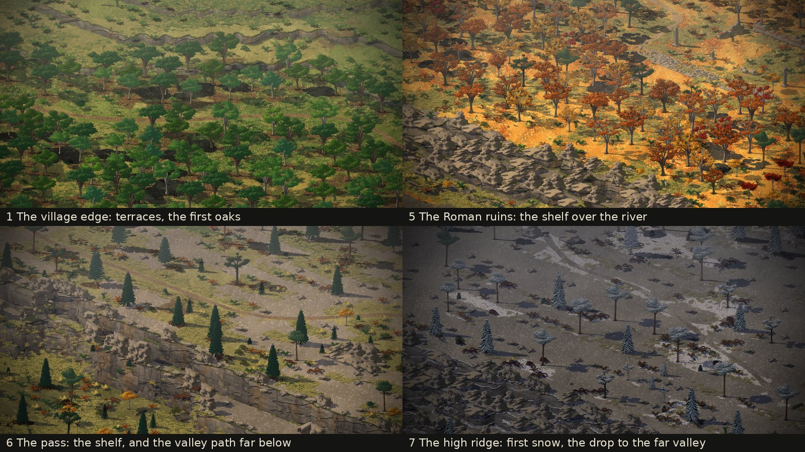

# The whole world grey-boxed (2026-11-11)

For phase 1's second half, issue #48 and its sub-issues #52 to #55 and #57. Made by Claude late on 2026-11-11 while
Dominic was away ("I won't be available to review. So continue to next phase once done as we discussed"). Decisions
D-077 to D-079.

## What was made

The four places the world plan (`docs/world.md`) still lacked, made by `tools/make_places.py` like the first three:

- **1 The village edge** (`village_edge`, 76 x 64 walkable tiles). The last lane out of the village. The village itself
  stands beyond the west gate as blocks: houses two levels up with bare stone roofs, either side of the lane. It is a
  set, seen and not walked. Three terraced fields climb the hill north of the trail, each a level above the last, with
  their walls wandering and no trees on them. The first trees are oak and hornbeam, with a beech standing in for the
  lime and the wild pear. A stream crosses at a ford. The run starts at the top of the lane, at dawn in late summer,
  and ends there in spring (picture 115).
- **5 The Roman ruins** (`ruins`, 76 x 76). A shelf above the river: the river runs east along the south edge on a
  floor four levels down, below a broken rock wall. The Roman road and its ruins (the props of #17) stand in a
  clearing on the shelf. The small clearing that held them until now is kept as `ruins_road`, for `leg:ruins_look`.
- **6 The pass** (`pass`, 108 x 44). This is D-076's set piece, built. The trail runs east on a shelf eight levels up,
  with crags above it to the north. To the south the shelf breaks off in one tall face, with a ledge part way down in
  places, to a valley floor at level 1 with its own path. Near the east gate a ramp climbs from the valley path up to
  the shelf, so in phase 2 the patrol can come up behind the men. The last trees thin out: Scots pine and spruce
  (pictures 113, 114).
- **7 The high ridge** (`ridge`, 108 x 76). Bare gneiss and grass, a rocky knoll to the north, few trees. It has one
  gate, in the west. The trail runs out east and bends south to a lookout. Below it the ridge breaks away in ledges of
  rock to the far valley, eight levels down, with a road across it that is seen and not walked.

`data/route.json` now has all 13 legs, from `village_out` to `village_home`. The gorge's east gate leads to the ruins,
not to the "season's work" beyond it (part of D-050 superseded), and the men turn for home on the ridge. The letters
between places are still Claude's placeholders, with new ones for the new walks. The last walk, down the lane, has no
letter: the run ends.

## How the maps are made now

`place()` takes a `land` function for a place with a shape of its own: it sets the levels and the ground, and can move
the trail and say where it ends (the ridge's stops at the lookout). Everything else is shared with the old places: the
trail, the stream and its ford, the rocks, the young clumps and the old trees. Every map now goes through a walk check
when it is written. A tile is walkable as Creel sees it: its ground is walkable and no tile round it stands higher than
its top. The check fails if any gate can't reach another. The first village failed in the game, not in the check: two
men were pushed onto a terrace beside the trail and stuck there. The terraces now keep five tiles clear of the trail
wherever it climbs.

Two new kinds of wood, so each height has its own trees until the new species come (#56): `oak` for the village edge
and `high` for the pass and the ridge (D-078).

## The walk, timed (#57)

`src/run_check.lobster` now walks the twenty men through all 13 legs in order and fails if any gate doesn't lead on.
On the way it fells a tree, digs at the landslide, mends the bridge, and walks out to the ridge's lookout. It prints
each leg's time:

| Leg | Place | Seconds in it | Loaded in (sim only) |
|---|---|---|---|
| 1 | Village edge | 76 | 0.003 s |
| 2 | Beech valley (and felling a tree) | 107 | 0.003 s |
| 3 | Deep fir woods (and digging at the landslide) | 217 | 0.004 s |
| 4 | Gorge (and mending the bridge) | 142 | 0.004 s |
| 5 | Roman ruins | 74 | 0.004 s |
| 6 | The pass | 104 | 0.003 s |
| 7 | High ridge (out to the lookout and back) | 206 | 0.005 s |
| 8 | The pass | 106 | 0.003 s |
| 9 | Roman ruins | 94 | 0.004 s |
| 10 | Gorge | 120 | 0.004 s |
| 11 | Deep fir woods | 130 | 0.004 s |
| 12 | Beech valley | 119 | 0.003 s |
| 13 | Village edge | 77 | 0.004 s |

Walking in all: about 26 minutes, against the plan's guess of about 21. The difference is the work on the way
and the walk out to the lookout. Every place is inside the size budget (128 x 96 tiles, 3,200 old trees). The loads
above are the sim's part only. The view's part (the ground, the crowns baked for the season) is printed by the game
as `loaded <leg> in ...` and must be timed on Dominic's Mac, as must the frame time in the heaviest map (#18): a cloud
session draws in software at about 10 fps.

## Not done

- The village is blocks. Its houses, and the homecoming, are the frame's (#51, #74 onward).
- No willows by the river, no alder, no dwarf mountain pine yet (#56, held: "Enough tree types for now"). Young
  spruces stand in for dwarf pine on the ridge.
- The far valley below the ridge is inside the map, eight levels down. Whether it reads as *far* at the game's camera
  is for Dominic to judge when he plays it. D-076 keeps a perspective trick in reserve.
- The valley path in the pass is there for the patrol, but there is no patrol yet (phase 2, #49).
- The view's load times and the frame time are still to be measured on a real machine (#57).
