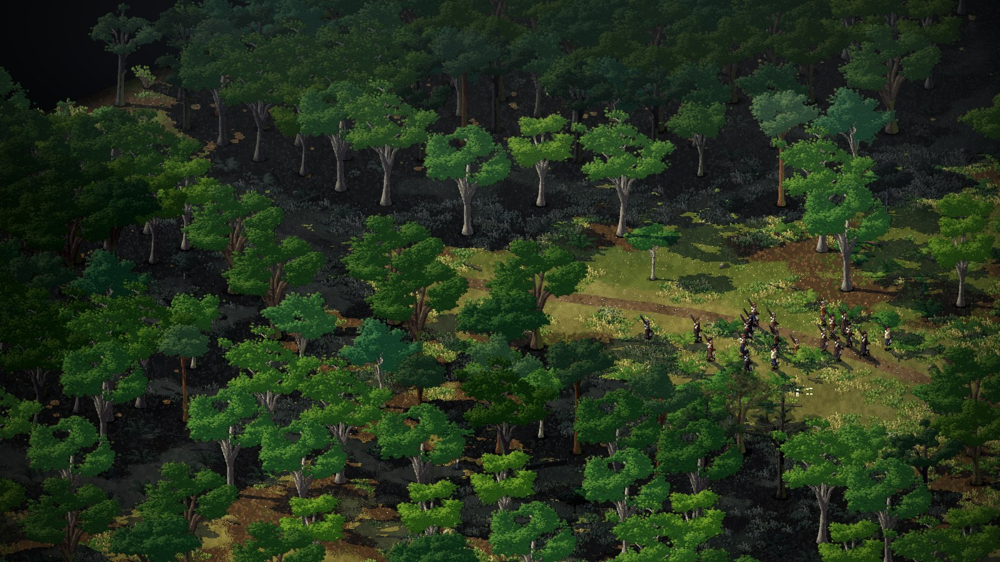
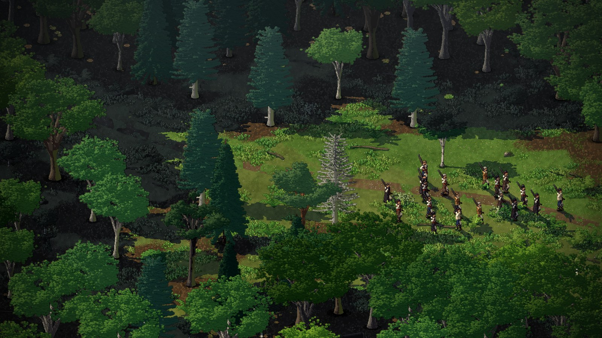
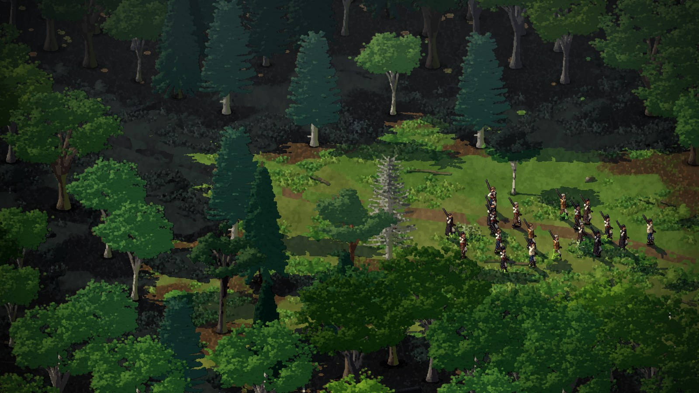
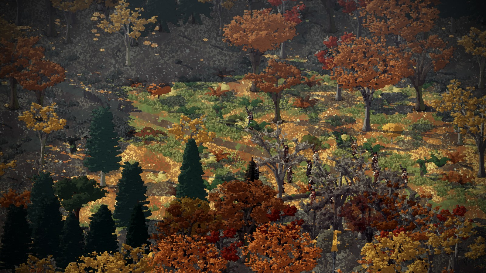
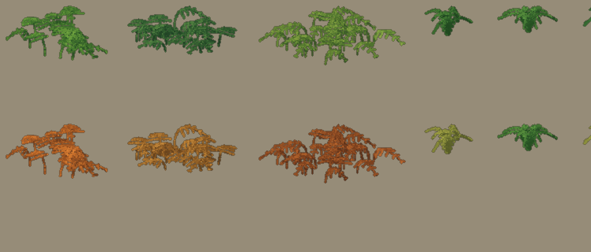
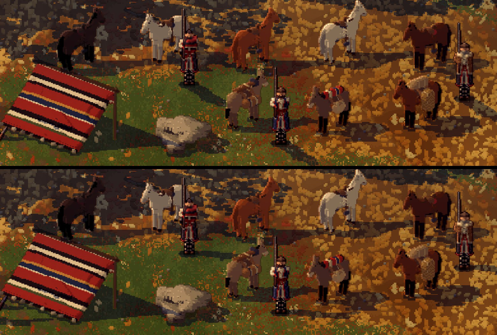
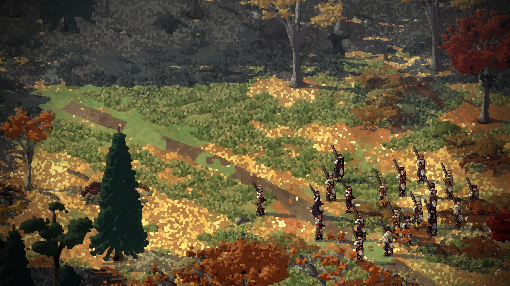
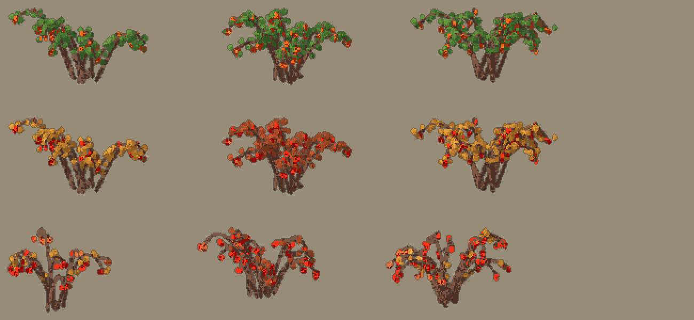
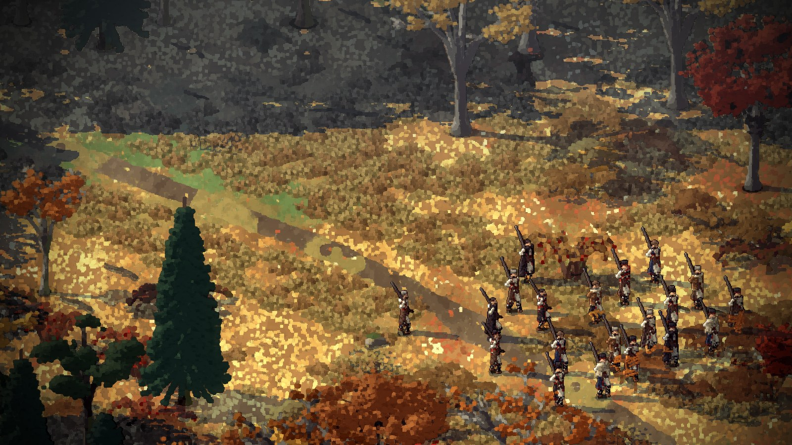
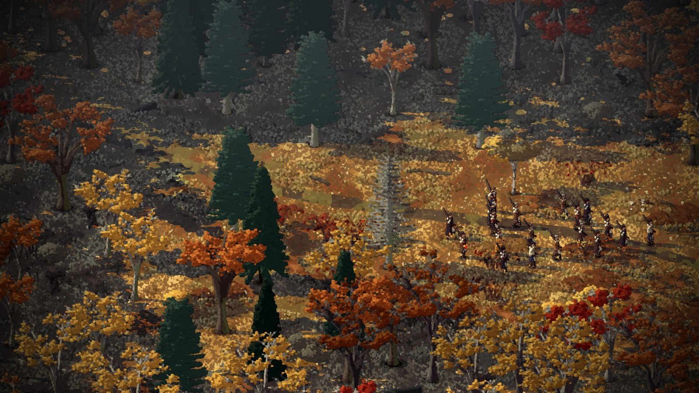

# Dense woods, green ground, and a softer picture

*2026-11-12, Claude. Answers Dominic's notes of the day
([notes](../notes/2026-11-12-dominic-forest-density-and-ferns.md)); plan in [`docs/woods.md`](../../docs/woods.md).*

A Bulgarian looking at the Roman ruins found the woods too sparse and the ground too dry; Dominic said the range
picture "looks like a little path through Africa". The plan went to `docs/woods.md` first, from his photos and the
sources on the Rhodope mixed forests.

## The woods grown (D-100)

`src/smyana/woods.lobster` grows a wood out from the trees each map draws, when the place loads: thick in clumps
(a smooth noise field), thinner between, a mantle of young trees at the edge toward the open, groups of trees in the
meadows, and the rim beyond play wooded. The trail, gates, camp, ruins, bridges and cliff edges are kept clear, and
any pocket of open ground the wood closes round is opened again from the gates. The numbers live in
`data/woods.json`. The run check needed a few fixes for the thicker wood: the patrol's road and the wolves' test now
snap to open ground.

## Green ground (D-101)

The grass is fresh green, going gold in autumn rather than straw. The first trail was dark earth; Dominic: "That new
path is much too hard… a path is not a single solid thing". It is now lighter worn earth with grass growing through
it (D-102).

## The right kind of tree (D-102)

Dominic liked the density but asked whether they were the right trees. The broadleaf crowns were a trunk with a flat
spreading top, the acacia outline. They now get a full dome of leaves round their branch tips. And the kinds grow in
stands, beech with patches of fir and spruce, as in the western Rhodope beech-fir woods, instead of a random mix.

## Watercolour (D-103)

He asked to try a filter "to make things smoother, less pixelated". Creel's atmosphere pass now has a `paint`
setting, a Kuwahara filter: each pixel takes the mean of the calmest of the four quadrants round it, so leaf noise
becomes soft patches and edges stay. The men are left sharp. At 0.5 it is gentle; at 1 it goes blotchy. It is on at
0.5 for him to judge.

Still to do from the plan: the shuttlecock ferns, bracken and polypody in place of the palm-like fern, and low cloud
on the slopes.

## The ferns, and the shadows (D-104, D-105)

The old fern was a stem of fronds radiating from one point, a palm. Now there are two. Bracken is a patch: a tile's
worth of fronds each arching up from the ground with a broad lacy blade. The first try held the blades flat on bare
stalks and read as mushrooms; arching them out of the ground fixed it. It grows in drifts in the light and goes rust
in autumn. The male fern is a shuttlecock of narrow fronds from a crown on the ground, in small groups under the wood
and by water and rock.

Dominic saw the men's shadows going a different way from the trees'. They were: down-right against left. The men's
way was worked out from the light with its downward part still in it, and squashed for a 30 degree camera when ours is
22. Now they agree.

## Rose hips and a true autumn (D-106, D-107)

Dominic's wife suggested rose hips. The dog rose is a mantle shrub of the Rhodope woods' edges, so it went there:
arching canes, small leaves, hips in clusters. In winter the bare canes with their red hips are the best of it.

Then Dominic: "Why would anything be green if it's autumn?" The green was ours: the meadow, herbs, tufts, one bush, a
fern. All of it turns now, and only the conifers stay green.

## Where the evergreens grow (D-108)

Dominic asked whether evergreens belong among the broadleaves. In the Rhodopes they do in one belt only: beech with
silver fir, around 1000 to 1500 m. Lower down, in the oak and hornbeam woods, there are only a few pines on rock.
Higher up, spruce and fir take over. Every beech wood had been getting a share of conifers wherever they fell. Now
the low places have none but pines on crags, and the beech valley keeps its firs in groups.

