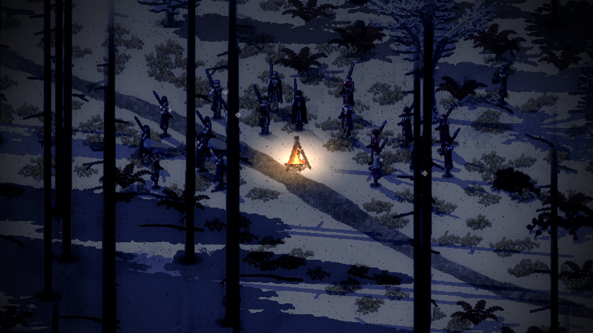
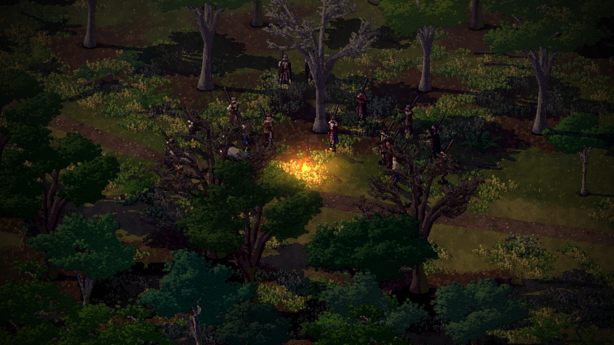
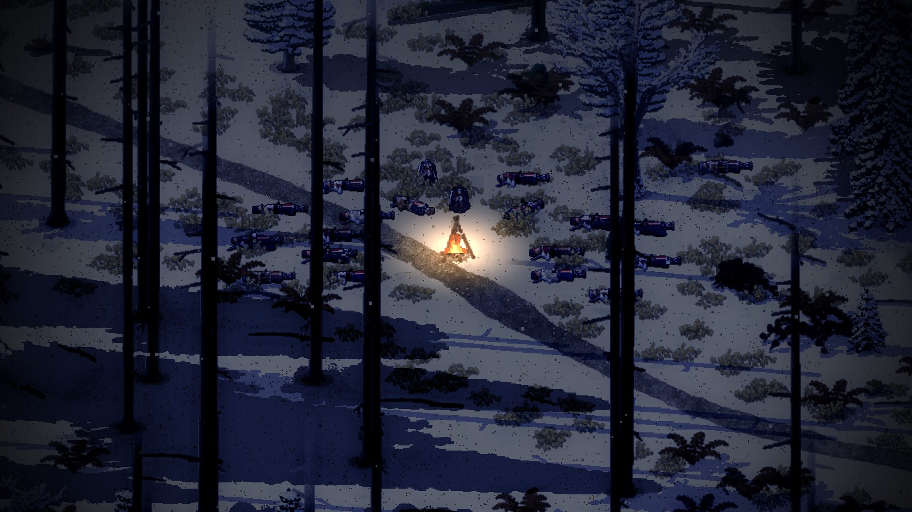
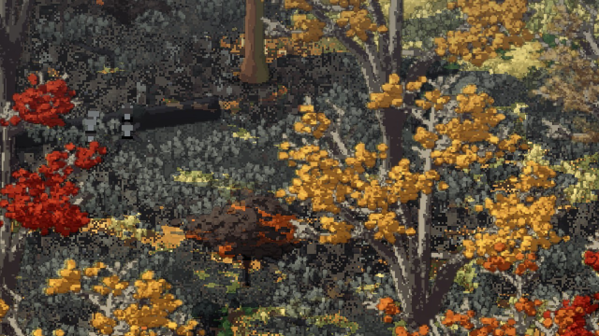
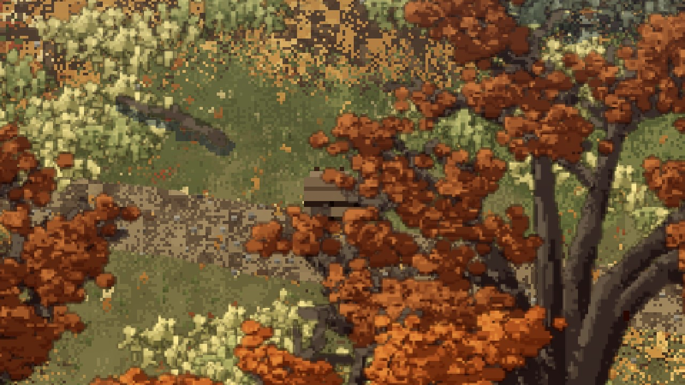
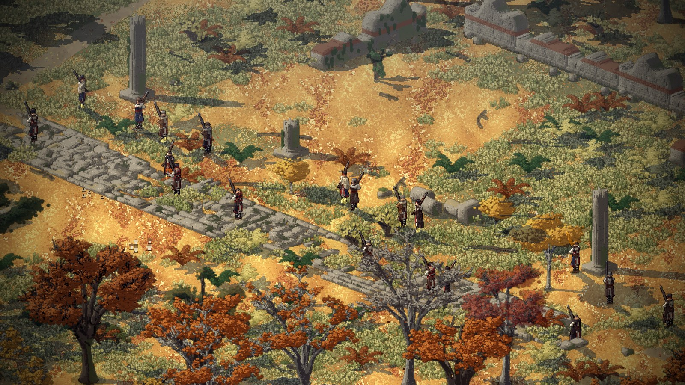

# The camp and the fire (2026-11-12)

Phase 3, resources and mechanics (#50), begun on 2026-11-12 from 15:17 UTC after Dominic's "next?"
([his words](../notes/2026-11-12-dominic-next-the-survival-phase.md)). Made by Claude. Decisions D-092 to D-094. No
Creel change was needed.

## Design first

As with the threats, a plan before building: [`docs/survival.md`](../../docs/survival.md). It turns D-009 ("every
night is a choice between eating and being found") into the needs, the camp and the fire, food by place and season,
packs and weight, caches, the Roman drain and the tally, each one read off the world rather than a meter, and an order
to build them in. Carts are proposed to be cut. Everything in it is a Proposal until Dominic agrees.

## What is in

- **The needs** (`src/smyana/survival.lobster`, numbers in `data/survival.json`): each man is fed, warm and rested,
  kept on him between places. They fall with the hours, the work, the load, the cold and the walks between places.
  Low, they slow him; run out, cold and hunger take his health, and a man can die of a winter night in the open. He
  lies where he fell, as a man shot does.
- **Making camp** is one key, C, with men chosen. They find the most open ground nearby, stand round the fire's far
  side and flanks, and lay it: two bundles of wood off their backs, or most of a minute finding dead wood. C again puts
  it out, or lights it again. At night they sleep round it, feet to the fire, and wake at first light or at a shot.
- **The meal**: the first camp after five in the evening, a portion each from their packs (they leave with four days'
  food), hot and filling at a lit fire, half as good cold.
- **The fire's danger**: the wolves keep seven tiles off it (and the winter pack won't rush a man inside that), a
  patrol sees it at night from far off through any cover and comes to look, and the bear smells a camp with food in
  it and wanders round it.
- **Reading the men**: their breath shows in cold air; a cold man shivers standing; in a camp they face the fire.
  With one man chosen his name shows at the bottom left with a few words on how he is.
- **For a look**: `cd src && lobster smyana.lobster -- leg:fir_woods_home makecamp hour:18.5 zoom:3.5` (the men make
  camp as the place opens; `fresh` keeps them from getting hungry, cold or tired). The run check spends a winter night
  in the fir woods with half the men round a fire and half out in the cold, and checks the camp sleeps, eats hot,
  stays warm and rests while the others don't, the wolves keep off the fire, and a patrol passing sixteen tiles off
  sees the fire and comes to look. The walk of the whole route is checked with the men kept fresh.

## Found on the way

- The first camp in the winter fir woods had the men scattered three or four tiles round a fire hidden behind a trunk:
  the ring round the fire ran into trees. Now the camp goes to the most open ground within four tiles, and a man whose
  place is a tree takes the nearest open ground to it.
- The first camp order from the look option included the wolves (every unit in the place) and so put the men in a
  muddle; orders now go to men only.
- The breath, drawn into the lit world, came out the same blue-grey as the snow and could not be seen. It is drawn over
  the lit picture now, a cool grey in the art's own pixels.

## Gathering (#66)

The second part, the same afternoon. `src/smyana/forage.lobster`: open ground (not trail, not bracken) has patches of
what the wood gives now, from `data/survival.json`'s "forage" by the map's wood and the season. Right-click a patch
with men chosen and each goes to the nearest free patch near it, stands on it six seconds, and puts its food (or its
herbs, as goods) into his pack. The place remembers what was taken. The run check sends four men to gather in the
autumn beeches and checks their food goes up, the patches go down, and stay down after leaving and coming back.

Found on the way: at first nothing could be seen. A tile is 96 pixels of art across, so a patch of a few pixels per
few dozen tiles was lost in the leaf litter and the undergrowth's tufts drew over it. The patches are now three times
as many, kept off bracken, drawn in front of their own tile's tufts, spread wider, with a dark pixel of shadow under
each thing so it stands off the litter. They are still quiet on purpose (no marker), and want a look from Dominic.

## Packs and caches (#67, #69)

The third part. `src/smyana/packs.lobster`: a pack holds twelve of food and goods; its weight takes up to about a
fifth off a man's pace. X drops the chosen men's packs in one pile (each keeps a day's food); right-click the pile to
share it back out. A pile is a cache: a patrol that would see a man lying there takes it, and the bear eats the food
in one. Each place keeps its piles. A fallen man's pack lies where he fell. For a look: `droppacks` puts the men's
packs down as the place opens and walks them on. The run check checks a full pack is slower, the drop keeps a day's
food each, the pick-up gives it all back, and a patrol walking past a pile in the open takes it.

## The Roman drain and the tally (#70, #72)

The fourth part. `src/smyana/knowledge.lobster`: right-click the ruins off the road and the chosen men spread along the
old road and study its drain; 24 hours of men's time learns it, kept between the two visits, and every man who gave an
hour of it knows it. The tally: the end screen now names each man who didn't come back and the place he lies in, what
the others carry home and how many know the drain. For a look: `leg:ruins_out study fresh look:48,45 zoom:2.5`. The
run check sends eight men to study, checks they learn it in about a minute and a half and the tally says so.

## Left for later

- A tired man sitting down when he stops needs a sitting pose (later, with the other poses).
- Barks for hunger and cold come with the voices (#51).
- Game to hunt with the rifle (roe deer, chamois), after the patches.
- The pack drawn on the man, bigger as it fills (only the wood bundle shows now).
- The men studying should face the road and crouch over the drain (a pose).
- Played as a whole run, the numbers (food, hunger, cold) need tuning by Dominic after playing.
