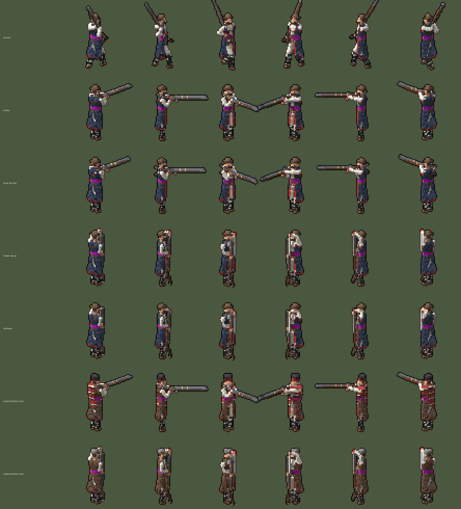
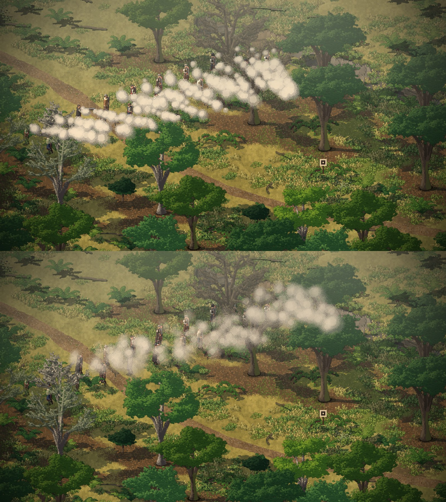
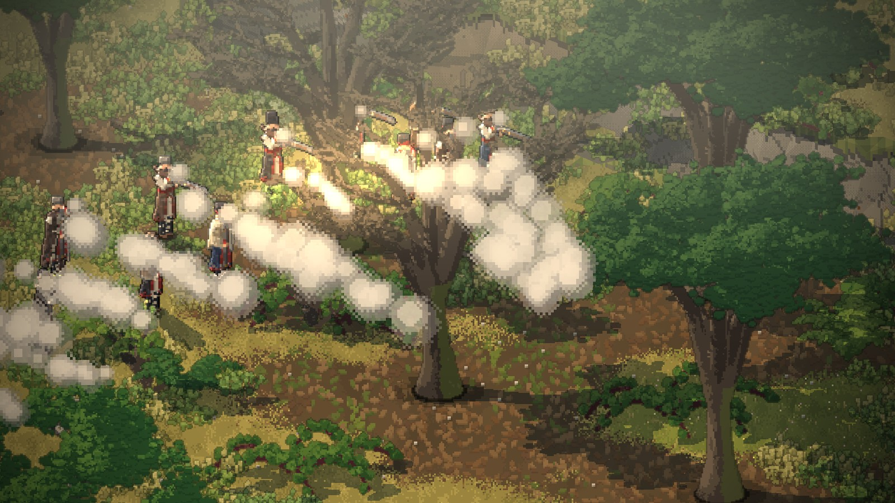
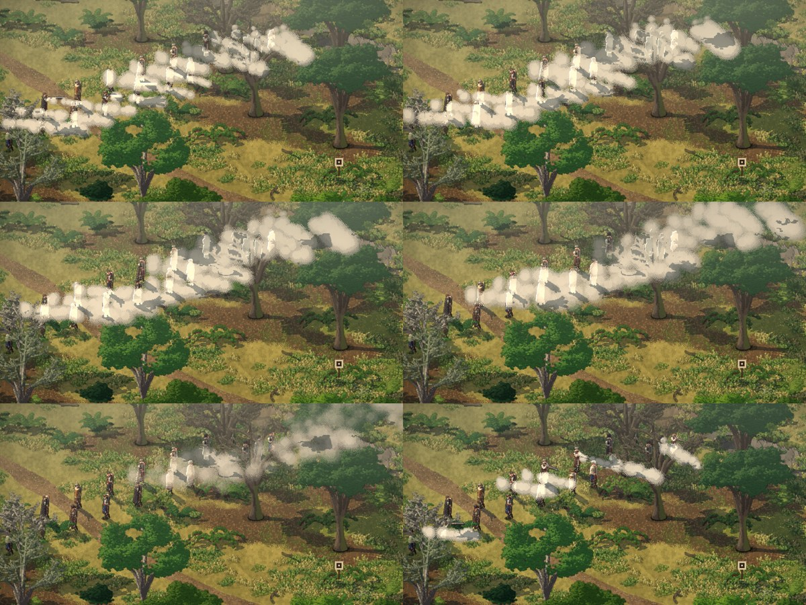
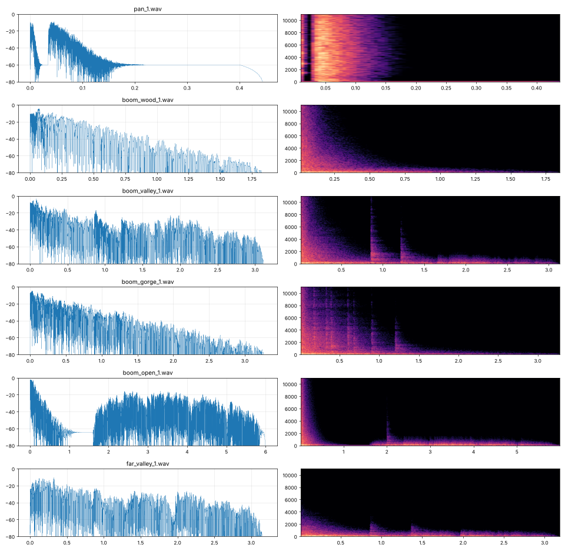

# The flintlock (2026-11-12)

Issue #58, the first of phase 2 (threats and the fight). Made by Claude on 2026-11-12, from 04:55 UTC, after Dominic's
"Let's start on the guns. And the risks phase after" ([his words](../notes/2026-11-12-dominic-the-guns.md)).
Decisions D-080 to D-083. Creel's part is [its own entry](../engine/2026-11-12-guns.md).

## What a shot is now

Right-click something to fire at (for now only the mark on the range) and each chosen man:

1. **Brings the rifle up in his own time**, one to four and a half seconds. Twenty men told at once go off one by
   one, never two in the same tick more than now and then (the run check counts it).
2. **The lock falls and the pan flashes**: a spark of light at his cheek, a fizzing hiss and a small puff out of the
   pan.
3. **A moment later the charge goes off**, 0.06 to 0.18 s after the pan, and one shot in twelve hangs fire for up to
   0.9 s. A tongue of flame at the muzzle and its light on the trees round him, the bang, the kick in his pose.
4. **The place answers.** Each map is a kind of place for the echo: the beech and fir woods are close wood (a thick,
   short, muffled roll), the village edge, ruins and pass are valley (one slap back off the far side, then a roll), the
   gorge is rock both sides (hard echoes back and forth), the ridge is open (dry, and seconds later the far valleys
   rolling it back, low). A shot far from the middle of the view is only the low far boom.
5. **Smoke.** A plume rolls out ahead of the muzzle, slows within a second, then swells into a cloud that hangs and
   drifts on the air: 26 s in the still wood, 18 in a valley, 10 on the windy ridge. It is drawn over the men, so after
   a few shots a line of men stands inside its own smoke and can hardly be seen (picture 31).
6. **The reload is long**: 18 s, plus up to 5 s more each time, each man his own. He stands the rifle up, pours the
   powder, draws the rod, rams the ball (the rod up and down in his pose), puts the rod back and cocks. Each has its
   own small sound, heard only near.

## How to see it

`lobster smyana.lobster -- leg:village_out range:14,50 look:16,50 zoom:2.5` puts the men in a loose line on that tile,
a mark (a pale board with a dark ring on a post) five tiles east, and tells them to fire. They keep firing until told
otherwise.

## How it's made

- **The rifle in the hand** (`data/voxel/gear.json`, `src/smyana/men_view.lobster`): the swallow-tail rifle's own
  `.vox` (from `art/men/`, made 2026-11-10) held in the right hand by three holds: on the shoulder, muzzle up and back,
  as the men walk; brought up to aim with the left hand under the barrel, kicking back on the shot; and stood upright
  for the reload, the rod in the left hand. Each man's sheet has four more poses: fire, aim, rod up, rod down.
- **The sounds** (`sound/flintlock.py`, numpy, like the music): every sound built from noise and sine waves, nothing
  recorded. The charge is a crack, a thump falling from about 110 to 45 Hz (black powder is low and boomy) and the gas
  roaring out after. Each place is a made echo: a tail that dies away, darker as it goes, and for the valley, gorge
  and ridge, echoes off things far away. 39 WAVs in `assets/audio/sfx`, 8 MB. Picture 34 is what they look like.
- **The sim** (`src/smyana/guns.lobster`): Creel's combat fires the shot. Smyana only sets each man's aim and stretches
  each reload, by a hash of his id and the tick, so a run plays the same every time.
- **The view** (`src/smyana/gunfire.lobster`): everything seen and heard, after the sim's shot event.

## Bugs on the way

- **The barrel vanished** when the rifle was carried at a slant: only the stock showed. The barrel is one voxel wide,
  and a model baked at an angle is sampled at its nearest cells, which step over it. The barrel and fore-stock got a
  thin capsule each over the model.
- **The smoke took the ground's shadows, and the men showed through it as white ghosts** (picture 33). The smoke was lit
  by the shade under it, and where it covered a man it was lit as a man is (kept readable). The smoke now wipes the
  shade buffer where it lies, as a tree does.
- **No shot was ever seen**: setting up a place turns the sim's events off. Each place now turns them back on.

## Not done, or not known

- **Nobody has heard it.** The cloud session has no sound device, so the sounds were judged by their pictures and
  numbers only (picture 34). Listening reels are in the project's files (`smyana-guns/`). The panning, and how loud
  the guns are beside the music, need a listen on Dominic's Mac.
- The puffs still read as balls when fresh; the hanging cloud reads better than the plume.
- Only the men fire. The enemy (the next thread: wolves, the bear, the patrol) will need their own guns and the
  bullets' hits.
- Nothing stops a man walking while he reloads; he walks with the rifle on his shoulder and is ready when the time is
  up.

