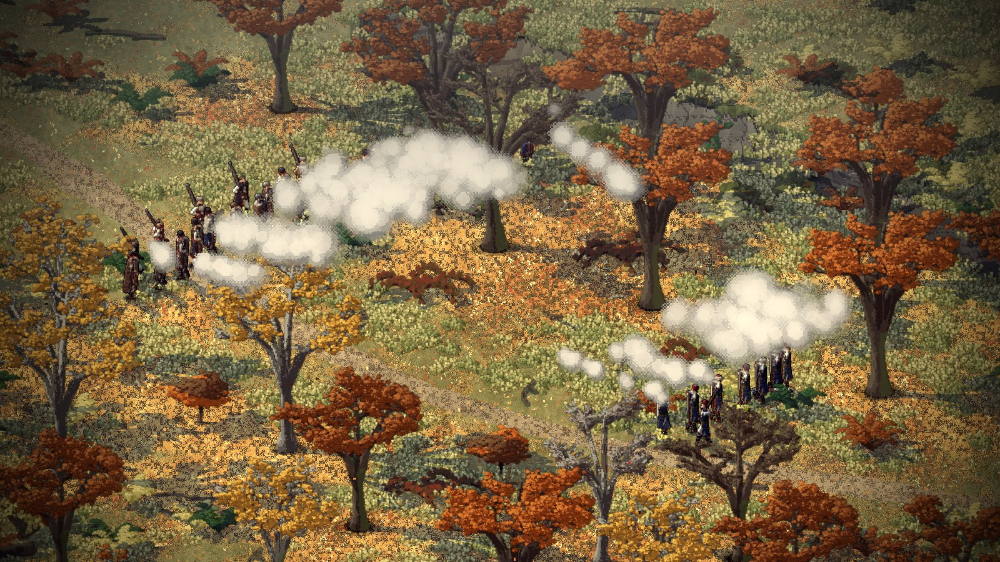
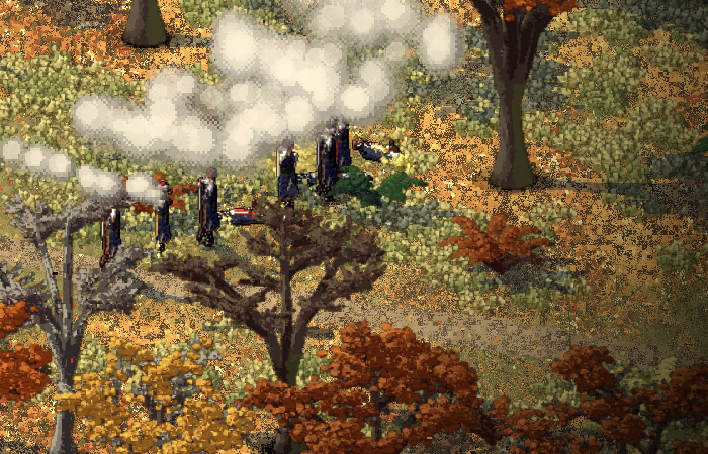
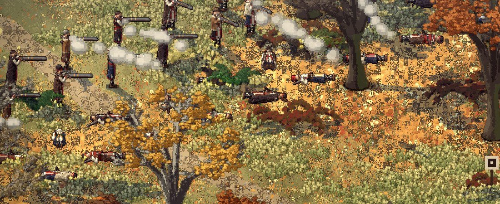

# The patrol and the fight (2026-11-12)

Phase 2's threats, after the flintlock. Made by Claude on 2026-11-12 from 05:30 UTC, from Dominic's "Let's start on
the guns. And the risks phase after" ([his words](../notes/2026-11-12-dominic-the-guns.md)), with the issues #49, #60
to #64 as the brief. Decisions D-085 to D-088. No Creel change was needed: Creel's hooks (a ball landing, a death) and
its commands were enough.

## Design first

Before building, a short plan: [`docs/threats.md`](../../docs/threats.md). What every threat shares (found only by
cover, a shot gives you away, a small mind of four states, music by state, hits seen and never counted, flintlocks
that miss), then the patrol, the wolves and the bear one by one, and the order to build them in. The patrol came first
because of what Dominic said on 2026-11-11: "All that matters is some fighting vs people that also have guns".

## What is in

- **The patrol's men** are our men's voxel rig with four new looks (`art/men/tools/men.py`: a red felt fez with a
  black tassel, a turban's white cloth wound round a fez, the zaptiye's dark blue coat with brass), drawn with a green
  sash where the men wear red. They carry the same long flintlock and reload as slowly.
- **Their mind** (`src/smyana/threats.lobster`): they walk a road. A shot heard sends them to look near where it came
  from (a few tiles off, they only guess). A man seen, by the cover check, or through his cover while his smoke hangs,
  is fired at, each patrolman bringing his rifle up in his own time. A man lost behind a trunk is kept on for six
  seconds, then they close in on where they last saw one. Forty seconds with nobody seen and they search, then go back
  to the road. When half are down they fall back the way they came and leave.
- **How a ball lands** (Creel's `hook_on_hit`): a miss throws up a little earth (snow where snow lies) beside the
  man; a hit is a puff off his coat. The first hit wounds (he walks slower), the second kills.
- **The fallen** lie on their backs where they were hit, feet where they stood, head away from who shot them: a new
  pose baked with the rest, the standing man turned a quarter onto the ground.
- **The men** fire only when told. Then each keeps at it, turning to the next enemy he can see when his falls or is
  hidden, until he is told to walk.
- **The music** goes to "wary" when a patrol has heard something, to the Ottomans' loop when it has seen the men, and
  at the end to the end stroke, or the short lament if a man fell.
- **A bench**: `cd src && lobster smyana.lobster -- leg:village_out fight:14,50,9 ambush look:17,50 zoom:2.5 year:1050 hour:15`
  (nine patrolmen down a road past the men; with `ambush` the men open fire when the first is seven tiles off).
  `fallen` lays one beside each man, turned every way, for a look. The run check plays a fight in the beech valley
  with no window and checks both sides fire, balls hit and miss, men fall, the music turns and the patrol breaks.

## Bugs on the way

- **Every fallen man lay feet to the camera** (picture 41): the way he lay was read from the view's memory of which
  way each man faced, which is cleared when a place opens. Now the sim keeps where the fatal shot came from, and he
  falls away from it (picture 40).
- **Half the patrol stood still at its start**: set down in a file behind the road's first point, some were in a
  pocket of the wood with no way out to the road. They are now set down only on ground that walks through to the road.
- **The patrol hardly fired**: a patrolman who lost sight of his man for a moment was given a new order, and each new
  order meant bringing the rifle up again. Now he keeps on the man he was firing at for six seconds after losing him.
- **A wounded man slowed the whole column on the walk** (the run check's hurt man made the walk 13 minutes longer):
  only a man hit by a ball walks slowly now, not any man short of health.

## Left for next

- The patrol in the pass (leg 8, the set piece): following the men up from the valley path (D-076, D-077).
- The wolves (#60), then the bear (#61). A man's death beyond falling (#64): what is left, his name kept.
- Sounds: nothing new is heard when a ball lands or a man is hit, and the patrol has no voices yet.
- Whether some of the patrol ride, as on the ridge (D-084), and whether they take prisoners (#62).
