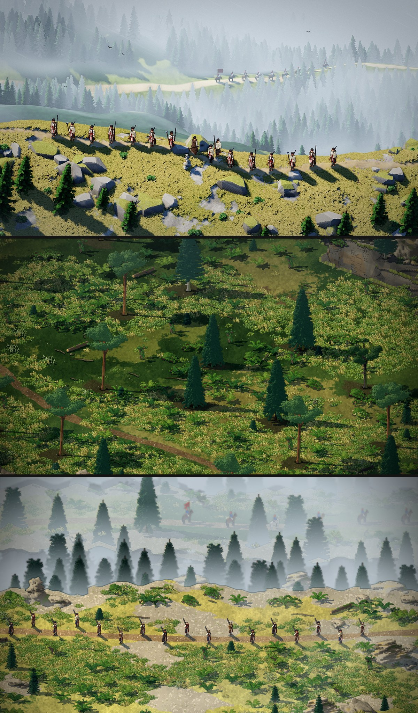
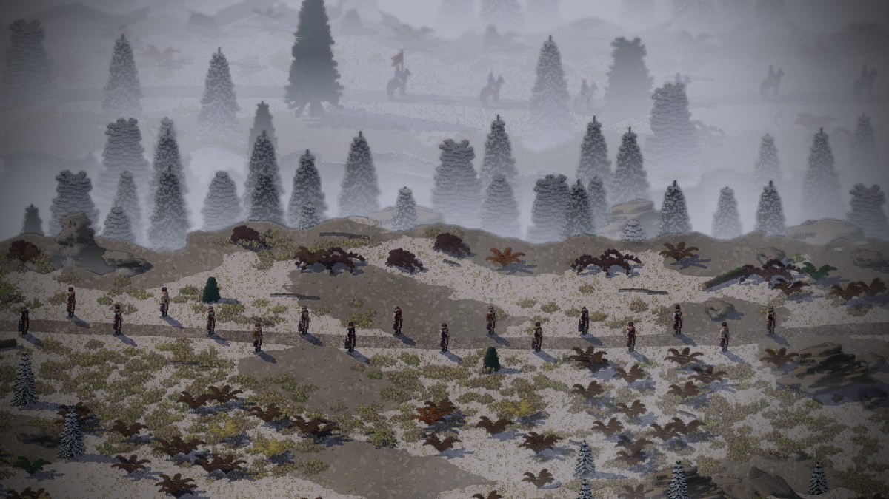

# The ridge in fog

2026-11-12. Claude, from Dominic's ask ([his words](../notes/2026-11-12-dominic-the-ridge-scene.md)): make the high
ridge look like its mock-up, with the map, fog and camera together.

## What was wrong

The grey-boxed ridge (D-077) was a flat lookout with its drop running straight up the screen, so the far valley was
seen from above, not across. Nothing in the valley was softer than the men, and the valley's trees drew over the
ridge's edge, because Smyana sorted its sprites by where they stood on the screen and not on the ground.

## What changed

- **The map lies on the diagonal.** The trail runs left to right across the picture, the rim follows it a few tiles
  behind, and the ground falls away in cliffs (Creel's ramps zigzag on a diagonal, so cliffs read better). Below is a
  spruce valley, then a shelf with the far road, then a second fogged valley at the top of the picture.
- **Low fog** (a new Creel option, see [the engine note](../engine/2026-11-12-low-fog.md)): fog that lies in the
  valleys, by the height of each pixel, with a top that drifts. The ridge stays clear and sunlit; the valley's trees
  stand out of the fog by their tops.
- **The hill's near edge hides what is behind it.** Smyana now uses Creel's occluders and sorts by where a thing
  stands on the ground, as Creel does. The ridge asks for five rows of near edge (`"occlude": 5`).
- **The patrol.** Seven riders on the far road with a red swallow-tailed banner (a new camp model, `rider_banner`).
  They are not marked like the men, so the fog takes them too: dark shapes, and the banner the one bright thing.
- **Only spruce and fir** on this map (`"spruce": 1`): the round pines and young beeches read as umbrellas on the rim.
- `file:<x>,<y>` for a look: the men stand in single file on the trail near that point.

## Left

A brown patch on the ridge top near the rim, source not found. The fog is set per mood in `data/atmosphere.json`
(`low_fog`, `low_fog_colour`, `low_fog_drift`) and per map (`"low_fog": [top, depth]` in levels, and a `"light"` block
added after the weather); both are first guesses for Dominic to judge.
