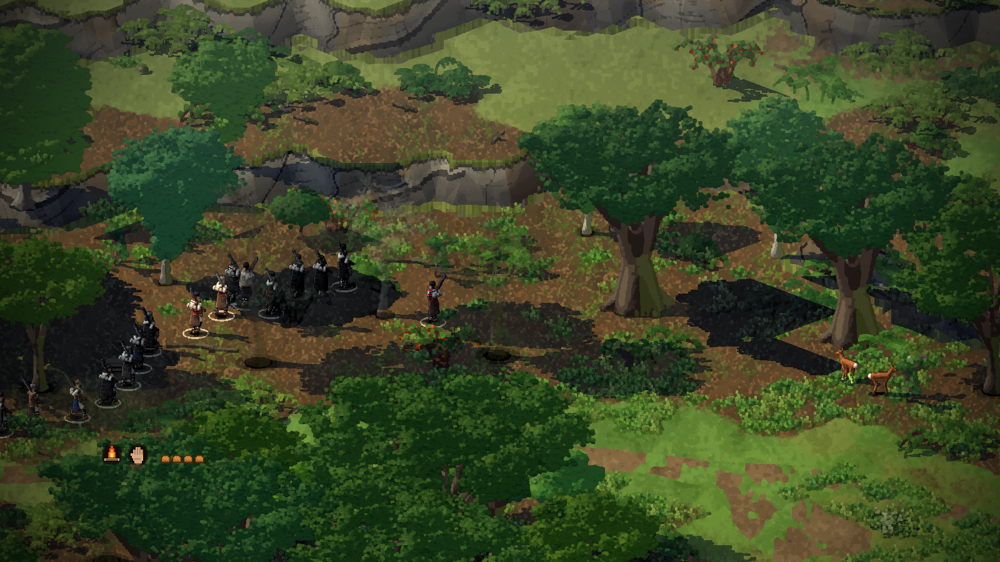

# The fourth first-time play, and what it found (2026-11-23, evening)

Dominic, 17:23: "Please dont ever wait for me, can wait async". So the work went on from his sound notes into the
next agent play without stopping (report: `archive/playtests/2026-11-23-04-first-time-player.md`). 118 steps, 22
minutes of game clock, three camps; the player never left the village edge and would have quit at about ten minutes.
All of what follows is Claude's work and Claude's calls.

## Men who answer and do not move (D-151)

For nearly two minutes about fifteen men said "hm" to every order and stood, until Halt. The third play had the same.
No `deaf:` line was printed, so the game thought the order had been taken. Read in Creel: a move to within five tiles
of where a block of men was last sent is dropped as the same order again, even if the block arrived long ago. Halt
clears the block. Every walk order of ours now goes through `send_men`, which takes a standing man out of his block
first. Not yet seen cured in play.

## The night (D-150, then D-153)

First try: the clock ran at 800 once all slept. The bot then lost every man on seed 1 and brought 9 home on seed 2
(11 and 12 before). Three copies of the game side by side on seed 1: fast clock only, 0 home; `send_men` only, 12;
neither, 16. The wood's game and food come back by the tick, so short nights starve the country. Second try, kept:
the whole game runs four times faster while every man sleeps. In the harness the night from 21h to 4h went by in
about a third of the real time of a day step.

## Smaller things (D-152)

- The menu plays its own track (it never had); 70 seconds of quiet between calm tracks, ended early by a turn of the
  light; the woodpecker calls every 40 to 200 seconds, not 25 to 70.
- "That is the last of the bread" was said when the packs were set down: the count now takes in the packs.
- The red-hipped dog roses are bushes, not stands, and both first-time players went to them first. A man now says
  why there is nothing to pick. No stand was found in 22 minutes: there are two strawberry patches and one of herbs
  at the village edge, none near the start. Open.
- A later morning still at the village edge, a man says which way again.

## Left open

The day is 4:20 of light and both players felt they got nowhere; the day's length is not changed, since the balance
moved a long way on a change to the night alone. Black beyond the map's edge. Nights too dark to find one's own
camp. Drags that chose nobody twice (seen again in the harness under load; may be the harness).

## Music draft 2 begins: summer day (D-154)

Two days ahead of the plan. The first of the calm tracks to be remade is the one heard first and most. Its sheet is
in `docs/music-design.md`; the tune is a plucked lute walking at 80 steps a minute with leaps of a fifth and notes
said twice, and a far kaval answering in the two places the walk stops or thins. Measured, not heard: 15 leaps
against the first draft's 2. Sent to Dominic with its pencil sketch.

## The fifth play (late night)

Report: `archive/playtests/2026-11-23-05-first-time-player.md`. 21 minutes, 118 steps. The player reached the beech
valley at 9:12 (the first to leave the village edge), gathered the strawberries in the first minute, liked the dog
rose's line, and had no long spell of men deaf to orders: one 20-second stand at dusk, cause unknown, and five
"No way through there" at the rock ledges of the village edge, where the men were right but the ledges do not read
as walls. It would still have stopped at about 13 minutes: "nothing happened to me except walking and sleeping".
That is Friday's work in the plan (the first ten minutes), and the biggest thing left.

Fixed the same night (Claude): hands gathering and the knife sound every second or two, not every frame (66 in six
seconds); no calm track begun in the last minute and a half before the light turns; rain's sound only once rain can
be seen; a click on empty ground keeps the men chosen (Escape lets go); no edge scrolling while a box is dragged; the
owl from half past seven in the evening; a man says what the gathering came to, and says to make a fire when it is
dark with no camp; the bare dog rose's line no longer breaks the summer one's promise.

Left: the afternoon lost in the walk between places (five hours by design, so the player arrives at dusk); the lane
lost under the crowns; nothing to hover on the loaves; the icons move with the men.

## Later: wolves a long way off, and spring (Claude)

Play 5's hardest word was that nothing happens in the first twenty minutes. A first small answer, ahead of Friday's
work on the opening: on the first night, once a fire is lit and it is past half past ten, wolves howl twice a long way
off and one man says so ("Wolves. A long way off yet. They keep clear of a fire.", Claude's placeholder). Nothing
comes; it only tells the player what the wood holds and what the fire is for. Seen in the harness at 5:16 of play.

Spring day was remade too (D-160): summer's walking tune a fourth up and quicker, with the theme's third and fourth
lines on a low kaval, the lines winter's hum never reached. Unheard by Dominic yet.

## Later still: the fire and the Ottomans (Claude)

The fire song was made from its sheet of 11 November (D-161): one man hums a line, the others hum it back, a stick
knocks on a log. Then the Ottomans (D-162), the one track Dominic had named: "too synth". The answer is distance:
the drum stays close and the pipe goes across the valley. Both unheard by him. With these the calm score and the
named danger track are through the design stage; wary, hiding, beasts, bandits and the chase are still first drafts.

## Something to meet (Claude)

The village edge had one herd of roe, and it stood at the end of a side path that no first-time player has yet
walked. It now stands beside the trail about two and a half minutes in (D-163). In a hand play on seed 1 a man said
"Roe deer, there among the trees" at 2:39, though the deer were just past the screen's edge, so the words now wait
until the deer are in the picture.

