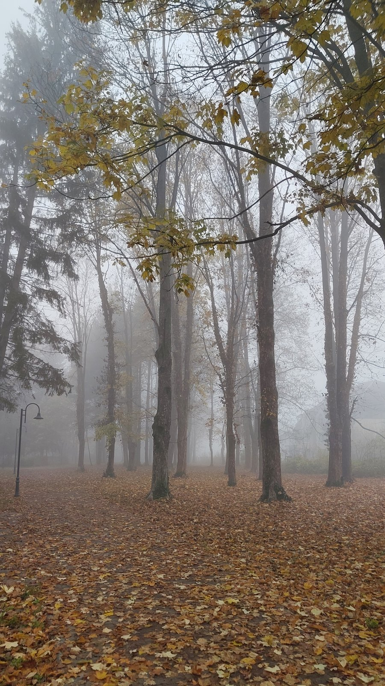

# Dominic on the ridge scene, 2026-11-12

Kept word for word. Written in the project chat, about the ridge mock-up from 2026-11-10
([picture](../images/2026-11-10/21-route-ridge.jpg)).

**04:47 UTC:**

> This was our design for ridge. I think mixture of map, fog and camera angle needed to make it work. Thoughts?

Claude proposed: the men's ridge as a raised shelf with the far road a level below and a clear drop; height fog in the
valley so the far trees and riders fade grey-blue while the ridge stays crisp and sunlit; the lower, longer camera
(22 degrees, the game's own setting) looking across the valley; the riders read as dark shapes with a red banner.

**04:48 UTC:**

> Yes, important for the atmosphere

**06:25 UTC:** a photo, with no words: a real autumn wood in fog, tall dark trunks fading to grey-white within a few
rows, yellow maple leaves overhead, a thick orange-brown leaf floor. Taken as the mood reference for how mist eats
depth among the trees.

