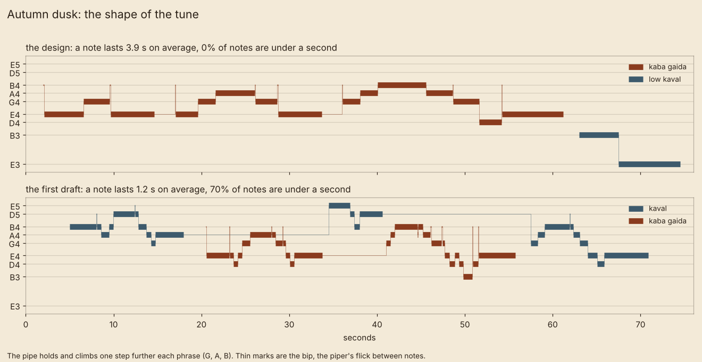
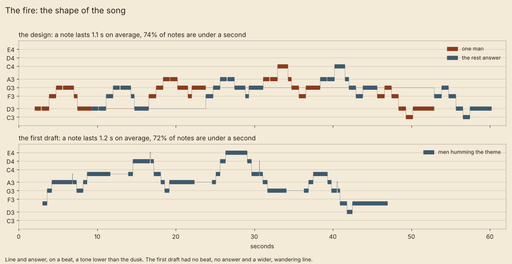

# Designing each song before it is made

Status: **Proposal** by Claude, 2026-11-11, after Dominic heard the first draft of the score. The rule itself is his
(D-060): "each song needs a clear design stage. Like we did for 2D before 3D". How the stage works, and the two
sheets below, are for him to change or agree.

## What he heard, and what the measurements say

His words on the first draft (2026-11-11, 10:10 UTC):

> autumn dusk and the fire bit samey. I worrry the trumpet type instrument and pipes are over used or just too flat?
> im listening with airpods and hearing a lot of the same tones across them all

> worry we're just churning out songs with not much thoughts

> ottomans sounds too synth

> all the music though is basically pipe going up and down quick

He is right, and it can be counted. Across the 58 tune phrases written for the first draft:

| What | Measured | What it means |
|---|---|---|
| How a tune moves | **Every** move, 100%, is to the next note of the scale. No leaps, no note said twice. | One shape: a line running up and down the steps. "Pipe going up and down quick." |
| How long notes last | 65% are 0.9 seconds or shorter. | Even the slow tracks are busy. |
| Key | 22 of 23 tracks have E as home, and most the same five notes. | "The same tones across them all." |
| Where the sound sits | Autumn dusk, the intro and summer day each have about two thirds of their energy in one band, 300 to 600 Hz. | The lead is always in the same octave. |
| Loud and soft | Most tracks move only 9 to 11 dB between quiet and loud passages. | "Too flat": nothing swells or drops away. |
| Space | Nearly every track has the same long valley echo. | A camp fire sounds as far off as a ridge. |

The "trumpet type instrument" is most likely the bench's open singing voice: a bright buzz with fixed peaks, in four
of the six tracks he was sent. The zurna is a bare buzz of the same family, which is why the Ottomans sound "too
synth".

The cause is the one he named. The tracks were written one after another from the same habits, with no step where
each was given an idea of its own.

## The design stage

Before any track is made, it has a sheet, and the sheet is agreed. Three steps, each cheap to throw away:

1. **The sheet.** A page of plain words and one picture. No sound.
2. **The pencil sketch.** The tune alone on one plain sound, under a minute, with no arrangement. It answers one
   question: is this shape right? This is the 2D drawing.
3. **The track.** Only after the sketch is liked: instruments, space, length. This is the 3D model.

What a sheet must settle:

| | Question |
|---|---|
| **Where** | When is it heard in the game, and what is on the screen? |
| **The one idea** | One sentence. If it fits another track too, it is not an idea yet. |
| **Shape** | How does the tune move: held or quick, steps or leaps, with a beat or free? Drawn as a picture. |
| **Who plays, who doesn't** | Instruments, and the ones kept out so that they mean something elsewhere. |
| **Home note and range** | Its key, and how high and low it goes. |
| **Space** | Close and dry, or far and echoing. |
| **Loud and soft** | Where it swells and where it nearly stops. |
| **Not like** | The tracks heard next to it in the game, and how it differs from each. |
| **Real model** | The kind of Rhodope music it leans on (from `rhodope-music-style.md`), so it isn't invented from nothing. |
| **Open** | What only hearing it, or Dominic, can answer. |

## Rules across the whole score

So that tracks differ by design and not by luck:

- **Each instrument has few homes.** The kaba gaida leads in autumn dusk, the bandits and the homecoming, and nowhere
  else. If it is everywhere, the homecoming's hundred pipes mean nothing.
- **Home notes move with the seasons** (a proposal): summer on G, autumn on E (the gaida's own note), winter lower on
  D, spring back up on A. The men's own singing sits on D.
- **Each track has a shape no neighbour has**: held notes, or a leap, or a beat, or a line and its answer, or silence.
- **Three spaces**: at the fire (close, almost no echo), in the wood (some), across the valley (the long echo). Each
  track picks one.
- **The synthesised sound stays** for the men's instruments (he likes its "tangerine dream feel"), but the voices and
  the zurna are where it fails. Those need a real singer or player, or a different idea.

## Sheet: autumn dusk

| | |
|---|---|
| **Where** | Autumn, 18h to 21h. The light goes orange, the men make camp. The poster-boy season. |
| **The one idea** | One piper at the camp plays as slowly as he can: the pipe holds, it does not run. |
| **Shape** | Three phrases. Each starts on the home note and climbs one step further than the last (to G, then A, then B) before sinking back. A note lasts almost four seconds on average, against 1.2 in the first draft; none is under a second. The only ornament is the "bip", the flick that parts two notes. |
| **Who plays** | Kaba gaida and its drone. A low kaval once, at the very end: two notes, a leap down a fifth, the only leap in the piece. |
| **Who doesn't** | No voices, no humming, no tambura, no high kaval, no haze of soft high notes. |
| **Home note and range** | E. The pipe stays between D and B, inside its real range. The kaval ends an octave below it. |
| **Space** | In the wood, near: a little echo. He is at this fire, not across the valley. |
| **Loud and soft** | A bagpipe can't play louder or softer, so the swell is the climb itself. The drone drops out for the kaval's two notes. |
| **Not like** | *Autumn day* (kaval far off in mist, men humming, no pipe). *The fire* (voices, a beat, a lower key). *Autumn night* (a fiddle, long silences). |
| **Real model** | The kaba gaida playing a slow song in free rhythm, plain and calm, as older players did. |
| **Open** | Is this too still to carry two minutes? Does the bench's pipe hold up when it has nowhere to hide? |

Pencil sketch (the pipe, its drone and the kaval's two notes, nothing else):
[`01-music-pencil-sketch-autumn-dusk.ogg`](../archive/audio/2026-11-11/01-music-pencil-sketch-autumn-dusk.ogg)

## Sheet: the fire

| | |
|---|---|
| **Where** | Night, at the camp, the fire lit. Sung in the world by the men on the screen. |
| **The one idea** | A song with a beat that one man starts and the others sing back. |
| **Shape** | Four lines. One man sings each, then all repeat it. One note to a syllable, some notes said twice, a steady slow walk of 66 beats a minute. The first draft had no beat, no answer and a line that wandered over an octave. |
| **Who sings** | One man, then all of them in rough unison. Somebody knocks a stick on a log every four beats. |
| **Who doesn't** | No instruments at all. No pipe, no kaval, no drone. |
| **Home note and range** | D, a tone below the dusk. Five notes of range (C to C), so tired men can sing it. |
| **Space** | At the fire: close and dry. The crackle of the fire belongs under it. |
| **Loud and soft** | One voice, then many: every line is quiet and then full. |
| **Not like** | *Autumn dusk* (one pipe, no beat, no voices, a tone higher). *Winter night* (one voice alone, no beat, no answer). |
| **Real model** | "A soloist sings, the others repeat together", the usual way a Rhodope song is led (Levy), and the working-bee songs sung in company. |
| **Open** | Is this the main theme in a plain form, or a song of its own? This sheet assumes its own; the theme needs a sheet first. And it wants real men's voices: this is the easiest track to record ourselves. |

Pencil sketch (hummed, since the bench can't sing words; one voice, then five, and the knock):
[`02-music-pencil-sketch-the-fire.ogg`](../archive/audio/2026-11-11/02-music-pencil-sketch-the-fire.ogg)

## What comes next

1. Dominic hears the two pencil sketches and reads the two sheets. Is the stage right, and are these two shapes?
2. **The main theme gets a sheet next.** Seven tracks borrow it, and its first version has the fault of everything
   else: all steps, mostly quick.
3. Then one sheet at a time, in the order the demo needs them. Nothing is arranged until its sketch is liked.
4. The Ottomans' sheet has to answer "too synth" with an idea, not a better buzz: perhaps the drum alone, close, and
   the pipe only as a far echo, or a real recording.

The first draft's tracks stay in the game as placeholders until each is replaced.

Made by [`music/pieces/design_sketches.py`](../music/pieces/design_sketches.py).
