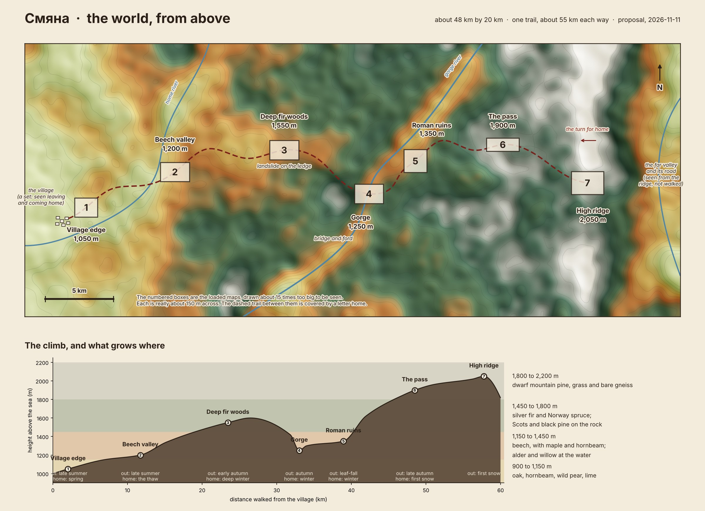
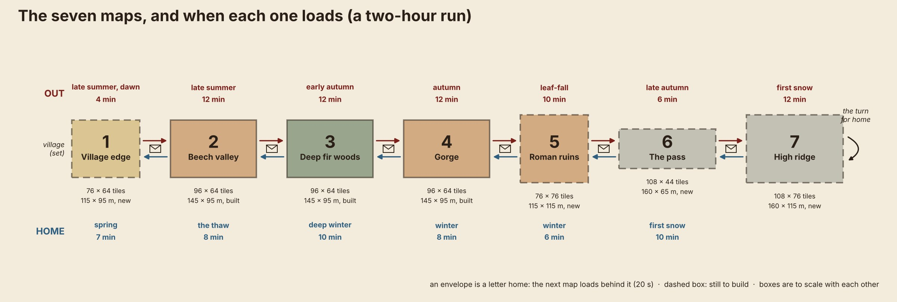

# Smyana: the world

*Agreed 2026-11-11. Claude proposed it; Dominic answered each question the same morning (his words are in
[`../archive/notes/2026-11-11-dominic-in-his-own-words.md`](../archive/notes/2026-11-11-dominic-in-his-own-words.md),
the decisions are D-053 to D-058). The phases and their issues: #48, #49, #50, #51.*

The world is one mountain trail, about 55 km each way, walked out and back through seven small maps.

## Size, shape and scale

- **The country** is a strip of the Rhodopes about 48 km by 20 km. The village is low at the west end (1,050 m) and a
  bare ridge stands at 2,050 m at the east end. One trail crosses it.
- **The shape is a line, not a loop.** The men turn round on the ridge and walk the same six places home. Every place
  except the ridge is met twice, in two seasons, so caches, felled trees, the mended bridge and the dug landslide are
  all found again.
- **Two scales.** The country is measured in kilometres and is only ever seen in the picture. The ground the men walk
  is measured in tiles: a man walks 1.2 tiles a second and a tile is about 1.5 m, so a map 96 tiles wide is about
  145 m and takes 80 seconds to cross in a straight line. The seven maps together are under 1 km of the trail. A
  letter home covers the rest.
- The village is drawn in the west and the climb goes east, because the built maps run west to east. Height decides
  the trees, not the compass.

## The places

| # | Place | Height | What it is | Trees | Mock-up |
|---|---|---|---|---|---|
| 1 | Village edge | 1,050 m | The last lane out of the village, terraced fields, the first trees. The village is a set at the low end | Oak, hornbeam, wild pear, lime; willow by the river | none yet |
| 2 | Beech valley | 1,200 m | Open beech wood with clearings and a stream. The first camp | Beech, maple, hornbeam; alder at the stream | 01 beech camp, 05 bare beech |
| 3 | Deep fir woods | 1,550 m | Dark, close, trunks to the sky. The landslide on the ledge | Silver fir, Norway spruce, some beech | 02 deep fir |
| 4 | Gorge | 1,250 m | The river in its cut. The broken bridge, and the ford downstream | Beech and hornbeam on the sides; alder and willow at the water; black pine on the crags | none yet |
| 5 | Roman ruins | 1,350 m | A mossy shelf above the river: fallen columns, a paved road, the drain | Beech, maple, lime; black pine on the rock | 04 ruins |
| 6 | The pass | 1,900 m | A long narrow saddle between crags, the last trees thinning out | Scots pine, spruce, dwarf mountain pine | none yet |
| 7 | High ridge | 2,050 m | Open, bare, the furthest point. The far valley and its road lie below | Dwarf mountain pine, grass, gneiss slabs | 03 ridge |

The trail between places, in hours on the game's clock: village to beech valley 3, to the fir woods 5, to the gorge 6,
to the ruins 2, to the pass 5, to the ridge 4.

## The loaded maps, and when each loads

There are seven maps, one per place, and only one is ever loaded (D-020). A map loads when the men walk off the edge
of the one before it, behind a letter home of about 20 seconds. That makes 12 loads in a run.

| # | Map | Walkable tiles | About | State (late 2026-11-11, D-077) | Gates |
|---|---|---|---|---|---|
| 1 | Village edge | 76 x 64 | 115 x 95 m | Grey-box (#52): the village as blocks beyond the lane, terraces | Village lane (west: start and end), east |
| 2 | Beech valley | 96 x 64 | 145 x 95 m | Built, grey-box | West, east |
| 3 | Deep fir woods | 96 x 64 | 145 x 95 m | Built, grey-box | West, east |
| 4 | Gorge | 96 x 64 | 145 x 95 m | Built, grey-box; its floor four levels below the wood, a ramp down each side | West, east |
| 5 | Roman ruins | 76 x 76 | 115 x 115 m | Grey-box (#53): a shelf four levels above the river, the old road on it | West, east |
| 6 | The pass | 108 x 44 | 160 x 65 m | Grey-box (#54): the trail on a shelf eight levels up, a valley path below (D-076) | West, east |
| 7 | High ridge | 108 x 76 | 160 x 115 m | Grey-box (#55): a lookout over the far valley and its road, eight levels down | West only: in and out the same way |

Every map adds a rim of 10 tiles of forest on each side that the men can't enter. All seven fit the budget in
`data/route.json` (128 x 96 tiles in all, 3,200 old trees). Forks, such as the long way round the fir woods, wait
until the line works end to end.

Load time: every load is measured from phase 1 on (#57), and bringing it down is a job for the end (#82).

## The year, leg by leg

The run is two hours: 13 legs and a 3-minute intro. Minutes are a first guess, to be timed.

| Leg | Map | Season | Minutes | What the leg is for |
|---|---|---|---|---|
| 1 | Village edge | Late summer, dawn | 4 | Leaving. The player takes the men at the lane |
| 2 | Beech valley | Late summer | 12 | Learn to gather and fell. The first camp and fire |
| 3 | Deep fir woods | Early autumn | 12 | The landslide. The first wolves |
| 4 | Gorge | Autumn | 12 | The broken bridge or the ford |
| 5 | Roman ruins | Leaf-fall | 10 | Study the drain. Learning takes time the season doesn't give |
| 6 | The pass | Late autumn | 6 | An easy crossing, and a look at the ground the men will be chased over |
| 7 | High ridge | First snow | 12 | The best hunting, no cover, a patrol seen below. The turn for home |
| 8 | The pass | First snow | 10 | The set piece: the patrol follows the men through the pass |
| 9 | Roman ruins | Winter | 6 | Shelter in the stones, and a night there |
| 10 | Gorge | Winter | 8 | The bridge as the men left it. The ford is cold now |
| 11 | Deep fir woods | Deep winter | 10 | Cold, hunger, bolder wolves. The caches |
| 12 | Beech valley | The thaw | 8 | No cover left. A bear wakes hungry |
| 13 | Village edge | Spring | 7 | Coming home, then the ending |

With nothing to do, the walk alone is about 21 minutes plus 4 minutes of letters. The run check walked all 13 legs on
2026-11-11 (#57): about 26 minutes, with felling, digging, mending the bridge and the ridge's lookout on the way; the
time of each leg is in [`../archive/journal/2026-11-11-the-whole-world-grey-boxed.md`](../archive/journal/2026-11-11-the-whole-world-grey-boxed.md).

## The phases

1. **Walk the whole world** (#48). Twenty men walk all 13 legs with nothing to do, in the right season on each.
2. **Threats and the fight** (#49). The flintlock's sound and smoke, the music turning, wolves, the bear, and a patrol
   that shoots back. Before resources, because the feel comes first.
3. **Resources and mechanics** (#50). Needs, food, loads, camp and fire, caches, knowledge, carts.
4. **The frame** (#51), at the end. The village, the intro, the homecoming, the ending, the letters, the submission.
